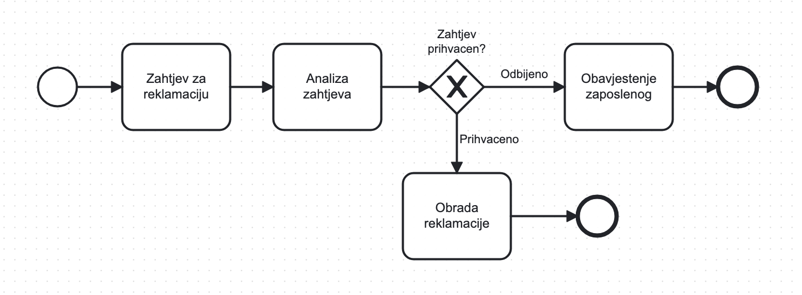
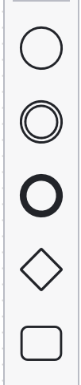
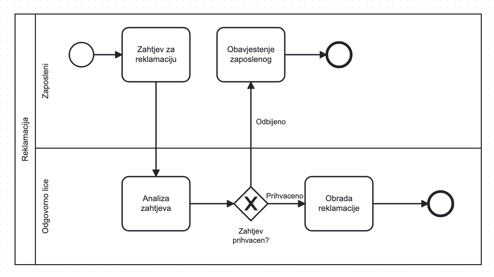
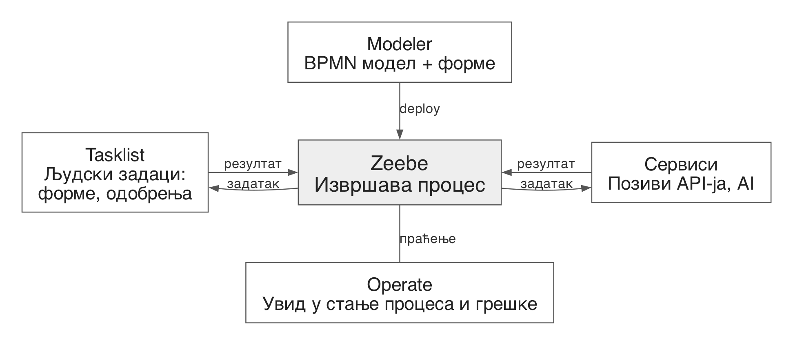

## Чиме се тачно бавимо на овом предмету?

Размотрите рекламацију рачуна:

1. Запослени подноси рекламацију.
2. Овлашћено лице прегледа захтјев и рачун.
3. На основу закона о рекламацији прихвата или одбија захтјев.
4. Запослени добија обавјештење о исходу.
5. Рекламација се обрађује.

---

## Како бисте ово направили у коду?

Дискусија у паровима, 5 минута, без писања кода.

- Које табеле и која стања захтјева су вам потребни?
- Који endpoint-и или handler-и мијењају стање?
- Ко и како обавјештава запосленог?

---

## Шта ако...?

Како бисте прилагодили рјешење у овим случајевима?

- Овлашћено лице има законски рок за одговор. Шта ако не одговори?
- Сервер се рестартује док захтјев чека одлуку.
- „Гдје је заглављен захтјев #1234 и колико дуго?“
- Изнад неког износа треба друго одобрење, а 300 захтјева је већ у току.

Ток процеса сада је распоређен по коду: стање је у табели,
cron прати рокове, лог биљежи историју, а правила су у више фајлова.

---

---

## Шта видите на дијаграму?

- Шта мислите да значе кругови, правоугаоници и ромб?
- Гдје је који корак из текста?
- Да ли бисте могли да испричате овај ток без објашњења?

---

## Да ли препознајете шаблон?

- Гдје сте видјели нешто слично?
  - упутство у студентској служби, дијаграм тока у коду, ...
- Сличан ток имају:
  - пријава испита, одбрана рада, упис године
  - онлајн куповина, обрада тикета, захтјев за кредит
- У овим примјерима препознајемо:
  - учеснике и њихове улоге
  - кораке и одлуке
  - чекање на некога или нешто и рокове

---

## Шта је пословни процес?

> Скуп повезаних активности које заједно остварују пословни циљ.

- Има почетак, крај и више могућих путања
- Укључује више улога (студент, референт, професор…)
- Често траје данима: чека се одговор, одлука или рок

---

## BPMN (Business Process Model and Notation)

- Стандардни језик за цртање процеса (OMG)
- Исти дијаграм читају и пословни људи и програмери
- Дијаграм служи као документација процеса
- Може се и извршавати у BPM платформи

---

## Основни елементи

:::: {.columns}
::: {.column width="20%"}

{height=70% style="max-height:400px; max-width:100%; width:auto; height:auto;"}

:::
::: {.column width="80%"}

- **Догађај**: нешто се десило
  - почетни, крајњи, међудогађај (порука, тајмер)
- **Задатак**: неко или нешто ради посао
  - људски задатак, сервисни задатак
- **Gateway**: одлука или гранање
  - искључиво (XOR): тачно једна путања
  - паралелно (AND): све путање истовремено
- **Ток секвенце**: редослијед корака

:::
::::

---

## Учесници: pool, lane и поруке

- **Pool**: један учесник (особа, организација, систем)
- **Lane**: улога унутар учесника
- **Ток секвенце**: само унутар једног pool-а
- **Ток порука**: само између pool-ова

{width=80%}

---

## Вјежба: пријава испита

Радите у паровима.

1. Ко учествује? Студент, студентска служба, професор, ...
2. Шта покреће процес и како се завршава?
3. Које су главне активности и ко их ради?
4. Шта може да крене погрешно?
   - прошао је рок, пријава није плаћена, нису испуњени услови
5. Нацртајте процес на папиру, у Camunda Modeler-у или на [bpmn.io](https://bpmn.io/).

---

## Заједничка анализа

Упоредите своје моделе:

- Да ли свака путања има почетак и крај?
- Да ли се зна ко ради сваки корак?
- Да ли има разлика између ваших процеса?

---

## Шта нам омогућава извршавање модела?

- Овлашћено лице има законски рок за одговор. Шта ако не одговори?
  - Модел задаје редослијед корака, а код извршава појединачне задатке
  - Рокове и понављања задајемо у моделу, помоћу тајмера
- Сервер се рестартује док захтјев чека одлуку.
  - Послије рестарта процес наставља од сачуваног стања
- „Гдје је заглављен захтјев #1234 и колико дуго?“
  - За сваку инстанцу видимо гдје је и зашто је стала
- Изнад неког износа треба друго одобрење, а 300 захтјева је већ у току.
  - Нова верзија модела ради упоредо са већ покренутим инстанцама

За AI задатке можемо задати провјеру резултата, људски преглед и резервни ток.

---

## Предности модел-вођеног развоја (MDD)

- Модел је уједно документација и оно што се извршава, па не застаријева
- Ток могу да прочитају и провјере и они који не програмирају
- Стање, рокове, праћење и верзије добијамо од платформе, без свог кода
- Брзо правимо прототип и лако мијењамо ток

---

## Мане модел-вођеног развоја (MDD)

- Алат нас може ограничити у томе шта можемо да урадимо
- Везујемо се за произвођача: BPMN је стандард, али проширења за извршавање нису
- Дио логике је у моделу, а дио у коду, па је теже тестирати и дебаговати
- Измјене модела (XML) у git-у прегледамо и спајамо теже него код
- Платформу неко мора да одржава, а често и да плати

---

## Када се не исплати?

- Кратка синхрона логика: један захтјев, један одговор
- Једноставан ток без чекања, рокова и више учесника
- Тим жели да процес опише у коду: code-first алати чувају стање,
али не дају модел који могу да читају и људи који не програмирају

Избор зависи од тога колико је процес сложен и ко треба да га чита.

---

## Camunda 8

{width=95%}

- У моделу задајемо редослијед корака и услове гранања
- Податке уносимо кроз форме и чувамо у промјенљивама
- Сервис враћа резултат, а процес наставља према моделу

[Документација](https://docs.camunda.io/)

---

## Распоред и полагање предмета

- Око 10 термина вјежби
- Рад и провјере су на часу
- Четири провјере: моделовање, извршавање и AI интеграција
- Укупно 50 бодова

---

## Да ли имате питања?

