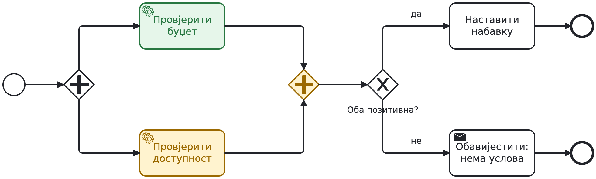
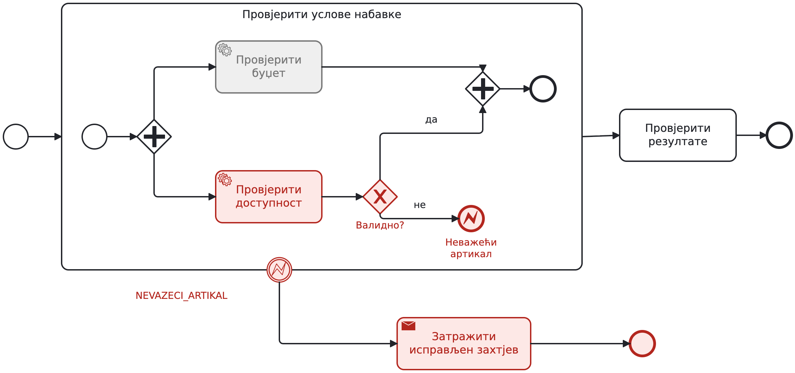
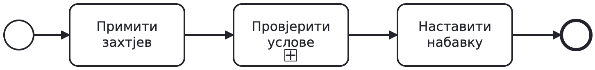
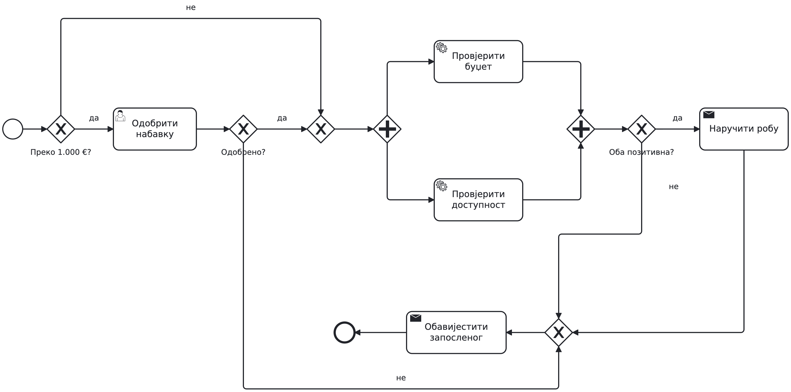

# BPMN dijagrami — drugi čas

Modeli se otvaraju u Camunda Modeler-u ili na [bpmn.io](https://demo.bpmn.io/).
Modeli su konceptualni, bez podešavanja za izvršavanje.

Dijagrami 05 i 06 su namjerno pogrešni primjeri za analizu.
Boje su ilustracija scenarija, ne dodatna BPMN notacija ni simulacija.

## Почетна скица — правила тек треба разјаснити

[Model za uređivanje](01-starter.bpmn) · [SVG](01-starter.svg) · [PNG](01-starter.png)

## Износ и одлука руководиоца

[Model za uređivanje](02-approval.bpmn) · [SVG](02-approval.svg) · [PNG](02-approval.png)

## Двије провјере, па одлука

[Model za uređivanje](03-parallel.bpmn) · [SVG](03-parallel.svg) · [PNG](03-parallel.png)

## Стање: буџет је провјерен, доступност још траје

[Model za uređivanje](04-waiting.bpmn) · [SVG](04-waiting.svg) · [PNG](04-waiting.png)

## Намјерна грешка: бира се једна грана, а чекају обје

[Model za uređivanje](05-wrong-xor-and.bpmn) · [SVG](05-wrong-xor-and.svg) · [PNG](05-wrong-xor-and.png)

## Намјерна грешка: двије гране, без синхронизације

[Model za uređivanje](06-wrong-and-xor.bpmn) · [SVG](06-wrong-and-xor.svg) · [PNG](06-wrong-and-xor.png)

## Пријем одговора са роком од 24 часа

[Model za uređivanje](08-supplier.bpmn) · [SVG](08-supplier.svg) · [PNG](08-supplier.png)

## Подсјетник оставља задатак активним; рок га прекида

[Model za uređivanje](10-boundary-timers.bpmn) · [SVG](10-boundary-timers.svg) · [PNG](10-boundary-timers.png)

## Грешка прекида цијели потпроцес провјера

[Model za uređivanje](11-error-scope.bpmn) · [SVG](11-error-scope.svg) · [PNG](11-error-scope.png)

## Сценарио: грешка у доступности, буџет још активан

[Model za uređivanje](12-error-active.bpmn) · [SVG](12-error-active.svg) · [PNG](12-error-active.png)

## Исти опсег, склопљен приказ

[Model za uređivanje](13-collapsed.bpmn) · [SVG](13-collapsed.svg) · [PNG](13-collapsed.png)

## Основни модел набавке — повезана цјелина

[Model za uređivanje](17-base-overview.bpmn) · [SVG](17-base-overview.svg) · [PNG](17-base-overview.png)

Generisano pomoću [bpmn-js](https://bpmn.io/toolkit/bpmn-js/).
[Uputstvo za regenerisanje](../../../../../tools/bpmn/README.md).
