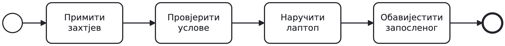
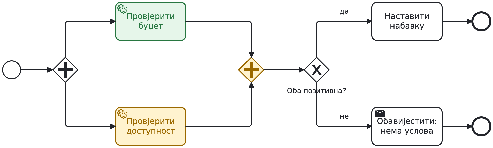
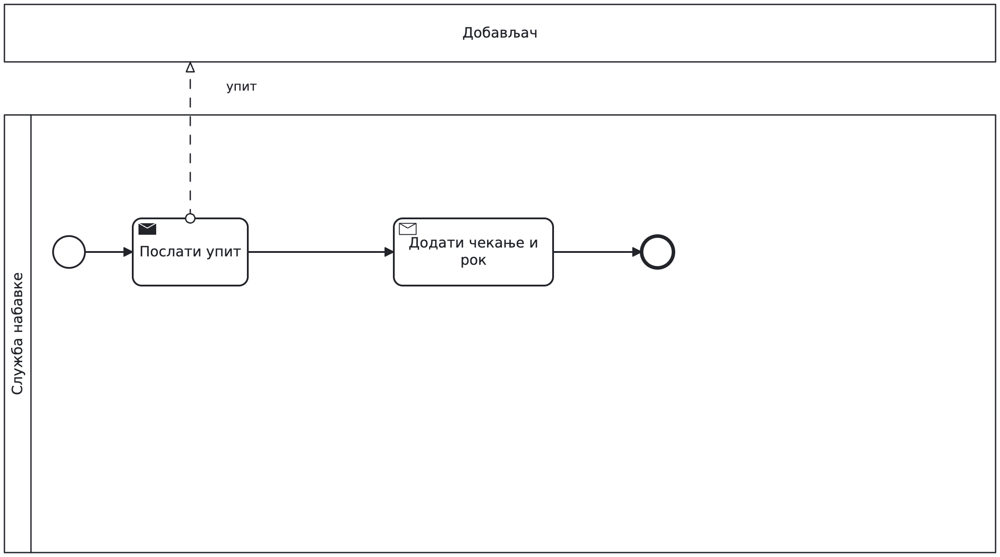
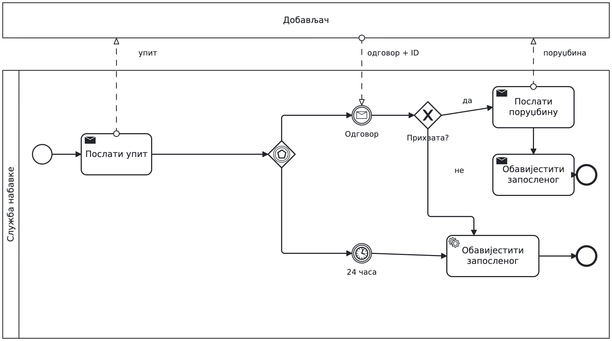
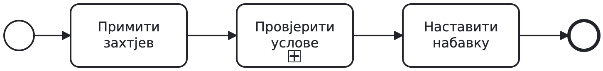
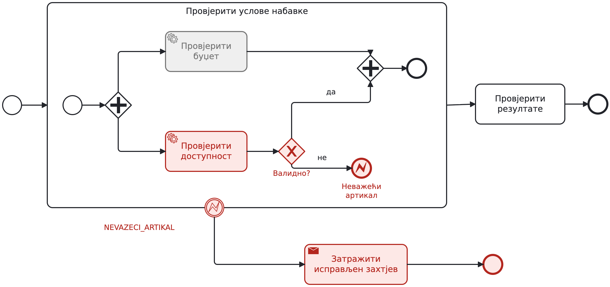
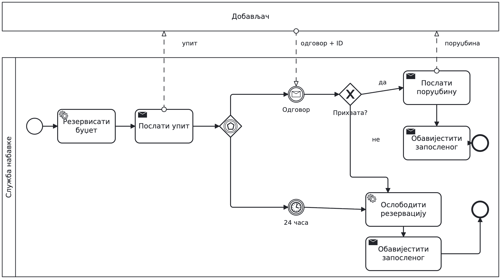
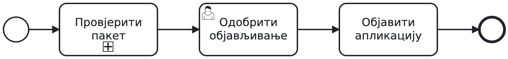
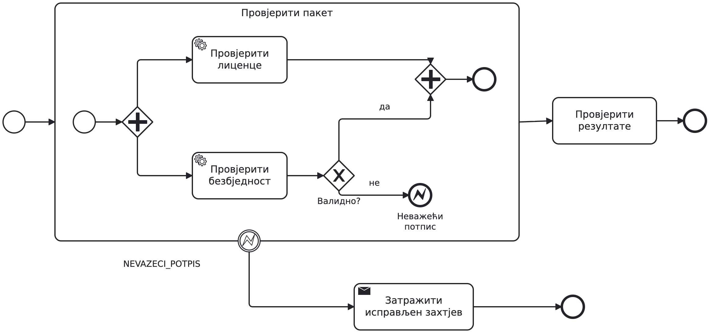
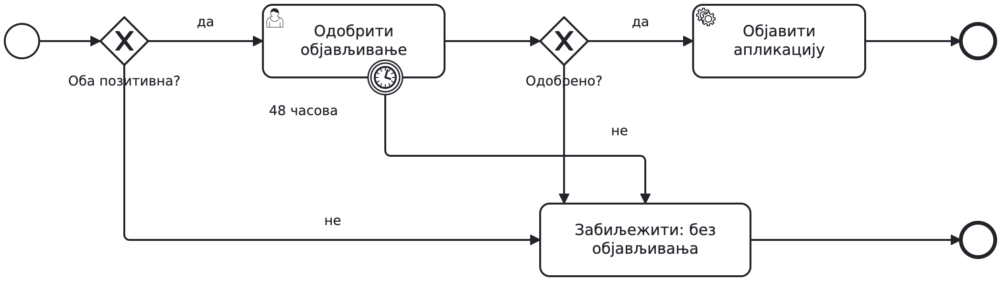

## Набавка: прва скица

```{=latex}
{\centering
```

{height=65% aria-label="Набавка: прва скица"}

```{=latex}
\par}
```

Запослени тражи лаптоп. Преко 1.000 € треба одобрење руководиоца.
За сваки коначан исход запослени добија обавјештење.

**Шта ова скица још не описује?**

---

## Прије цртања: питања наручиоцу

```{=latex}
{\centering
```

{height=65% aria-label="Прије цртања: питања наручиоцу"}

```{=latex}
\par}
```

Да ли су обје провјере обавезне? Колико дуго чекамо одговор?
Шта се дешава са већ започетим радом?

**У пару: три питања и кратка скица стања у програму. Без кода.**

---

## Захтјев 1: обје провјере су обавезне

```{=latex}
{\centering
```

{height=65% aria-label="Захтјев 1: обје провјере су обавезне"}

```{=latex}
\par}
```

Одобрење је разрађено; сада разрадите „Провјерити услове“.
Буџет и доступност се провјеравају независно и истовремено.

**Настављамо тек када обје заврше и оба резултата су позитивна.**

---

## Рјешење: прво синхронизација, па одлука

```{=latex}
{\centering
```

{height=65% aria-label="Рјешење: прво синхронизација, па одлука"}

```{=latex}
\par}
```

AND (+) покреће обје гране и чека обје. XOR (X) затим чита резултате.

**Завршена провјера не мора имати позитиван резултат.**

---

## Гдје је сада овај захтјев?

```{=latex}
{\centering
```

{height=65% aria-label="Гдје је сада овај захтјев?"}

```{=latex}
\par}
```

Зелено: буџет провјерен. Жуто: доступност још траје, спајање чека.

**Покажите активан рад. Доступност затим враћа „нема на стању“. Куда даље?**

---

## Преглед: једна грана, а чекамо обје

```{=latex}
{\centering
```

{height=65% aria-label="Преглед: једна грана, а чекамо обје"}

```{=latex}
\par}
```

**Модел је намјерно погрешан.** XOR покреће једну провјеру.

Који токен AND никада неће добити? Поправите и објасните модел.

---

## Преглед: двије гране, без синхронизације

```{=latex}
{\centering
```

{height=65% aria-label="Преглед: двије гране, без синхронизације"}

```{=latex}
\par}
```

**Модел је намјерно погрешан.** XOR спајање не чека други токен.

Колико пута може кренути наставак? Размијените моделе и наведите контра-примјер.

---

## Захтјев 2: добављач има 24 часа

```{=latex}
{\centering
```

{height=65% aria-label="Захтјев 2: добављач има 24 часа"}

```{=latex}
\par}
```

Приказана је почетна скица чекања, без обраде рока. Добављач прихвата
или одбија; без одговора за 24 часа затварамо захтјев.

**Замијените чекање одговарајућим догађајима и додајте исходе.**

---

## Рјешење: чекање па одлука

```{=latex}
{\centering
```

{height=65% aria-label="Рјешење: чекање па одлука"}

```{=latex}
\par}
```

Gateway заснован на догађајима чека поруку или тајмер.
Први догађај бира наставак; друго чекање се отказује.

**Тек послије поруке XOR провјерава прихватање.**

---

## Порука: који захтјев чека?

```{=latex}
{\centering
```

{height=65% aria-label="Порука: који захтјев чека?"}

```{=latex}
\par}
```

Испрекидан ток поруке повезује pool-ове; ток секвенце остаје унутра.
Одговор носи идентификатор захтјева.

**За #1234 и #1235 стижу два одговора. Како их разликујемо?**

---

## Захтјев 3: подсјетник и одустајање

```{=latex}
{\centering
```

{height=65% aria-label="Захтјев 3: подсјетник и одустајање"}

```{=latex}
\par}
```

Проширите задатак руководиоца: један подсјетник послије дана,
одустајање послије два дана без одлуке.

**Који рок оставља задатак активним, а који га прекида?**

---

## Рјешење: два различита boundary тајмера

```{=latex}
{\centering
```

{height=65% aria-label="Рјешење: два различита boundary тајмера"}

```{=latex}
\par}
```

Испрекидан обод: подсјетник, задатак остаје активан.
Пун обод: прекид одобравања и затварање захтјева.

**Крај гране подсјетника не завршава одобравање.**

---

## Сценарији: одговор и рок

```{=latex}
{\centering
```

{height=65% aria-label="Сценарији: одговор и рок"}

```{=latex}
\par}
```

**Пратите сваки случај:** прихватање за 2 часа; одбијање за 2 часа;
одговор тек послије 25 часова.

Шта се отказује? Касни одговор не отвара поново затворен захтјев.

---

## Сценарио: одобрење након подсјетника

```{=latex}
{\centering
```

{height=65% aria-label="Сценарио: одобрење након подсјетника"}

```{=latex}
\par}
```

Подсјетник је послат. Руководилац одобрава послије 30 часова.

**Шта је још активно? Шта се дешава са тајмером од два дана?**

---

## Захтјев 4: прекините цијелу провјеру

```{=latex}
{\centering
```

{height=65% aria-label="Захтјев 4: прекините цијелу провјеру"}

```{=latex}
\par}
```

Неважећа шифра артикла мора прекинути обје провјере, укључујући
буџет ако још траје. Затражите нов, исправљен захтјев.

**Гдје је граница вашег `try/catch`? Издвојите потпроцес.**

---

## Склопљен потпроцес: једна цјелина

```{=latex}
{\centering
```

{height=65% aria-label="Склопљен потпроцес: једна цјелина"}

```{=latex}
\par}
```

Знак + у дну активности означава склопљен потпроцес.
Унутрашње провјере припадају том опсегу.

**У наредном приказу отварамо исти опсег и додајемо обраду грешке.**

---

## Рјешење: error унутра, catch на граници

```{=latex}
{\centering
```

{height=65% aria-label="Рјешење: error унутра, catch на граници"}

```{=latex}
\par}
```

Error end баца `NEVAZECI_ARTIKAL`; boundary на потпроцесу га хвата.
Прекида активан рад унутра и покреће обавјештење о исправци.

**Обичан end једне гране не прекида другу.**

---

## Сценарио: буџет још није провјерен

```{=latex}
{\centering
```

{height=65% aria-label="Сценарио: буџет још није провјерен"}

```{=latex}
\par}
```

Црвено: путања грешке и обраде. Сиво: провјера која се отказује.

**Да ли унутрашњи AND сада чека? Гдје наставља процес?**

---

## Негативан резултат није аутоматски error

```{=latex}
{\centering
```

{height=65% aria-label="Негативан резултат није аутоматски error"}

```{=latex}
\par}
```

Нема буџета је очекивани резултат: XOR води на обавјештење.
Неважећи артикал по договору прекида цијелу групу: BPMN error.

**Недоступан сервис тражи техничку политику понављања или интервенције.**

---

## Захтјев 5: већ смо резервисали буџет

```{=latex}
{\centering
```

{height=65% aria-label="Захтјев 5: већ смо резервисали буџет"}

```{=latex}
\par}
```

Нова варијанта: послије позитивних провјера, а прије упита,
резервишемо буџет. Добављач затим одбија или рок истиче.

**Додајте ослобађање резервације на оба неуспјешна исхода.**

---

## Рјешење: исправка већ извршеног ефекта

```{=latex}
{\centering
```

{height=65% aria-label="Рјешење: исправка већ извршеног ефекта"}

```{=latex}
\par}
```

Прекид не поништава резервацију. Експлицитни задатак је ослобађа.
То је разлог за компензацију; формалну нотацију остављамо за касније.

**Шта ако и ослобађање не успије? Које правило недостаје?**

---

## Одбраните модел: опсег прекида

```{=latex}
{\centering
```

{height=65% aria-label="Одбраните модел: опсег прекида"}

```{=latex}
\par}
```

Други пар бира тренутак у ком настаје грешка: прије, током или
послије провјере буџета.

**Покажите активне токене, опсег прекида и завршни исход.**

---

## Одбраните модел: спољни ефекти

```{=latex}
{\centering
```

{height=65% aria-label="Одбраните модел: спољни ефекти"}

```{=latex}
\par}
```

Позитивне провјере, резервисан буџет, одговор не стиже.
Затим пробајте одбијање добављача.

**Покажите путању и једну претпоставку коју још треба разјаснити.**

---

## Самостално: објављивање апликације

```{=latex}
{\centering
```

{height=65% aria-label="Самостално: објављивање апликације"}

```{=latex}
\par}
```

Провјере безбједности и лиценци теку паралелно; обје морају бити
позитивне. Неважећи потпис прекида обје. Власник има 48 часова
да одобри објављивање; одбијање или рок значе да објављивања нема.

**Разрадите скицу. Покажите опсег прекида.**

---

## Осврт: провјере и опсег грешке

```{=latex}
{\centering
```

{height=65% aria-label="Осврт: провјере и опсег грешке"}

```{=latex}
\par}
```

Упоредите са својим рјешењем тек када завршите.

**Зашто је catch на потпроцесу? Када обје провјере заврше,
још треба провјерити оба резултата.**

---

## Осврт: одобрење или 48 часова

```{=latex}
{\centering
```

{height=65% aria-label="Осврт: одобрење или 48 часова"}

```{=latex}
\par}
```

Само позитивне провјере и позитивна одлука воде на објављивање.
Рок прекида задатак одобравања.

**Објасните сваку завршну путању без читања текста захтјева.**

---

## За сљедећи час

```{=latex}
{\centering
```

{height=65% aria-label="За сљедећи час"}

```{=latex}
\par}
```

У свом моделу покажите: одлуку, синхронизацију, чекање, опсег
прекида и исправку спољног ефекта гдје је потребна.

**Припремите се да сваку тврдњу провјерите конкретним сценаријем.**
