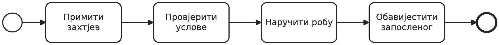
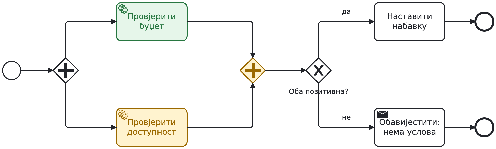
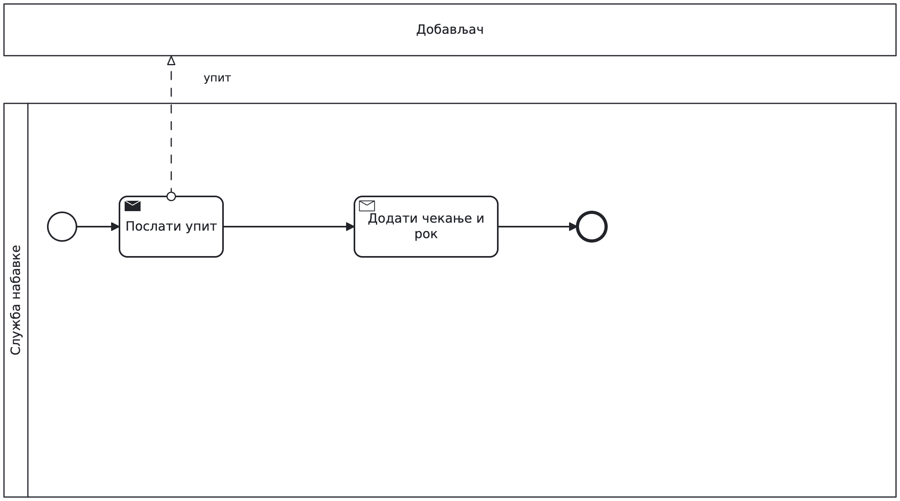
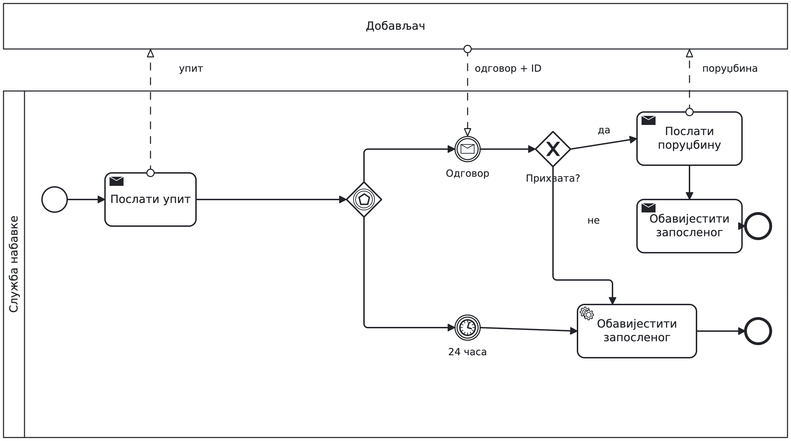
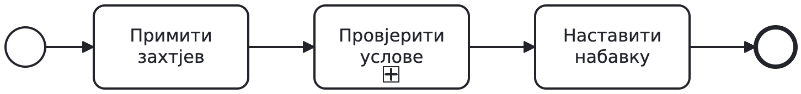
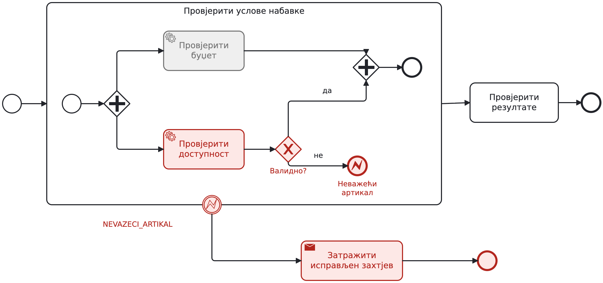
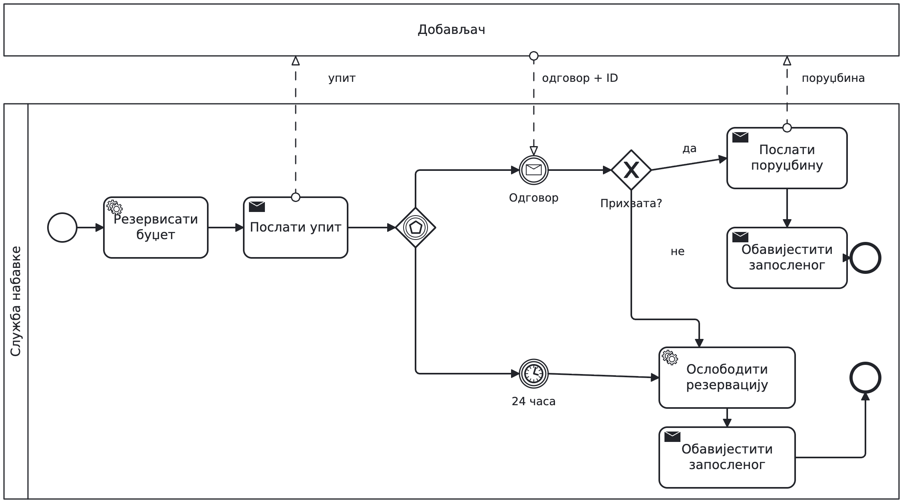

## Набавка робе

```{=latex}
{\centering
```

{height=65% aria-label="Набавка робе"}

```{=latex}
\par}
```

Запослени подноси захтјев. Служба провјерава услове, наручује робу
и обавјештава запосленог.

**Шта треба додати овој почетној скици?**

---

## Гранање: када треба одобрење?

```{=latex}
{\centering
```

{height=65% aria-label="Гранање: када треба одобрење?"}

```{=latex}
\par}
```

Преко 1.000 € треба одобрење руководиоца. XOR бира једну путању.

**Пратите захтјев од 800 €, затим захтјев од 1.500 € који је одбијен.**

---

## Паралелне провјере

```{=latex}
{\centering
```

{height=65% aria-label="Паралелне провјере"}

```{=latex}
\par}
```

AND покреће обје провјере и чека обје.
XOR затим провјерава да ли су оба резултата позитивна.

**Који дио одговара `WhenAll`, а који провјери резултата?**

---

## Гдје процес чека?

```{=latex}
{\centering
```

{height=65% aria-label="Гдје процес чека?"}

```{=latex}
\par}
```

Буџет је провјерен; доступност још није позната.

**Када стигне резултат „нема на стању“, којом путањом настављамо?**

---

## Додајте рок за одговор

```{=latex}
{\centering
```

{height=65% aria-label="Додајте рок за одговор"}

```{=latex}
\par}
```

Добављач има 24 часа да прихвати или одбије упит.
Без одговора затварамо захтјев и обавјештавамо запосленог.

**Дорадите приказано чекање: одговор или истек рока.**

---

## Порука или истек рока

```{=latex}
{\centering
```

{height=65% aria-label="Порука или истек рока"}

```{=latex}
\par}
```

Gateway заснован на догађајима бира први догађај; друго чекање се отказује.
XOR послије поруке чита одговор.

**Шта ако одговор стигне тек након 25 часова?**

---

## Подсјетник и рок за одобрење

```{=latex}
{\centering
```

{height=65% aria-label="Подсјетник и рок за одобрење"}

```{=latex}
\par}
```

Испрекидан обод: послије дана шаљемо подсјетник, задатак остаје активан.
Пун обод: послије два дана прекидамо одобравање.

**Руководилац одобрава послије 30 часова. Шта је још активно?**

---

## Потпроцес: издвојена цјелина

```{=latex}
{\centering
```

{height=65% aria-label="Потпроцес: издвојена цјелина"}

```{=latex}
\par}
```

Провјере групишемо у потпроцес. Знак + означава склопљени приказ.

**Гдје бисте поставили `try/catch` око обје провјере?**

---

## Грешка у потпроцесу

```{=latex}
{\centering
```

{height=65% aria-label="Грешка у потпроцесу"}

```{=latex}
\par}
```

Неважећа шифра артикла баца BPMN грешку. Boundary на потпроцесу
је хвата и прекида активан рад унутра.

**За исправку се шаље нов захтјев.**

---

## Шта се прекида?

```{=latex}
{\centering
```

{height=65% aria-label="Шта се прекида?"}

```{=latex}
\par}
```

Црвено: грешка и обрада. Сиво: провјера буџета која се отказује.

**Да ли AND још чека? Да ли би обичан end имао исти ефекат?**

---

## Вјежба: повежите дијелове модела

```{=latex}
{\centering
```

{height=65% aria-label="Вјежба: повежите дијелове модела"}

```{=latex}
\par}
```

Разрадите скицу: одобрење са подсјетником и роком, паралелне провјере
у потпроцесу, одговор добављача са роком. Додајте обраду грешке.

**На свакој завршној путањи обавијестите запосленог.**

---

## Провјерите модел у пару

```{=latex}
{\centering
```

{height=65% aria-label="Провјерите модел у пару"}

```{=latex}
\par}
```

Други пар бира случај: одбијено одобрење, неважећи артикал
или одговор добављача након истека рока.

**Покажите путању, шта се отказује и коначан исход.**

---

## Додатак: једна грана, а чекамо обје

```{=latex}
{\centering
```

{height=65% aria-label="Додатак: једна грана, а чекамо обје"}

```{=latex}
\par}
```

**Намјерно погрешан модел.** XOR покреће само једну провјеру.

Који токен AND никада неће добити?

---

## Додатак: двије гране, без синхронизације

```{=latex}
{\centering
```

{height=65% aria-label="Додатак: двије гране, без синхронизације"}

```{=latex}
\par}
```

**Намјерно погрешан модел.** XOR спајање не чека другу грану.

Колико пута може кренути наставак?

---

## Додатак: ако смо већ резервисали буџет

```{=latex}
{\centering
```

{height=65% aria-label="Додатак: ако смо већ резервисали буџет"}

```{=latex}
\par}
```

Послије провјера резервишемо буџет. Одбијање добављача или рок
захтијевају ослобађање резервације.

**Прекид не поништава већ извршен спољни ефекат.**
