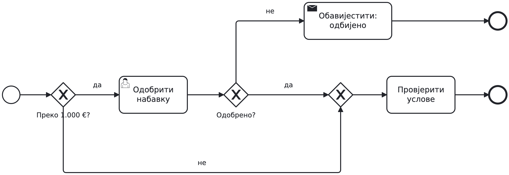
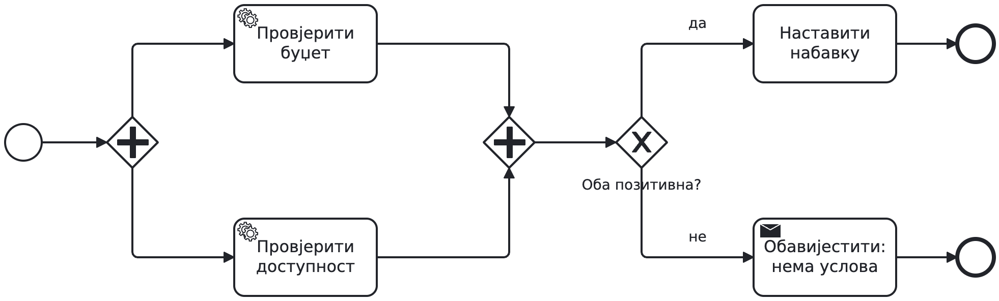
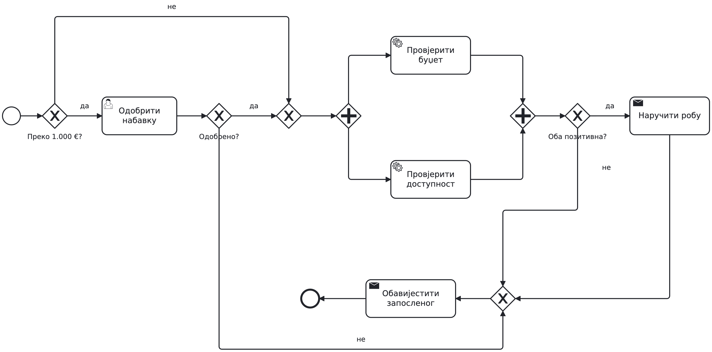
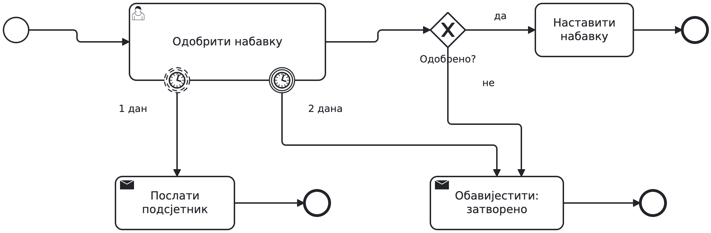
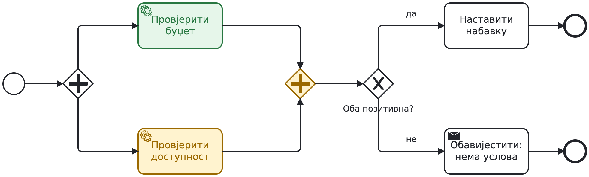

## Набавка робе

```{=latex}
{\centering
```

{height=65% aria-label="Набавка робе"}

```{=latex}
\par}
```

Преко 1.000 € треба одобрење руководиоца. Буџет и доступност
провјеравамо независно; оба резултата морају бити позитивна.

**Како бисте чували стање овог захтјева у програму?**

---

## Гранање: када треба одобрење?

```{=latex}
{\centering
```

{height=65% aria-label="Гранање: када треба одобрење?"}

```{=latex}
\par}
```

XOR бира једну путању на основу података.

**Пратите захтјев од 800 €, затим захтјев од 1.500 € који је одбијен.**

---

## Паралелне провјере

```{=latex}
{\centering
```

{height=65% aria-label="Паралелне провјере"}

```{=latex}
\par}
```

AND покреће обје провјере и чека обје. XOR затим чита резултате.

**Једна провјера завршава одмах, друга сјутра. Гдје процес чека?**

---

## Основни модел набавке

```{=latex}
{\centering
```

{height=84% aria-label="Основни модел набавке" .overview}

```{=latex}
\par}
```


---

## Дорада 1: рок за одобрење

```{=latex}
{\centering
```

{height=65% aria-label="Дорада 1: рок за одобрење"}

```{=latex}
\par}
```

Руководиоцу шаљемо један подсјетник послије дана.
Послије два дана без одлуке затварамо захтјев.

**Предложите измјену: шта наставља да ради, а шта се прекида?**

---

## Рок на задатку

```{=latex}
{\centering
```

{height=65% aria-label="Рок на задатку"}

```{=latex}
\par}
```

Испрекидан обод: подсјетник, задатак остаје активан.
Пун обод: прекид одобравања.

**Руководилац одобрава послије 30 часова. Шта се дешава са роком?**

---

## Исти принцип: одговор добављача

```{=latex}
{\centering
```

{height=65% aria-label="Исти принцип: одговор добављача"}

```{=latex}
\par}
```

Receive task чека поруку; прекидни тајмер ограничава чекање на 24 часа.
XOR након пријема чита одговор.

**Шта ако одговор стигне послије истека рока?**

---

## Дорада 2: прекид обје провјере

```{=latex}
{\centering
```

{height=65% aria-label="Дорада 2: прекид обје провјере"}

```{=latex}
\par}
```

Неважећа шифра артикла мора прекинути цијелу провјеру услова,
укључујући провјеру буџета ако још траје.

**Гдје бисте поставили `try/catch` око обје провјере?**

---

## Потпроцес и обрада грешке

```{=latex}
{\centering
```

{height=65% aria-label="Потпроцес и обрада грешке"}

```{=latex}
\par}
```

Error end баца грешку; boundary на потпроцесу је хвата
и прекида активан рад унутра. За исправку се шаље нов захтјев.

**Да ли би обичан end имао исти ефекат?**

---

## Самостално: заједнички рок провјера

```{=latex}
{\centering
```

{height=65% aria-label="Самостално: заједнички рок провјера"}

```{=latex}
\par}
```

Обје провјере заједно имају рок од 48 часова. Послије 24 часа шаљемо
један подсјетник без прекида провјера. Истек рока прекида незавршене
провјере и води на ручну провјеру услова. Њени резултати одређују наставак набавке.

**Дорадите модел. На који опсег се односе ова два рока?**

---

## Провјера у пару

```{=latex}
{\centering
```

{height=65% aria-label="Провјера у пару"}

```{=latex}
\par}
```

Пратите три случаја: обје провјере заврше за 10 часова;
једна за 20, друга за 30 часова; једна за 20, друга још траје након 48 часова.

**Када се шаље подсјетник, шта се прекида и како се наставља?**
