## Прочитајте ток

```{=latex}
{\centering
```

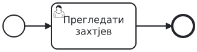{height=65% aria-label="Прочитајте ток"}

```{=latex}
\par}
```

Кругови означавају почетак и крај; задатак је посао који треба обавити.
Стрелица задаје редослијед.

**Свако за себе: шта је активно док преглед још траје? Затим упоредите.**

---

## XOR: једна путања

```{=latex}
{\centering
```

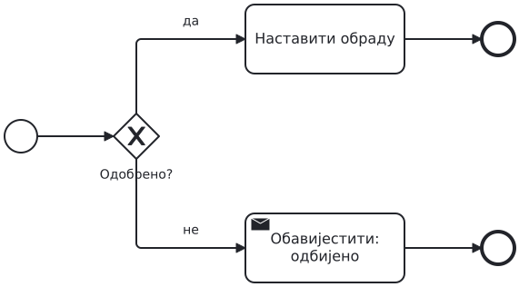{height=65% aria-label="XOR: једна путања"}

```{=latex}
\par}
```

Одлука користи познат податак и бира једну путању.

**Захтјев је одбијен. Који посао се обавља, а који се прескаче?**

---

## AND: обје гране

```{=latex}
{\centering
```

{height=65% aria-label="AND: обје гране"}

```{=latex}
\par}
```

Раздвајање покреће обје гране; спајање чека обје.

**Буџет је провјерен, доступност још није. Може ли процес да се заврши?**

---

## Задатак A: набавка робе

```{=latex}
{\centering
```

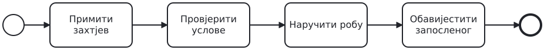{height=48% aria-label="Задатак A: набавка робе" .compact}

```{=latex}
\par}
```

Запослени тражи робу. Преко 1.000 € треба одобрење руководиоца;
одбијање завршава захтјев. Иначе се буџет и доступност провјеравају
независно и истовремено. Сачекајте обје провјере. Наручујемо само
ако су оба резултата позитивна. Сваки исход јављамо запосленом.

**Прво свако скицира одлуке; затим у пару направите модел.**

---

## Када је модел исправан?

```{=latex}
{\centering
```

{height=48% aria-label="Када је модел исправан?" .compact}

```{=latex}
\par}
```

- Одбијен захтјев не стиже до наручивања.
- Обје провјере се заврше прије одлуке о резултатима.
- Набавка и обавјештење не покрећу се двапут.
- Свака завршна путања обавјештава запосленог.

**Ово су критеријуми за преглед вашег модела.**

---

## Рјешење A: један повезан модел

```{=latex}
{\centering
```

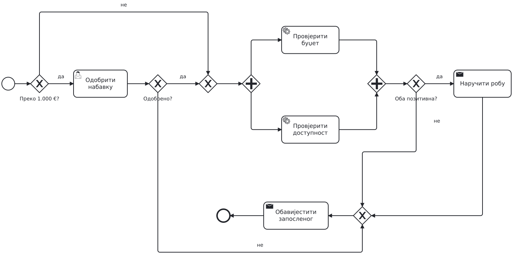{height=84% aria-label="Рјешење A: један повезан модел" .overview}

```{=latex}
\par}
```


---

## Зашто овакво рјешење?

```{=latex}
{\centering
```

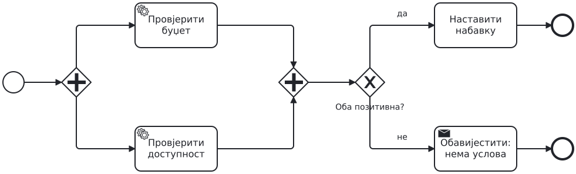{height=65% aria-label="Зашто овакво рјешење?"}

```{=latex}
\par}
```

AND чека завршетак рада; XOR чита резултате. Завршена провјера
не мора бити позитивна.

**Који захтјев оправдава сваки gateway? Исправите свој модел прије наставка.**

---

## Прекидни тајмер

```{=latex}
{\centering
```

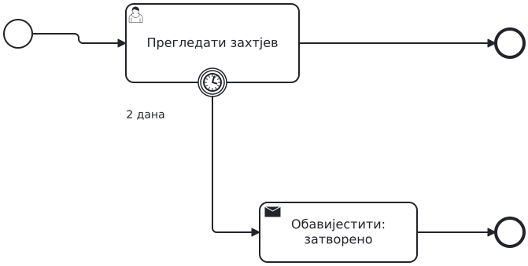{height=65% aria-label="Прекидни тајмер"}

```{=latex}
\par}
```

Ако преглед није завршен за два дана, пун обод означава прекид задатка.

**Може ли након истека овог рока преглед завршити нормалном путањом?**

---

## Подсјетник без прекида

```{=latex}
{\centering
```

{height=65% aria-label="Подсјетник без прекида"}

```{=latex}
\par}
```

Испрекидан обод: послије дана шаљемо један подсјетник. Преглед остаје активан.

**Шта је и даље активно када се заврши грана подсјетника?**

---

## Потпроцес и грешка

```{=latex}
{\centering
```

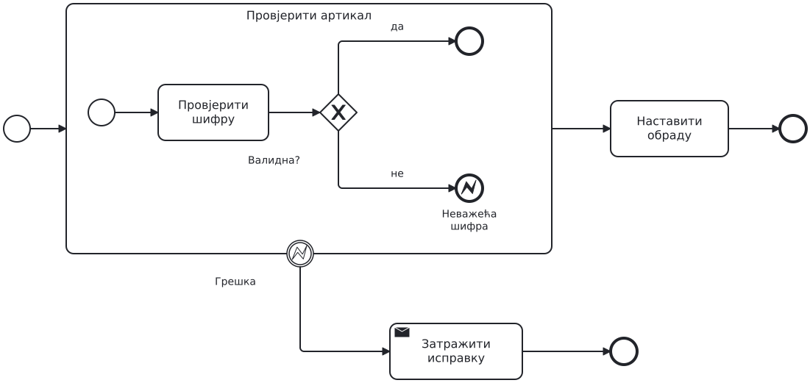{height=65% aria-label="Потпроцес и грешка"}

```{=latex}
\par}
```

Потпроцес задаје опсег рада. Error end баца грешку; boundary на граници
прекида тај опсег и покреће обраду.

**Којом путањом идемо ако је шифра исправна, а којом ако није?**

---

## Задатак B: провјере као цјелина

```{=latex}
{\centering
```

{height=65% aria-label="Задатак B: провјере као цјелина"}

```{=latex}
\par}
```

Дорадите свој модел A. Неважећа шифра артикла мора прекинути
обје провјере, укључујући другу ако још траје. Обавијестите
запосленог да треба да пошаље нов, исправљен захтјев.

**Не мијењајте правило за обичан негативан резултат провјере.**

---

## Задатак B: заједнички рок

```{=latex}
{\centering
```

{height=48% aria-label="Задатак B: заједнички рок" .compact}

```{=latex}
\par}
```

Обје провјере заједно имају рок од 48 часова. Послије 24 часа шаљемо
један подсјетник без прекида провјера. Истек рока прекида незавршене
провјере и води на ручну провјеру услова. Њени резултати одређују наставак набавке.

**Кратка индивидуална скица, затим једно рјешење у пару.**

---

## Припремите објашњење свог модела

```{=latex}
{\centering
```

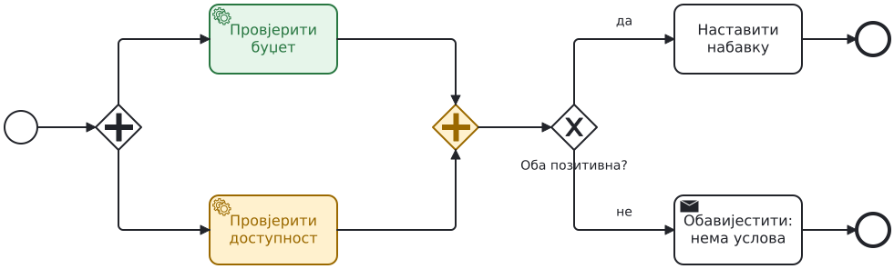{height=65% aria-label="Припремите објашњење свог модела"}

```{=latex}
\par}
```

Обје провјере заврше за 10 часова; једна за 20, друга за 30 часова;
једна за 20, друга још траје након 48 часова.

**За сваки случај покажите активно чекање, подсјетник и наставак.**

---

## Рјешење B: опсег оба рока

```{=latex}
{\centering
```

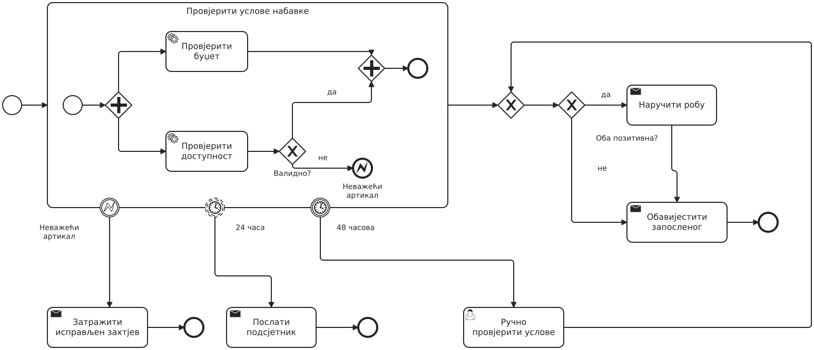{height=84% aria-label="Рјешење B: опсег оба рока" .overview}

```{=latex}
\par}
```


---

## Зашто су рокови на потпроцесу?

```{=latex}
{\centering
```

{height=65% aria-label="Зашто су рокови на потпроцесу?"}

```{=latex}
\par}
```

Рок важи за обје провјере заједно. Подсјетник их не прекида;
истек рока прекида преостали рад. Ручна провјера је изван тог опсега.

**Провјерите три случаја и исправите свој модел.**

---

## Честа грешка: једна грана, чекамо обје

```{=latex}
{\centering
```

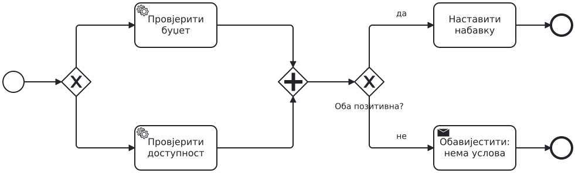{height=65% aria-label="Честа грешка: једна грана, чекамо обје"}

```{=latex}
\par}
```

**Намјерно погрешан модел.** Изабрана је само једна провјера.

Који токен AND неће добити? Предложите исправку и објасните је.

---

## Честа грешка: двије гране, без чекања

```{=latex}
{\centering
```

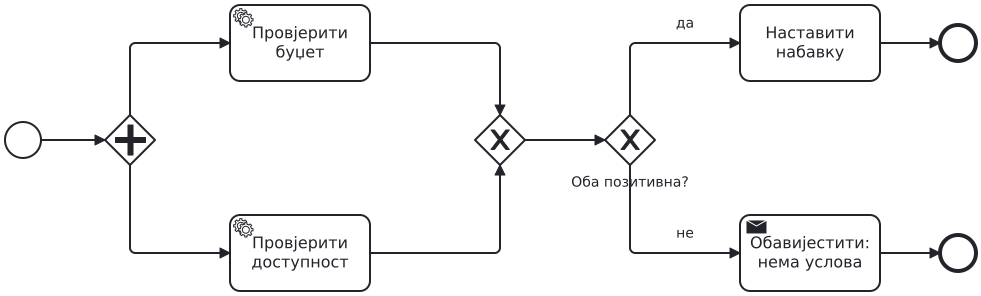{height=65% aria-label="Честа грешка: двије гране, без чекања"}

```{=latex}
\par}
```

**Намјерно погрешан модел.** XOR спајање не синхронизује гране.

Колико пута може кренути наставак? Наведите конкретан редослијед завршетака.

---

## Честа грешка: рок на погрешном опсегу

```{=latex}
{\centering
```

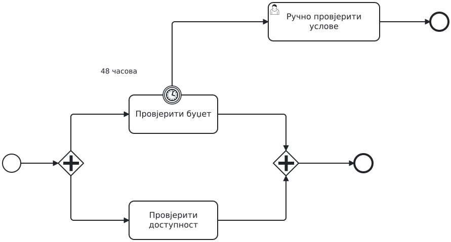{height=65% aria-label="Честа грешка: рок на погрешном опсегу"}

```{=latex}
\par}
```

**Намјерно погрешан модел.** Рок је постављен само на провјеру буџета.

Буџет заврши за 20 часова, доступност траје 60. Да ли се активира ручна провјера?

---

## Самостално, без гледања рјешења

```{=latex}
{\centering
```

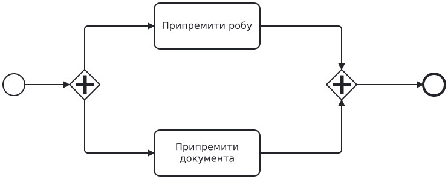{height=65% aria-label="Самостално, без гледања рјешења"}

```{=latex}
\par}
```

Цијела припрема испоруке има рок од три часа. Ако истекне,
прекините оба посла и обавијестите оператера.

**Скицирајте опсег рока и резервни ток. Објасните избор у једној реченици.**

---

## Додатак: чекање одговора добављача

```{=latex}
{\centering
```

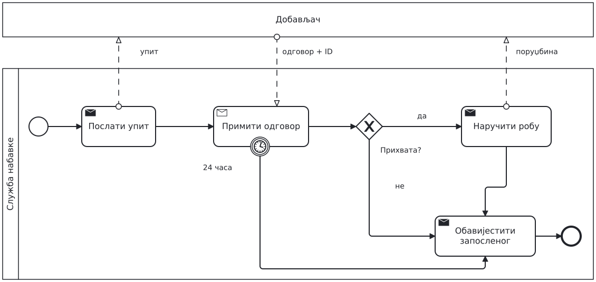{height=65% aria-label="Додатак: чекање одговора добављача"}

```{=latex}
\par}
```

Receive task чека поруку; прекидни тајмер ограничава чекање.
XOR након пријема чита одговор.

**Касни одговор не отвара поново затворен захтјев.**
