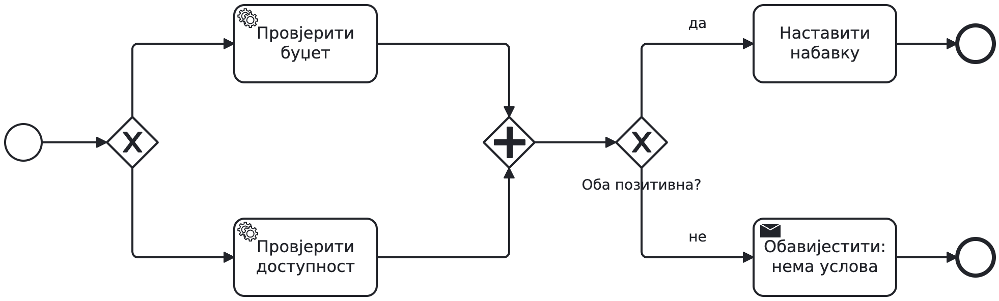
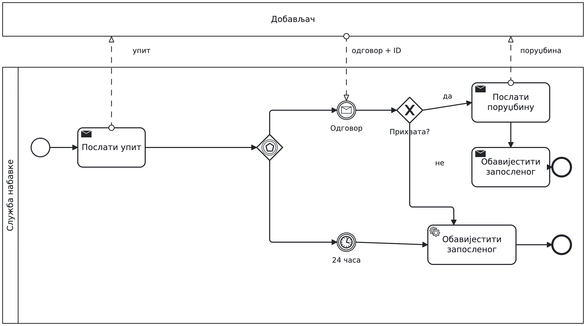
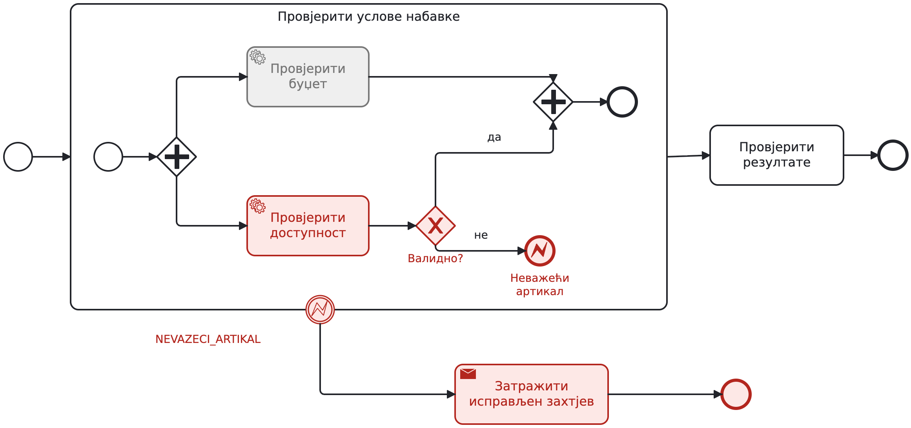
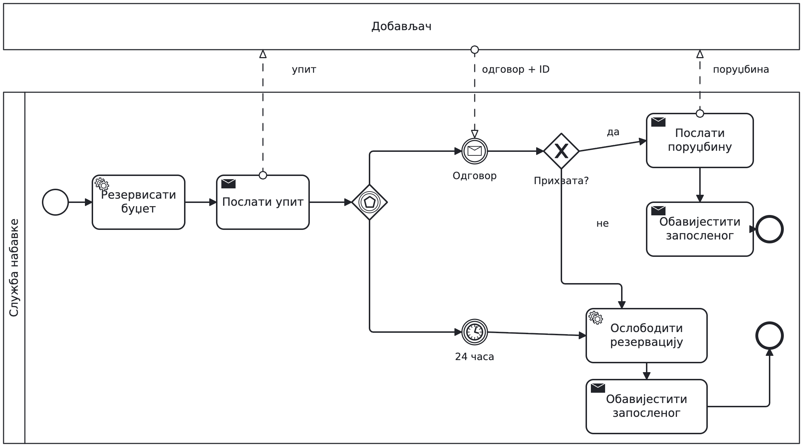
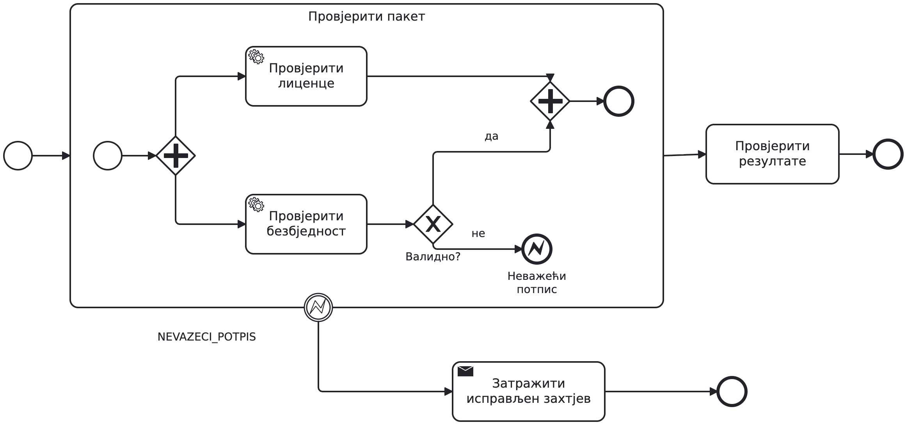
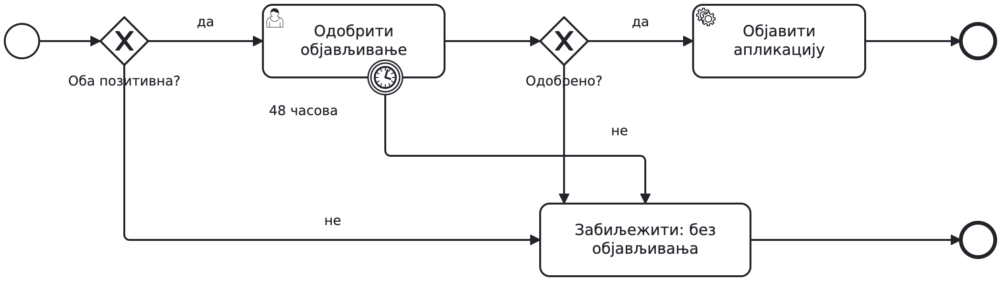

# Sedmica 2 — radionica modelovanja

Materijal za nastavnika. Spojene teme sedmica 2 i 3 obrađujemo kroz
izmjene jednog zahtjeva. Cilj je da studenti objasne ponašanje modela.
Ne tražiti da pamte katalog simbola prije nego što imaju problem za njih.

## Rad sa vizuelnim materijalom

Svaki sadržajni slajd ima BPMN prikaz. Početne skice su namjerno
nepotpune; rješenja prikazati nakon pokušaja studenata. Dijagrami
05 i 06 su namjerno pogrešni i tako su označeni. Boje u scenarijima
su objašnjenje stanja, ne dodatni BPMN simboli ni živa simulacija.

[Pregled svih dijagrama i izvornih modela](bpmn-class2-v1/README.md).
Otvoriti `.bpmn` u Camunda Modeler-u ili na demo.bpmn.io i mijenjati
isti model tokom časa. Rješenje završnog zadatka je na naredna dva
slajda: ne prikazivati ih prije isteka vremena za samostalan rad.

## Izvođenje: 90 minuta

| Vrijeme | Rad i očekivani rezultat |
| --- | --- |
| 0–8 | Početni tekst, pitanja naručiocu, skica stanja u kodu |
| 8–23 | Zahtjev 1, kratko objašnjenje XOR/AND, razmjena modela |
| 23–38 | Zahtjevi 2 i 3: poruka, rok, podsjetnik i prekid |
| 38–45 | Scenariji koji pokušavaju da slome model |
| 45–62 | Zahtjev 4: potproces, error i opseg prekida |
| 62–70 | Zahtjev 5: rezervacija i eksplicitno oslobađanje |
| 70–80 | Odbrana modela pred drugim parom |
| 80–88 | Samostalan zadatak: objavljivanje aplikacije |
| 88–90 | Prikupiti modele i zabilježiti nejasnoće za sedmicu 3 |

Studenti rade u parovima i mijenjaju isti model. Na svakom zahtjevu
najprije dati 2–3 minuta za prijedlog, pa pokazati potreban konstrukt.
Nastavnik crta referentno rješenje uživo. Slajdovi sa objašnjenjem su
kratka pomoć nakon pokušaja, a ne tekst za čitanje unaprijed.
Modeli su konceptualni: bez formi, worker-a i podešavanja izvršavanja.

## Dogovorene pretpostavke i referentno rješenje

Pool službe nabavke, sa lane-om rukovodioca. Zaposleni i dobavljač su
odvojeni zatvoreni pool-ovi. Zahtjev pokreće prijem poruke zaposlenog.
Sve obavijesti zaposlenom šalju se porukom; sequence flow ne prelazi pool.

**Zahtjev 1.** XOR: iznos preko 1.000 € vodi na odobravanje, ostali
zahtjevi ga preskaču. Odbijanje vodi na obavještenje i kraj. Odobrenje
i preskakanje spojiti XOR-om. AND pokreće dvije provjere koje samo
čitaju podatke i daju odvojene rezultate. AND spaja završene provjere,
a XOR provjerava da li su oba rezultata pozitivna. Negativan rezultat
vodi na obavještenje i kraj. Pozitivan vodi na upit dobavljaču.

U pregledu modela tražiti konkretan kontra-primjer: AND → XOR može
pokrenuti nastavak za svaki pristigli token; XOR → AND može čekati
neaktiviranu granu. Ne prihvatati samo tvrdnju „pogrešan gateway“.

**Zahtjev 2.** Slanje upita → event-based gateway → message catch ili
jednokratni timer catch od 24 časa. Nakon poruke XOR provjerava sadržaj:
prihvatanje → porudžbina → obavještenje → kraj; odbijanje → obavještenje
→ kraj. Tajmer vodi na obavještenje o zatvaranju i kraj. Drugo čekanje
se otkazuje. Kasni odgovor ne otvara zatvoren zahtjev; integracionu
obradu takvih poruka tek treba definisati. Identifikator zahtjeva
razlikuje istovremene nabavke. Ne obećavati poslovni prioritet događaja
koji stignu praktično istovremeno.

**Zahtjev 3.** Na odobravanju: jednokratni neprekidni boundary timer
poslije jednog dana → slanje podsjetnika → običan end. Prekidni timer
poslije dva dana → obavještenje o zatvaranju → kraj. Podsjetnik ne
završava osnovni zadatak; odobrenje nakon 30 časova je i dalje moguće.
Ako odluka stigne ranije, boundary tajmeri prestaju da čekaju sa
završetkom zadatka. Ovdje nema ponavljanja podsjetnika.

**Zahtjev 4.** AND provjere zatvoriti u ugrađeni potproces sa sopstvenim
početkom i krajem. Provjera dostupnosti vodi na XOR: nevažeća šifra
→ error end NEVAZECI_ARTIKAL; validna → normalno AND spajanje.
Odgovarajući error boundary na potprocesu prekida sav aktivan rad u
njemu i vodi na obavještenje da treba poslati novi, ispravljen zahtjev,
pa kraj. Ne vraćamo se u petlju u ovoj vježbi. Ako provjera budžeta
još traje, otkazuje se; unutrašnje spajanje više nije aktivno.

Izbor BPMN error-a ovdje slijedi eksplicitno pravilo da se prekida
cijela grupa provjera. Isti podatak bi se, uz drugačiji zahtjev, mogao
obraditi običnim poslovnim rezultatom. Nedostatak budžeta je XOR ishod.
Nedostupan servis traži tehničku politiku ponavljanja/intervencije;
ne tvrditi da se svaki programski exception hvata ovim boundary-jem.

**Zahtjev 5.** Na pozitivnoj grani poslije provjera dodati rezervaciju
budžeta, prije upita dobavljaču. Pretpostavljamo da je rezervacija
uspjela. I odbijanje dobavljača i istek roka vode na oslobađanje
rezervacije, zatim na obavještenje i kraj. Prihvatanje vodi na porudžbinu,
koja koristi rezervisani budžet. Provjere u potprocesu i dalje samo čitaju,
pa njihov error ne zahtijeva oslobađanje. Za diskusiju ostaviti kvar
oslobađanja ili neuspjeh slanja porudžbine: to zahtijeva dodatna pravila.

Kompenzaciju danas objasniti kao razlog za eksplicitnu poslovnu
ispravku već izvršenog efekta. Formalnu compensation notaciju i call
activity ostaviti kao proširenje ako se pojavi potreba; ne dodavati
još simbola samo zato što smo spojili sedmice.

## Samostalan zadatak: kriterijumi za osvrt

Ispravan model ima AND provjere u potprocesu, error end za nevažeći
potpis i odgovarajući error boundary na potprocesu. Boundary vodi na
neobjavljivanje. Normalan tok spaja provjere i XOR-om provjerava oba
rezultata. Zatim slijedi ljudski zadatak odobravanja sa prekidnim
boundary tajmerom od 48 časova. Odobrenje vodi na objavljivanje;
odbijanje ili rok na završetak bez objavljivanja. Prihvatiti i korektno
modelovanje odobrenja kao razmjene poruka sa event-based gateway-em.

Tražiti da student pokaže: gdje se čeka, koje grane se prekidaju i
zašto nastavak ne može krenuti dva puta. Ovo je dijagnostički zadatak,
a kontrolna tačka ostaje u sedmici 3.

## Prilagođavanje tempa

Ako do 45. minuta većina ne razlikuje čekanje događaja i odluku nad
podacima, skratiti podsjetnike na demonstraciju i zadržati samostalan
rad na potprocesu i error-u. Zahtjev 5 tada obraditi usmeno, a njegovu
izradu prenijeti u sedmicu 3. Završni zadatak sačuvati: on otkriva
razumijevanje bolje od završenog zajedničkog primjera.
