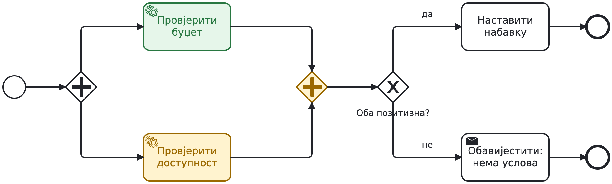
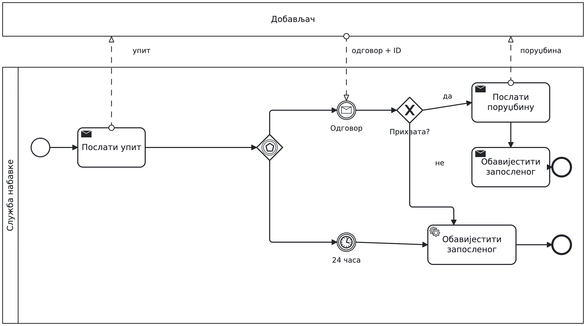
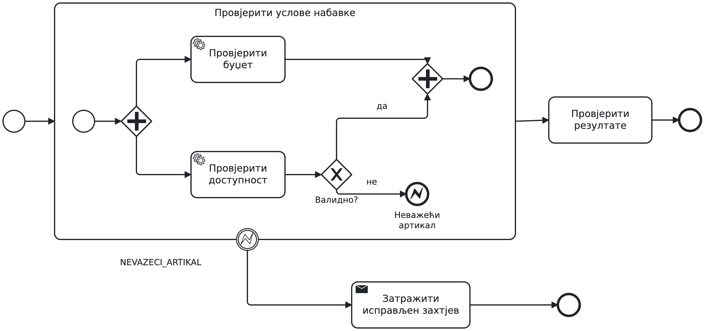
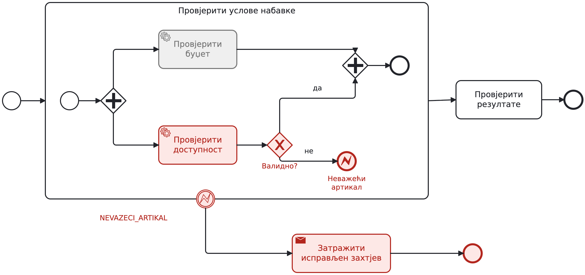
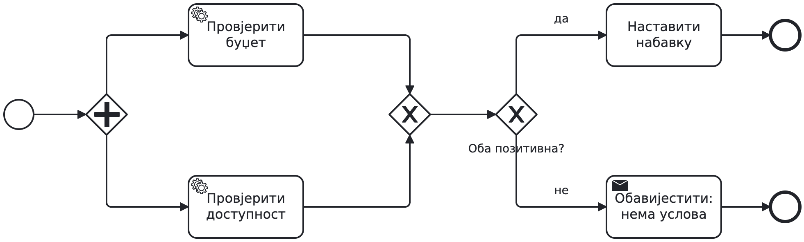
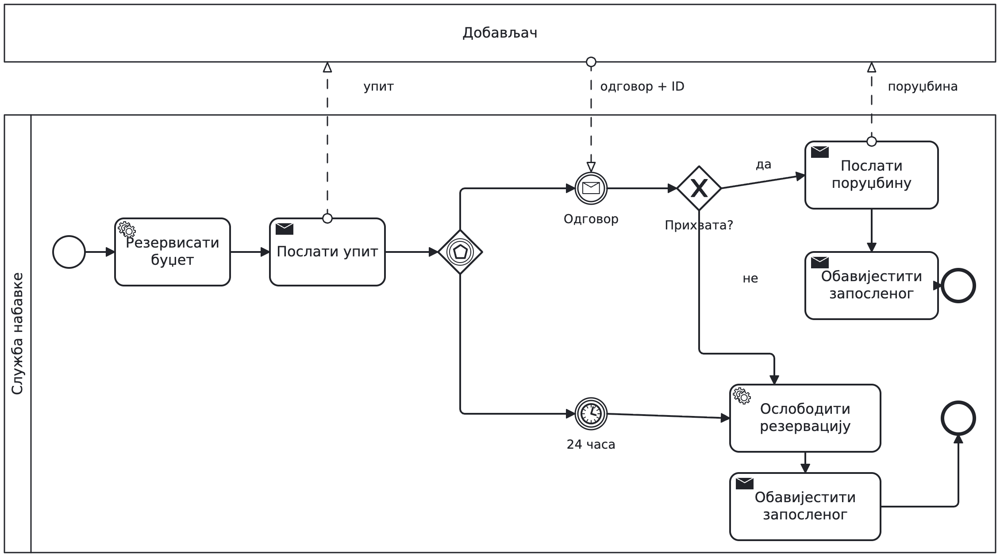

# Drugi čas — BPMN

Materijal za nastavnika. Jedan primjer nabavke robe prolazi kroz odluku,
paralelizam, čekanje, rokove i obradu greške. Prezentacija ima 12 glavnih
slajdova i 3 opciona slajda u dodatku. Ranija verzija je sačuvana kao
[class2-v1.md](class2-v1.md), sa zasebnom kopijom dijagrama.

## Plan za 90 minuta

| Vrijeme | Slajdovi | Rad |
| --- | --- | --- |
| 0–5 | Nabavka robe | Razjasniti tekst i pretpostavke |
| 5–15 | Grananje | Pratiti iznos i odluku rukovodioca |
| 15–30 | Paralelne provjere; Gdje proces čeka? | Razlikovati završetak provjera i njihove rezultate |
| 30–45 | Dodajte rok; Poruka ili istek roka | Parovi prvo dorade skicu, zatim porede rješenje |
| 45–55 | Podsjetnik i rok | Razlikovati nastavak i prekid zadatka |
| 55–70 | Potproces; Greška; Šta se prekida? | Nacrtati granicu obrade i pratiti aktivan rad |
| 70–85 | Vježba | Spojiti dijelove u jedan model nabavke |
| 85–90 | Provjerite model | Drugi par bira scenario i traži objašnjenje |

Dodatak nije još jedan obavezan dio časa. Pogrešna spajanja koristiti
ako se baš ta greška pojavi u radu; rezervaciju i kompenzaciju samo
ako ostane vremena. Ne uvodimo drugi poslovni primjer.

## Kako koristiti dijagrame

Svaki slajd ima dijagram i jedno glavno pitanje. Ne čitati tekst uz
svaki simbol: tražiti od studenata da pokažu putanju i kažu gdje se čeka.
Početne skice nisu kompletna rješenja. Rješenje čekanja dobavljača ide
poslije pokušaja u paru. Boje su statična ilustracija stanja, ne simulacija.

[Izvorni BPMN modeli i slike](bpmn-class2-v2/README.md) otvaraju se u Camunda
Modeler-u ili na demo.bpmn.io. Koristiti iste modele pri demonstraciji.
To su konceptualni modeli, bez konfiguracije za izvršavanje. Dijagrami
su čitljivi fragmenti istog procesa; studenti ih spajaju u cjelinu.

## 1. Odobrenje

Do uključivo 1.000 € odobrenje se preskače. Preko 1.000 € rukovodilac
odlučuje; odbijanje završava zahtjev uz obavještenje. Odobrenje i
preskakanje spajaju se XOR-om, pa se nastavlja na provjere. XOR ne
sinhronizuje tokene. U fragmentu su završeci lokalni; pri spajanju
modela nastavak „Provjeriti uslove“ razrađujemo u sljedeći dio.

## 2. Provjere

Provjere su nezavisne, samo čitaju podatke i vraćaju odvojene rezultate.
AND pokreće obje, pa ih spaja. Tek XOR provjerava da li su oba rezultata
pozitivna. Nedostatak budžeta ili robe je normalan poslovni ishod.
Nastavak „Nastaviti nabavku“ vodi na upit dobavljaču.

Zeleno je završena provjera; žuto je aktivan rad i spajanje koje čeka.
Kada dostupnost vrati „nema na stanju“, AND nastavlja, a XOR bira
obavještenje da nabavka nije moguća. Sam AND ne čita rezultate.

## 3. Dobavljač i rok

Poslije slanja upita event-based gateway čeka message catch ili
jednokratni timer catch od 24 časa. Prvi događaj bira nastavak i
ukida drugo čekanje. Sadržaj odgovora zatim čita XOR. Prihvatanje vodi
na porudžbinu i obavještenje; odbijanje ili rok na obavještenje i kraj.
Kasni odgovor ne otvara ponovo zatvoren zahtjev. Ne obećavati poslovni
prioritet događaja koji stignu praktično istovremeno.

Dobavljač je zaseban pool. Isprekidani message flow prelazi granicu
pool-a; sequence flow ostaje unutar pool-a. ID zahtjeva povezuje odgovor
sa odgovarajućom nabavkom. Korelaciju pomenuti uz sliku, bez posebnog
slajda. Zaposleni je takođe spoljni učesnik; slanje obavještenja može
biti prikazano send task-om, bez ponavljanja njegovog pool-a na svakom
fragmentu.

## 4. Podsjetnik i prekid

Neprekidni tajmer poslije jednog dana pokreće jedan podsjetnik i završava
tu dodatnu granu. Zadatak odobravanja ostaje aktivan. Prekidni tajmer
poslije dva dana bez odluke otkazuje zadatak i zatvara zahtjev.
Odobrenje poslije 30 časova je moguće; završetkom zadatka ukida se
preostalo čekanje njegovih boundary tajmera. Običan kraj grane
podsjetnika ne završava cijelu instancu dok odobravanje još traje.

## 5. Potproces i greška

AND provjere izdvojiti u ugrađeni potproces sa sopstvenim početkom i
krajem. Nevažeća šifra vodi na error end NEVAZECI_ARTIKAL. Odgovarajući
error boundary na potprocesu otkazuje sav aktivan rad unutar njega i
vodi na zahtjev za ispravku, pa kraj. Ispravka se šalje kao nov zahtjev;
u ovoj vježbi ne crtamo petlju povratka.

Ako provjera budžeta još traje, otkazuje se. Unutrašnje AND spajanje
više ne čeka. Ako je budžet već provjeren, nema efekta koji treba
poništavati jer provjere samo čitaju. Običan end u grani dostupnosti
ne bi prekinuo drugu granu i ne bi aktivirao ovu obradu greške.

BPMN error je ovdje izbor zbog pravila da se prekida cijela grupa.
Negativan poslovni rezultat može se obrađivati XOR-om. Nedostupan servis
traži tehničku politiku ponavljanja ili intervencije; exception u kodu
ne postaje automatski BPMN error. Ovo objasniti uz postojeću sliku.

## Završna vježba i pregled

Studenti rade na istom procesu, povezujući odobrenje, potproces provjera
i dobavljača. Početne i završne događaje fragmenata prilagoditi cjelini:
ne nizati više zasebnih procesa samo zato što su slike bile odvojene.
Na odobravanju dodati podsjetnik i rok, na potprocesu error boundary,
a pri čekanju dobavljača trku poruke i roka. Sve završne poslovne
putanje šalju obavještenje zaposlenom.

Drugi par bira odobrenje koje je odbijeno, nevažeći artikal dok druga
provjera traje ili zakašnjeli odgovor dobavljača. Provjera razumijevanja:
student pokazuje aktivan rad, opseg prekida i konačan ishod. Ako
objašnjenje nije jasno, vratiti se na odgovarajući fragment.

Kontrolna tačka modelovanja ostaje u sedmici 3. Bilježiti gdje studenti
zapnu; preostalo vrijeme sljedećeg termina usmjeriti na te nedoumice.

## Dodatak, po potrebi

Jedna grana nije pokrenuta, a AND je čeka.

XOR ne čeka oba tokena, pa nastavak može krenuti za svaki pristigli token.

Ovo je dodatna varijanta istog procesa. Poslije pozitivnih provjera,
a prije upita, uspješno rezervišemo budžet. Odbijanje dobavljača ili rok
vode na oslobađanje rezervacije, pa obavještenje i kraj. Prihvatanje vodi
na porudžbinu koja koristi rezervisani budžet. Prekid aktivnosti sam ne
poništava rezervaciju. Formalnu compensation notaciju ne uvodimo danas.
Kvar oslobađanja ili slanja porudžbine zahtijeva dodatna pravila.

## Ako tempo bude sporiji

Sačuvati vrijeme za spajanje modela i pregled u paru. Izostaviti dodatak,
a podsjetnik samo demonstrirati. Ne dodavati novi primjer da bi se
popunilo vrijeme; produbiti postojeći konkretnim scenarijem.
