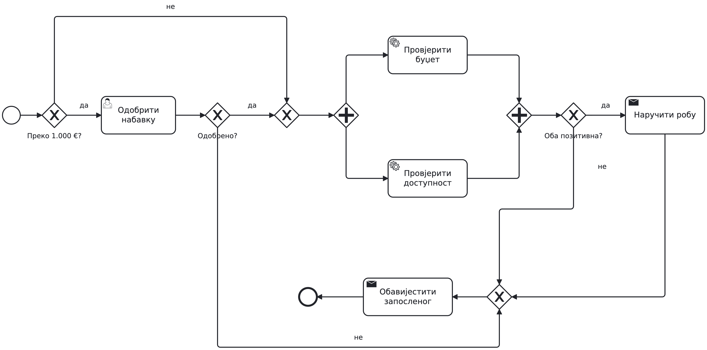
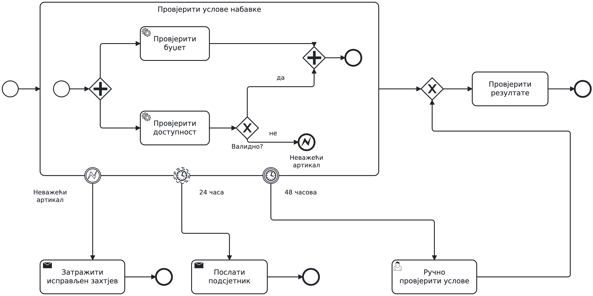

# Drugi čas — BPMN

Materijal za nastavnika. Koristimo jedan proces nabavke robe: prvo
zajednički osnovni model, zatim dvije vođene dorade, pa samostalan zahtjev
koji studenti još nisu vidjeli riješen. Event-based gateway i kompenzacija
nisu dio ovog časa. Raniji materijali su u [v1](class2-v1.md) i
[v2](class2-v2.md), sa zasebnim kopijama dijagrama.

## Plan za 90 minuta

| Vrijeme | Rad | Uloga studenata |
| --- | --- | --- |
| 0–5 | Tekst nabavke i kratka diskusija o stanju u programu | Razjasniti pretpostavke |
| 5–20 | XOR, odobrenje i AND provjere | Predlagati i pratiti tokene |
| 20–30 | Jedan povezan osnovni model | Provjeriti sve poslovne ishode |
| 30–45 | Rok i podsjetnik na odobrenju; receive task za dobavljača | Prvo predložiti izmjenu, pa uporediti rješenje |
| 45–60 | Potproces i greška koja prekida obje provjere | Odrediti opseg prekida |
| 60–80 | Novi zahtjev: zajednički rok provjera | Samostalno modelovati u paru |
| 80–90 | Razmjena modela i tri scenarija | Braniti rješenje konkretnom putanjom |

Ne pretvarati vođene dorade u zasebne velike zadatke. Dati 2–3 minuta
za prijedlog, zatim pokazati rješenje. Sačuvati najmanje 20 minuta za
samostalan zadatak. Dodatne primjere grešaka u spajanju koristiti samo
ako se ta greška pojavi u radu.

## Osnovni model: jedna cjelina

[Model za otvaranje i zajedničku doradu](bpmn-class2-v3/17-base-overview.bpmn).

Zaposleni podnosi zahtjev; prijem je početak prikazanog procesa. Do
uključivo 1.000 € preskače se odobrenje, a preko tog iznosa rukovodilac
odlučuje. Odbijanje vodi na zajedničko obavještenje i kraj. Odobrenje
i preskakanje spajaju se XOR-om, zatim AND pokreće provjere budžeta i
dostupnosti. Obje samo čitaju podatke i vraćaju odvojene rezultate.
AND ih spaja, a XOR provjerava rezultate. Oba pozitivna vode na
„Naručiti robu“, zatim na obavještenje; ostali ishodi direktno na
obavještenje. Donji dio dijagrama teče zdesna nalijevo ka završetku.
XOR prije obavještenja spaja alternativne ishode; ne čeka više tokena.

Dijagram je osnovna verzija bez rokova i izuzetaka. Na njoj zajedno
provjeriti: 800 € uz pozitivne provjere; 1.500 € uz odbijanje; odobren
zahtjev bez budžeta; odobren zahtjev uz obje pozitivne provjere.
Na svakoj putanji obavještenje se šalje tačno jednom.

Detaljnije slike XOR i AND služe objašnjenju istih dijelova, ne uvode
nove procese. Otvoriti povezani model u Modeler-u i doraditi ga uživo.
Početke i završetke iz uvećanih fragmenata ne prepisivati u sredinu
povezanog procesa. Modeli su konceptualni, bez podešavanja izvršavanja.

## Vođena dorada 1: rok na aktivnosti

Prije rješenja pitati: „Poslije jednog dana treba podsjetnik, poslije
dva dana zatvaranje bez odluke. Da li oba roka prekidaju odobravanje?“

Neprekidni boundary tajmer od jednog dana šalje jedan podsjetnik; njegov
običan end završava samo dodatnu granu. Odobravanje ostaje aktivno.
Prekidni tajmer od dva dana otkazuje zadatak i vodi na obavještenje o
zatvaranju. Odluka poslije 30 časova je dozvoljena i ukida preostale
boundary tajmere zadatka. Ovi rokovi mjere vrijeme od početka odobravanja.

Zadatak „Naručiti robu“ u osnovnom modelu razraditi slanjem upita,
receive task-om „Primiti odgovor“, XOR-om nad odgovorom i naručivanjem
ako dobavljač prihvata. Na receive task postaviti prekidni tajmer od
24 časa. Istek roka otkazuje čekanje i vodi na obavještenje, kao i
odbijanje; prihvatanje vodi na naručivanje pa obavještenje. Uvećani
prikaz prikazuje iste ishode sa jednim zajedničkim obavještenjem.

Pomenuti pool-ove i poruke uz postojeću sliku: dobavljač je zaseban
pool, message flow prelazi granicu, sequence flow ostaje unutar pool-a.
ID zahtjeva povezuje odgovor sa odgovarajućom instancom. Kasni odgovor
ne otvara ponovo zatvoren zahtjev; postupanje sa takvom porukom u
integraciji nije predmet današnjeg zadatka. Event-based gateway nije
potreban za ovu demonstraciju.

## Vođena dorada 2: opseg greške

Prije rješenja pitati: „Nevažeća šifra mora prekinuti obje provjere.
Gdje biste postavili try/catch?“

Provjere izdvojiti u ugrađeni potproces sa svojim početkom i krajem.
Nevažeća šifra vodi na error end NEVAZECI_ARTIKAL. Odgovarajući error
boundary na potprocesu prekida aktivan rad unutar njega i vodi na
obavještenje da treba poslati nov, ispravljen zahtjev, pa kraj. Nema
petlje povratka. Ako provjera budžeta još traje, otkazuje se; unutrašnje
AND spajanje više ne čeka. Običan end jedne grane ne bi prekinuo drugu.

U povezanom modelu normalan izlaz potprocesa vodi na postojeću XOR
provjeru oba rezultata; greška ima zaseban izlaz ka obavještenju.
Izbor BPMN greške slijedi dogovor da se prekida cijela grupa. Nema
budžeta je očekivani rezultat koji obrađuje XOR. Nedostupan servis
traži tehničku politiku ponavljanja/intervencije: programski exception
ne postaje automatski BPMN error. Provjere samo čitaju podatke.

## Samostalan zadatak: student dobija nov zahtjev

[Tekst zadatka za studente](zadatak-class2-v3.md). Polazni dijagram na slajdu
ima obradu greške, ali NEMA zajedničke tajmere. Ne prikazivati sljedeće
rješenje prije završetka samostalnog rada.

Obje provjere zajedno imaju rok od 48 časova. Poslije 24 časa šalje se
jedan podsjetnik, a provjere nastavljaju. Poslije 48 časova otkazuje se
preostali automatski rad i prelazi na ručnu provjeru uslova. Ručna
provjera daje rezultate potrebne za postojeću odluku o nabavci.
Sačuvati obradu nevažećeg artikla.

Ovo nije ponavljanje pokaznog primjera: studenti treba da prenesu
poznati boundary obrazac sa pojedinačnog zadatka na cijeli potproces.
Ne tražiti da ponovo nacrtaju cijeli model od početka; mijenjaju postojeći.

## Rješenje — samo za nastavnika

[Model rješenja](bpmn-class2-v3/instructor/19-shared-deadline-solution.bpmn).
Rješenje nije uključeno u studentsku prezentaciju ni studentski katalog.

Na granicu potprocesa dodati dva jednokratna tajmera: neprekidni od
24 časa i prekidni od 48 časova. Oba se aktiviraju ulaskom u potproces.
Neprekidni vodi na slanje podsjetnika i običan kraj te grane; unutrašnje
provjere ostaju aktivne. Prekidni otkazuje sav preostali rad u potprocesu,
uključujući čekanje na AND spajanju, i vodi na ljudski zadatak ručne
provjere. Poslije nje alternativnim spajanjem nastavljamo ka postojećoj
provjeri rezultata. Nema paralelnog nastavka automatskim i ručnim putem.

Postojeći error boundary ostaje na istom potprocesu. Ako dođe do greške,
aktivne provjere i preostali boundary tajmeri tog potprocesa prestaju,
a zahtjev ide na ispravku. Tajmeri ne premještaju niti poništavaju
obradu greške. Ako potproces normalno završi prije 48 časova, njegovi
preostali tajmeri više ne čekaju. Ručna provjera nije unutar otkazanog
potprocesa i ne nasljeđuje njegov istekao rok.

Rok od 48 časova ne važi za ranije odobravanje, čekanje dobavljača ili
naknadnu ručnu provjeru. Jasno razlikovati ove tri početne tačke mjerenja.
Zahtjevi koji nastanu poslije predaje na ručnu obradu ostaju odvojena
poslovna pravila; u zadatku pretpostavljamo da ručna provjera završi.

## Pregled u paru: očekivana objašnjenja

1. **Obje provjere završe za 10 časova.** Nema podsjetnika ni ručne
   provjere. Slijedi odluka prema rezultatima; oba tajmera prestaju.
2. **Jedna završi za 20, druga za 30 časova.** Poslije 24 časa šalje
   se jedan podsjetnik. Druga provjera nastavlja do 30. časa. Zatim
   slijedi odluka prema rezultatima; rok od 48 časova više nije aktivan.
3. **Jedna završi za 20, druga traje i nakon 48 časova.** Jedan
   podsjetnik u 24. času. U 48. času otkazuje se druga provjera i
   unutrašnje čekanje; aktivira se ručna provjera. Po njenom završetku
   slijedi odluka prema dobijenim rezultatima.

Kriterijumi: zajednički opseg oba tajmera, ispravno prekidanje, jedan
podsjetnik, nastavak poslije ručne provjere i sačuvana obrada greške.
Primjedba mora navesti konkretan scenario, a ne samo „pogrešan simbol“.
Kontrolna tačka modelovanja ostaje u sedmici 3.

## Ako treba dodatno objašnjenje

XOR pokrene jednu granu, a AND čeka i neaktiviranu granu.

XOR spajanje ne sinhronizuje, pa nastavak može krenuti za svaki token.
Ovi prikazi su pomoć za diskusiju, bez dodatnih slajdova u osnovnom toku.
Ako vrijeme ističe, skratiti objašnjenje dobavljača; sačuvati samostalan
zadatak i pregled. Kompenzaciju ostaviti za rad sa servisnim pozivima.
