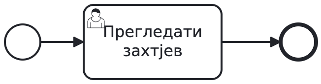
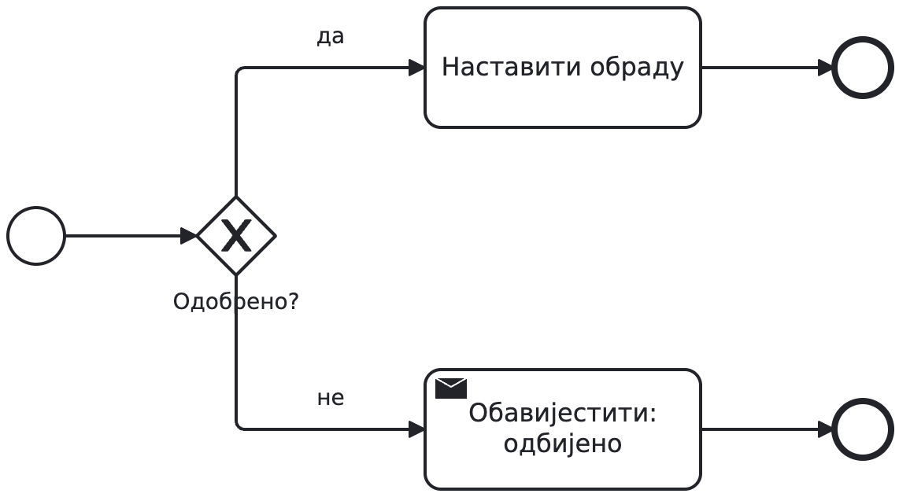
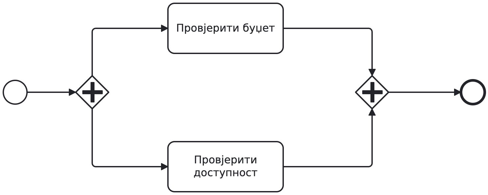
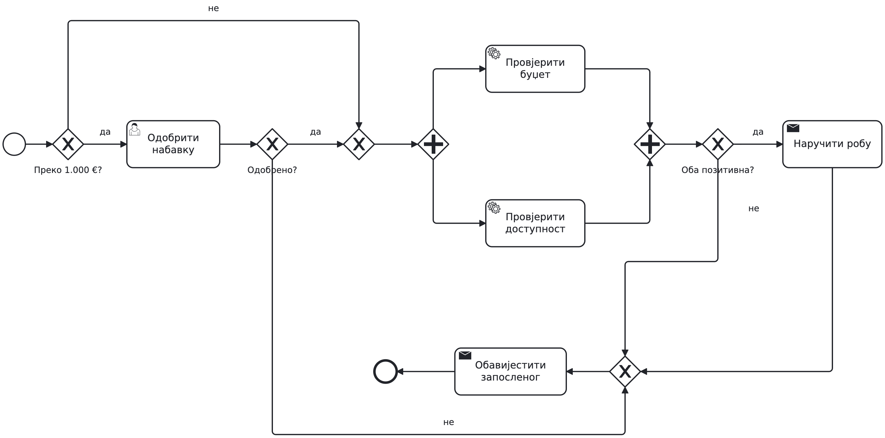
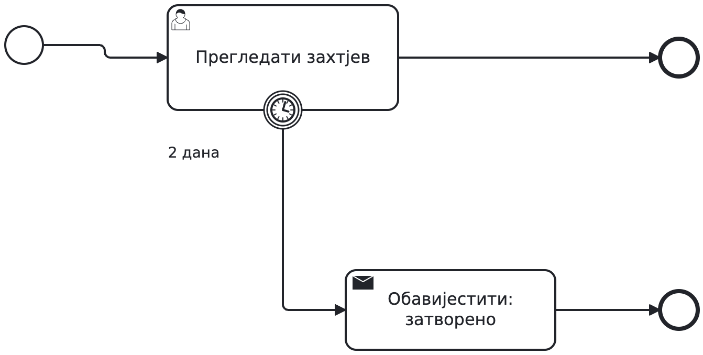
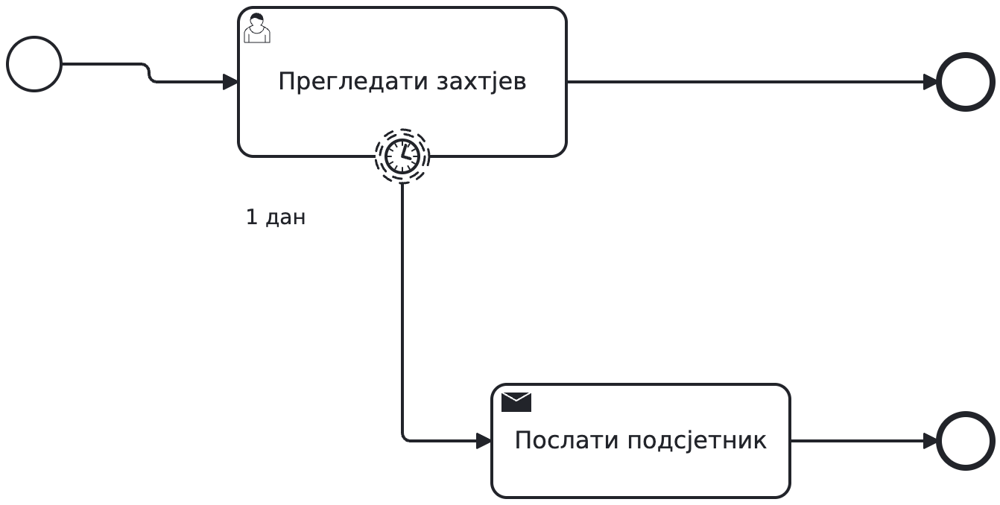
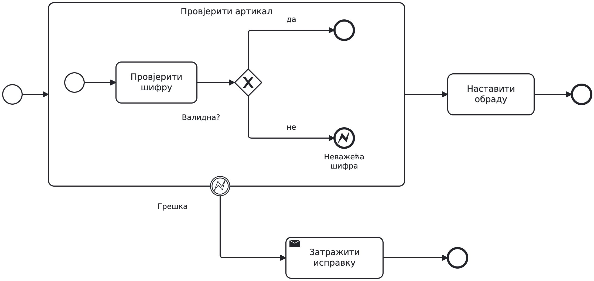
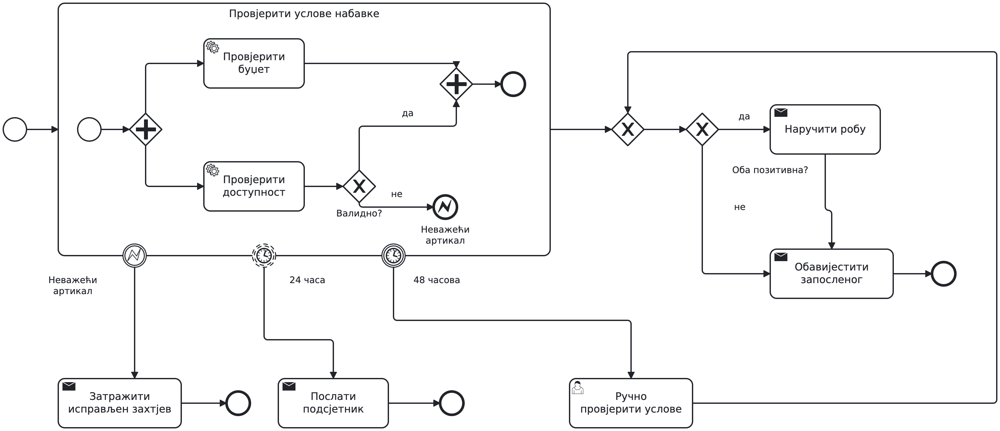
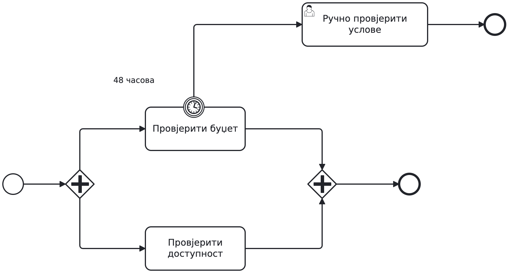
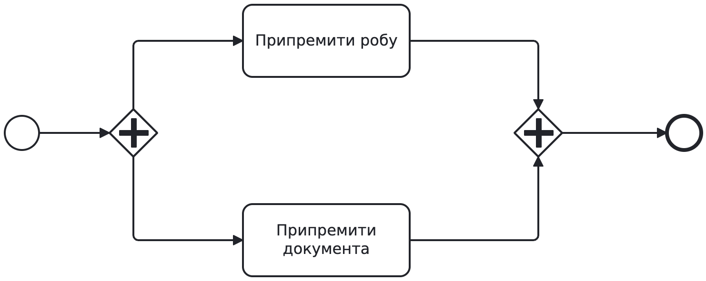

# Drugi čas — BPMN: dva kruga učenja

Materijal za nastavnika. Koristimo jednu priču o nabavci. Prvo studenti
upoznaju nekoliko elemenata na minimalnim dijagramima i sami sastavljaju
osnovni model. Nakon poređenja i ispravke dobijaju nove elemente i novi
zahtjev za isti proces. Potpuna rješenja prikazujemo poslije njihovog
pokušaja. [V3](class2-v3.md) i njeni dijagrami ostaju sačuvani.

## Ishodi časa

Student treba da može da izabere XOR ili AND prema tekstu zahtjeva,
razlikuje završetak aktivnosti od njenog rezultata, odredi opseg roka
i greške, te obrazloži model konkretnim scenarijem. Uredan dijagram
nije dovoljan ako njegovo ponašanje ne ispunjava zahtjev.

## Plan za 90 minuta

| Vrijeme | Slajdovi | Rad i dokaz razumijevanja |
| --- | --- | --- |
| 0–5 | Pročitajte tok | Svako sam predviđa aktivno stanje, pa poredi u paru |
| 5–17 | XOR; AND | Mali primjeri, predviđanje putanje i čekanja |
| 17–30 | Zadatak A; kriterijumi | Dva minuta individualne skice, zatim zajednički model |
| 30–40 | Rješenje A; zašto | Prolazak kroz scenarije i ispravka vlastitog modela |
| 40–52 | Prekidni tajmer; podsjetnik; potproces i greška | Tri minimalna primjera; jedan konstrukt i pitanje po prikazu |
| 52–67 | Zadatak B; pripremite objašnjenje | Kratka individualna odluka o opsegu, zatim dorada u paru |
| 67–77 | Rješenje B; zašto | Poređenje kroz scenarije i ispravka modela |
| 77–85 | Tri česte greške | Kontra-primjer, objašnjenje i popravka |
| 85–90 | Samostalno, bez gledanja rješenja | Individualna skica i jedna rečenica obrazloženja |

Dodatak sa dobavljačem nije obavezan dio ovih 90 minuta. Ne skraćivati
samostalan rad da bi svi slajdovi dobili podjednako vremena. Modeli su
konceptualni; danas nema formi, worker-a, deploy-a, event-based gateway-a
ni kompenzacije.

## Priprema i materijali

- [Prezentacija](class2-v4.md) ima 19 glavnih sadržajnih slajdova i jedan dodatak.
- [Zadaci za studente](zadatak-class2-v4.md) sadrže A, B, kriterijume i završnu provjeru, bez rješenja.
- [Katalog dijagrama i modela](bpmn-class2-v4/README.md) sadrži i rješenja za analizu.

Tokom rada ostaviti prikazan tekst zadatka, ne slajd sa rješenjem.
Za rad dati studentima tekst zadataka; kompletan katalog i prezentacija
sadrže rješenja i koriste se pri zajedničkoj analizi. Ko otvara Modeler,
može raditi od praznog dijagrama. Nastavnik ima sačuvane referentne modele.

U paru oba studenta prvo daju svoj odgovor. Onaj koji ne crta treba da
prati scenarije i objašnjava odluke; za zadatak B zamijeniti uloge. Pri
obilasku pitati i tišeg člana para. Završna provjera je individualna i
služi da vidimo šta treba ponoviti, ne za bodovanje.

## Podsjetnik i minimalni primjeri

Odgovor na početno pitanje: dok pregledu nije kraj, aktivan je zadatak;
proces još nije stigao na end. Krugovi nisu zadaci. Sequence flow zadaje
redoslijed u jednom pool-u. Pool-ove i poruke samo obnoviti iz prošlog časa,
bez novog velikog dijagrama.

Odgovor na „odbijeno“: slanje obavještenja, zatim kraj; druga grana se
ne pokreće. XOR bira prema poznatom podatku. Uslovi treba da budu jasni
i da pokriju namjeravane slučajeve bez preklapanja. Ne prikazivati još
cijeli model nabavke. Studentski zadatak će zahtijevati spajanje odluka
sa ostalim dijelovima procesa.

Ako jedna provjera traje, AND spajanje čeka. AND ne odlučuje da li su
rezultati pozitivni. Od svakog studenta tražiti kratko predviđanje prije
odgovora grupe. Primjer ima samo dvije aktivnosti i sinhronizaciju;
odluka o poslovnom ishodu tek je dio zadatka A.

## Zadatak A: osnovna nabavka

Tekst i kriterijumi su na posebnom listu. Studentima zadati ponašanje,
a ne instrukciju „upotrijebite AND ovdje“. Prvo dva minuta samostalne
skice, zatim rad u paru. Tokom rada pitati: „Šta se desi za 1.000 €?“
i „Šta ako je samo jedna provjera završila?“ Ne rješavati model umjesto
njih; vratiti ih na konkretan zahtjev koji treba ostvariti.

Kriterijumi: odbijanje ne vodi na provjere ili porudžbinu; obje provjere
završe prije odluke o rezultatima; naručivanje samo uz oba pozitivna;
svaki poslovni ishod ima tačno jedno obavještenje i nema duplog nastavka.
Provjere samo čitaju podatke i u ovoj fazi uvijek završe. Nema rokova.

## Rješenje A i analiza

[Model rješenja A](bpmn-class2-v4/17-base-overview.bpmn).

Do uključivo 1.000 € odobrenje se preskače. Preko toga rukovodilac
odlučuje; odbijanje vodi na obavještenje i kraj. Odobrenje i preskakanje
spajaju se XOR-om. AND pokreće nezavisne provjere budžeta i dostupnosti,
pa čeka obje. XOR provjerava rezultate: oba pozitivna vode na naručivanje,
a ostali na obavještenje. Donji tok ide zdesna nalijevo. XOR prije
obavještenja spaja alternativne ishode i ne sinhronizuje.

Ne čitati samo nazive elemenata. Za svaki važan izbor tražiti tri stvari:
koji zahtjev ostvaruje, zašto je izabran taj konstrukt i koji scenario
bi otkrio pogrešan izbor. Prihvatiti drugačije rasporede i modele sa
istim ispravnim ponašanjem; sličnost sa slikom nije kriterijum.

| Scenario | Očekivano ponašanje |
| --- | --- |
| 1.000 €, oba rezultata pozitivna | Bez odobravanja; provjere, jedna porudžbina, jedno obavještenje |
| 1.500 €, rukovodilac odbija | Bez provjera i naručivanja; jedno obavještenje |
| 800 €, roba nije dostupna | Obje provjere završe; nema naručivanja; jedno obavještenje |
| Budžet potvrđen, dostupnost još traje | Čekanje na spajanju; nema prerane odluke |

Ostaviti posljednja dva minuta ovog bloka za ispravku njihovog modela.
Student treba da zabilježi bar jednu izmjenu ili objasni zašto njegovo
rješenje već prolazi navedene scenarije.

## Novi elementi prije zadatka B

Puni obod: poslije dva dana aktivan zadatak se otkazuje. Njegova normalna
putanja se tada ne nastavlja. Ako zadatak završi ranije, njegov tajmer
prestaje da čeka. Ovo je rok za jedan zadatak, ne za cijelu instancu.

Isprekidani obod: poslije jednog dana šalje se jedan podsjetnik; osnovni
zadatak ostaje aktivan. Običan end te dodatne grane završava samo tu
putanju. Jednokratni tajmer nije periodično ponavljanje podsjetnika.

Normalna putanja završava unutrašnji rad i nastavlja van potprocesa.
Nevažeća šifra vodi na error end koji baca NEVAZECI_ARTIKAL; odgovarajući
error boundary na potprocesu prekida njegov aktivan rad i traži ispravku.
Prikaz ima jednu provjeru, kako bi opseg bio jasan bez paralelizma.
Zadatak B traži da studenti taj obrazac prenesu na dvije provjere.

Očekivani negativan rezultat, npr. nema budžeta, i dalje je XOR ishod.
BPMN grešku uvodimo zbog izričitog pravila da se prekida grupa provjera.
Programski exception ne postaje automatski BPMN error. Tehničke kvarove
i politike ponavljanja ostaviti za rad sa servisnim pozivima.

## Zadatak B: prenijeti princip na veći opseg

Studenti mijenjaju svoj ispravljen model A. Dobijaju novi tekst, bez
rješenja sa dva tajmera na potprocesu. Nevažeća šifra mora prekinuti
obje provjere i zatražiti nov zahtjev. Obične negativne rezultate i
ostala pravila A treba sačuvati.

Provjere zajedno imaju 48 časova od početka tog rada. U 24. času jedan
podsjetnik bez prekida; u 48. času prekid preostalog automatskog rada i
ručna provjera uslova. Ručni rezultati koriste se za postojeću odluku
o nabavci. Rokovi ne važe za ranije odobravanje niti za kasniji ručni rad.

Prvo svako sam označi opseg i predloži mjesto za rokove. Zatim par spaja
prijedloge i crta. Pri obilasku pitati „Čiji rok mjerite?“ i „Koji posao
ostaje aktivan poslije podsjetnika?“ Posljednja tri minuta parovi
provjeravaju slučajeve sa slajda i pripremaju objašnjenje.

## Rješenje B i analiza

[Model rješenja B](bpmn-class2-v4/19-shared-deadline-solution.bpmn).
Ovaj prikaz je u prezentaciji tek poslije zadatka B.

Obje provjere su unutar ugrađenog potprocesa sa svojim početkom i krajem.
Normalan završetak AND spajanja završava potproces. Na njegovoj granici
su: odgovarajući error boundary, neprekidni tajmer PT24H i prekidni
PT48H. Oba tajmera počinju ulaskom u potproces. Podsjetnik je zasebna
grana sa običnim end događajem. Istek roka otkazuje preostale provjere
i unutrašnje čekanje, pa pokreće ljudsku ručnu provjeru izvan potprocesa.
Alternativno spajanje vraća taj put na odluku prema rezultatima.

U povezanom modelu A odobravanje ostaje ispred prikazanog dijela. Ovaj
fragment razrađuje provjere i njihov nastavak: normalni i ručni izlaz
spajaju se alternativno, a XOR zatim čita oba rezultata. Oba pozitivna
vode na „Naručiti robu“, pa obavještenje; ostali direktno na obavještenje.
Greška ima zaseban izlaz na zahtjev za ispravku i kraj. Početak fragmenta
u studentskom povezanom modelu zamjenjuje dolazni tok iz odobravanja;
ne dodavati nov početak procesa u njegovu sredinu.

Postojeća obrada nevažeće šifre ostaje na istom opsegu. Ako greška
prekine potproces, njegovi preostali tajmeri i aktivne provjere prestaju.
Ako potproces normalno završi ranije, preostali tajmeri više ne čekaju.
Ručna provjera daje potrebne rezultate i ne nasljeđuje istekao rok.
Provjere samo čitaju, pa prekid ne zahtijeva poništavanje spoljnih efekata.

| Scenario | Podsjetnik i prekid | Nastavak |
| --- | --- | --- |
| Obje provjere završe za 10 časova | Nema podsjetnika ni prekida; tajmeri prestaju | Odluka prema rezultatima |
| Jedna završi za 20, druga za 30 časova | Jedan podsjetnik u 24. času; druga provjera nastavlja | Odluka u 30. času; rok od 48 više ne čeka |
| Jedna završi za 20, druga traje nakon 48 časova | Podsjetnik u 24; u 48 se prekida preostali rad | Ručna provjera, zatim odluka prema rezultatima |
| Nevažeća šifra dok druga provjera traje | Prekid opsega preko greške; preostali tajmeri prestaju | Obavještenje o novom, ispravljenom zahtjevu |

Nakon objašnjenja studenti popravljaju model. Od svakog para tražiti
jedno obrazloženje: zašto oba tajmera pripadaju tom opsegu ili zašto
ručna provjera mora biti izvan njega. Ne ostaviti analizu na pasivnom
posmatranju referentnog dijagrama.

## Česte greške: otkriti pa popraviti

Jedna grana nije aktivirana, a AND je čeka. Popravka za obavezne provjere:
AND razdvajanje i AND spajanje. Zamjena samo spajanja XOR-om ne ostvaruje
zahtjev da se obje provjere obave.

XOR ne sinhronizuje, pa svaki pristigli token može pokrenuti nastavak.
Kontra-primjer: budžet završi prvi, dostupnost kasnije. Umjesto jednog
nastavka poslije oba rezultata, dobijamo prerani i potencijalno dupli rad.

Budžet završi za 20 časova, pa njegov tajmer više ne čeka. Dostupnost
može trajati 60 časova i ručna provjera se ne pokreće. Popravka: zajednički
opseg obje provjere, pa tajmer na tom opsegu. Još jedan problem pogrešnog
modela: prekid samo budžeta ostavlja drugu granu i njeno čekanje aktivnim.

Svaki par prvo imenuje scenario koji otkriva grešku, zatim predlaže
izmjenu i provjerava isti scenario poslije popravke.

Druge stvari na koje skrenuti pažnju uz studentske modele:

- AND spajanje ne provjerava da li su rezultati pozitivni.
- Običan end jedne grane ne prekida ostale aktivne grane.
- Tajmer zadatka ne ograničava automatski cijeli proces.
- Sequence flow ne prelazi pool; između učesnika ide message flow.
- Preklopljeni uslovi ili nepokrivena granica iznosa traže jasnije pravilo.
- Dobar raspored dijagrama pomaže čitanju, ali ne dokazuje ispravnost.

## Završna individualna provjera

Student bez gledanja rješenja skicira dopunu: oba posla unutar zajedničkog
potprocesa, prekidni boundary tajmer PT3H, rezervni tok za obavještenje
operateru. Normalan završetak i dalje čeka oba posla. Dovoljna je skica
oko datih aktivnosti i jedna rečenica; ne crtati cijelu nabavku ponovo.

Prikupiti odgovore prije diskusije. Provjeriti tri stvari: obuhvaćene
obje aktivnosti, prekidni tip tajmera i rezervni tok izvan tog opsega.
Zabilježiti ko razumije opseg, ko zna simbol ali ne i ponašanje, a kome
treba obnoviti sinhronizaciju. To usmjerava početak sedmice 3.

## Kratko prisjećanje sljedeće sedmice

Prvih pet minuta prikazati isti polazni dijagram pripreme, bez rješenja.
Svako sam odgovara prije razgovora:

1. Dokumenta su spremna, roba još nije. Zašto proces još ne završava?
2. Poslije jednog časa treba podsjetnik bez prekida. Koji događaj i gdje?
3. Poslije tri časa treba prekinuti oba posla. Koji događaj i gdje?

Očekivano: AND spajanje čeka obje grane; neprekidni jednokratni tajmer
na zajedničkom potprocesu za podsjetnik; prekidni tajmer na istom opsegu
za ukupni rok. Zatim kratka povratna informacija i nastavak provjere
modelovanja. Ne tražiti prisjećanje gledanjem prethodnog rješenja.

## Opcioni dodatak: prijem odgovora dobavljača

Ovo je primjena poznatog boundary obrasca na čekanje poruke. Receive task
čeka odgovor, prekidni tajmer ograničava čekanje, XOR nakon prijema čita
sadržaj odgovora. ID zahtjeva povezuje poruku sa instancom. Kasna poruka
ne otvara zatvoren zahtjev. Koristiti samo ako se pitanje pojavi ili na
narednom terminu; nije potrebno za zadatke A i B.

## Zašto ovakav raspored

Mali riješeni primjeri se smjenjuju sa samostalnim pokušajem, objašnjenjem
i ispravkom. Individualna predviđanja, završna provjera i prisjećanje
sljedeće sedmice daju dokaze razumijevanja pored zajedničkog crteža.
Opšti oslonac: [IES, Organizing Instruction and Study to Improve Student Learning](https://ies.ed.gov/ncee/wwc/PracticeGuide/1).
Raspored i izbor zadataka su prilagođeni ovoj grupi; plan mijenjamo prema
njihovim odgovorima. Ako vrijeme ističe, skratiti diskusiju tipičnih grešaka
na one koje su se pojavile. Sačuvati oba pokušaja, ispravke i završnu provjeru.
