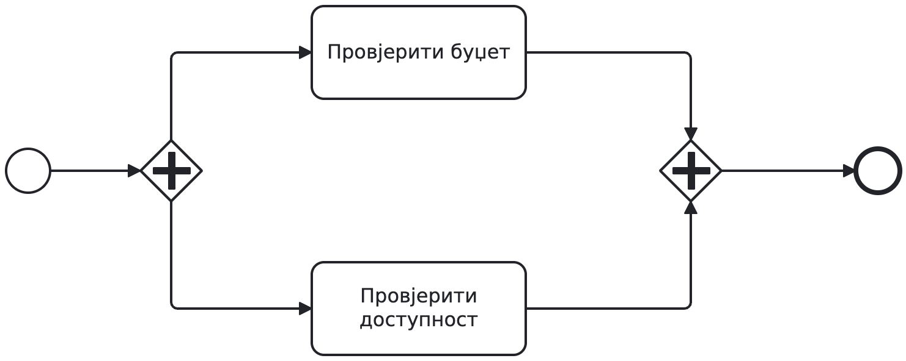
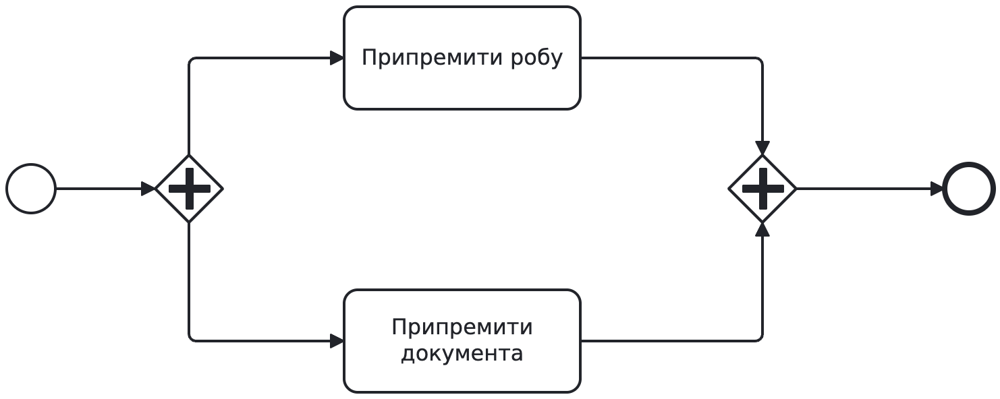

# BPMN — задаци за рад на часу

## Задатак A: основна набавка

Запослени тражи робу. Преко 1.000 € треба одобрење руководиоца;
одбијање завршава захтјев. Иначе се буџет и доступност провјеравају
независно и истовремено. Сачекајте обје провјере. Наручујемо само
ако су оба резултата позитивна. Сваки исход јављамо запосленом.

Претпоставите да су износ и остали улазни подаци познати. Провјере само читају податке и увијек се заврше. Рокове и грешке додајемо тек у задатку B.

Прва два минута свако сам скицира одлуке. Затим у пару направите један модел. Не отварајте рјешење прије анализе.

### Критеријуми успјеха

- Све путање имају јасан исход.
- Одбијање не води на провјере ни наручивање.
- Обје провјере морају завршити прије одлуке о њиховим резултатима.
- Наручујемо само уз оба позитивна резултата.
- Наручивање и обавјештење се не дуплирају.
- Сваки завршни исход се јавља запосленом.

Провјерите: 1.000 € уз позитивне резултате; 1.500 € уз одбијено одобрење; 800 € без доступне робе. Након анализе рјешења исправите свој модел.

## Задатак B: нови захтјеви за исту набавку

Дорадите свој модел A. Неважећа шифра артикла мора прекинути
обје провјере, укључујући другу ако још траје. Обавијестите
запосленог да треба да пошаље нов, исправљен захтјев.

Обје провјере заједно имају рок од 48 часова. Послије 24 часа шаљемо
један подсјетник без прекида провјера. Истек рока прекида незавршене
провјере и води на ручну провјеру услова. Њени резултати одређују наставак набавке.

Задржите правила задатка A, осим новог начина прекида провјера. Недостатак буџета или робе остаје обичан негативан резултат. Ручна провјера утврђује резултате потребне за исту одлуку о набавци.

Оба нова рока почињу уласком у провјере, не пријемом захтјева нити почетком одобравања. Подсјетник се шаље највише једном и само ако провјере још трају. Ако се провјере заврше раније, њихови преостали рокови више не важе. Рок од 48 часова не важи за каснију ручну провјеру.

Прије заједничког цртања свако сам означи опсег прекида и предложи мјесто за рокове. У пару обједините рјешење и прођите сценарије:

1. Обје провјере заврше за 10 часова.
2. Једна заврши за 20, друга за 30 часова.
3. Једна заврши за 20, друга још траје након 48 часова.
4. Откривена је неважећа шифра док друга провјера још траје.

За сваки случај покажите активан рад, обавјештења, прекинуте активности и наставак. Обје позитивне провјере воде на набавку; остали резултати на обавјештење. Након заједничке анализе исправите модел.

## Завршна индивидуална провјера

Цијела припрема испоруке има рок од три часа. Ако истекне, прекините оба посла и обавијестите оператера. Без гледања рјешења скицирајте опсег рока и резервни ток. Избор објасните једном реченицом.
