# BPMN dijagrami: drugi čas

Modeli se otvaraju u Camunda Modeler-u ili na [bpmn.io](https://demo.bpmn.io/).
Modeli su konceptualni, bez podešavanja za izvršavanje.

Dijagrami 05 i 06 su namjerno pogrešni primjeri za analizu.
Boje su ilustracija scenarija, ne dodatna BPMN notacija ni simulacija.

## Почетна скица: правила тек треба разјаснити

[Model za uređivanje](01-starter.bpmn) · [SVG](01-starter.svg) · [PNG](01-starter.png)

## Износ и одлука руководиоца

[Model za uređivanje](02-approval.bpmn) · [SVG](02-approval.svg) · [PNG](02-approval.png)

## Двије провјере, па одлука

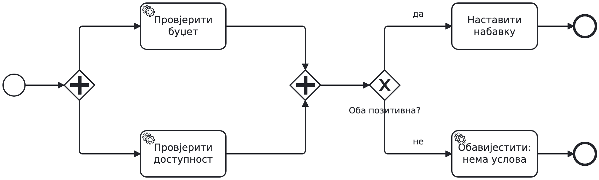

[Model za uređivanje](03-parallel.bpmn) · [SVG](03-parallel.svg) · [PNG](03-parallel.png)

## Стање: буџет је провјерен, доступност још траје

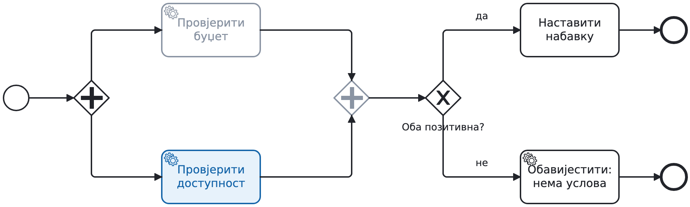

[Model za uređivanje](04-waiting.bpmn) · [SVG](04-waiting.svg) · [PNG](04-waiting.png)

## Намјерна грешка: бира се једна грана, а чекају обје

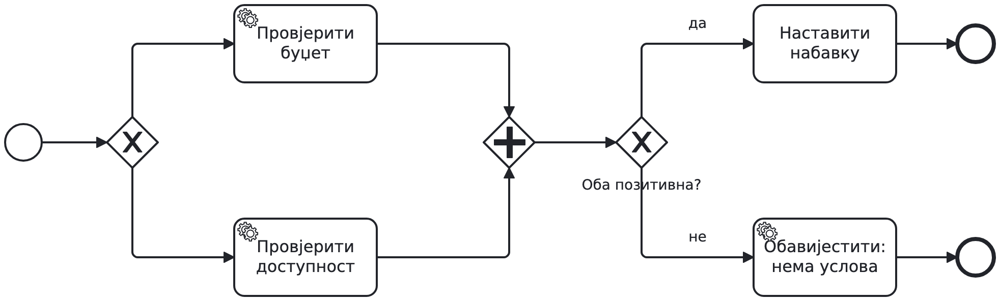

[Model za uređivanje](05-wrong-xor-and.bpmn) · [SVG](05-wrong-xor-and.svg) · [PNG](05-wrong-xor-and.png)

## Намјерна грешка: двије гране, без синхронизације

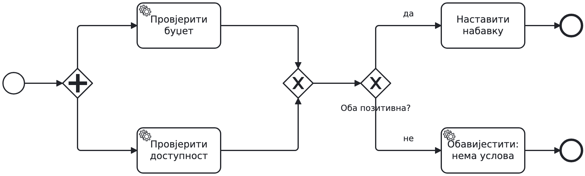

[Model za uređivanje](06-wrong-and-xor.bpmn) · [SVG](06-wrong-and-xor.svg) · [PNG](06-wrong-and-xor.png)

## Пријем одговора са роком од 24 часа

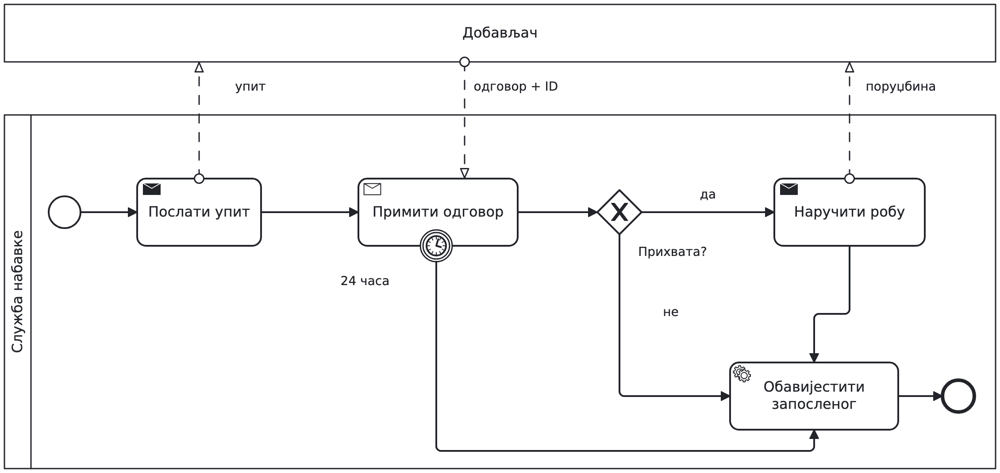

[Model za uređivanje](08-supplier.bpmn) · [SVG](08-supplier.svg) · [PNG](08-supplier.png)

## Подсјетник оставља задатак активним; рок га прекида

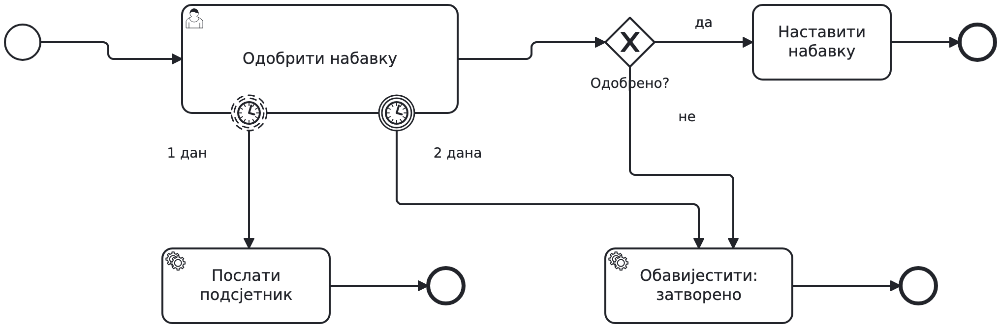

[Model za uređivanje](10-boundary-timers.bpmn) · [SVG](10-boundary-timers.svg) · [PNG](10-boundary-timers.png)

## Грешка прекида цијели потпроцес провјера

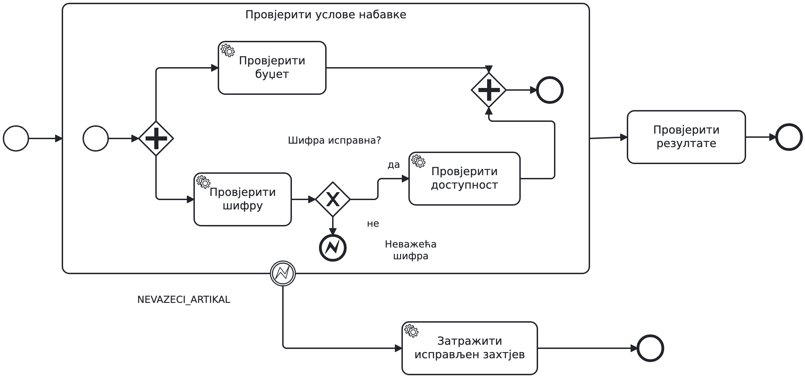

[Model za uređivanje](11-error-scope.bpmn) · [SVG](11-error-scope.svg) · [PNG](11-error-scope.png)

## Сценарио: неважећа шифра, буџет још активан

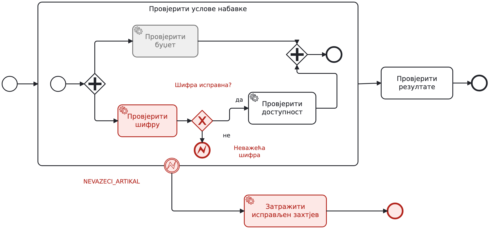

[Model za uređivanje](12-error-active.bpmn) · [SVG](12-error-active.svg) · [PNG](12-error-active.png)

## Исти опсег, склопљен приказ

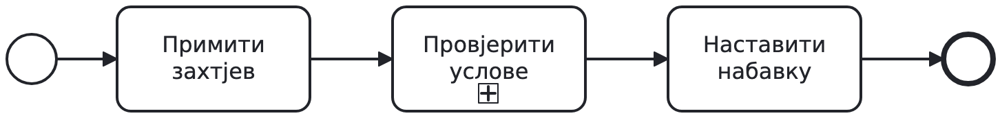

[Model za uređivanje](13-collapsed.bpmn) · [SVG](13-collapsed.svg) · [PNG](13-collapsed.png)

## Основни модел набавке: повезана цјелина

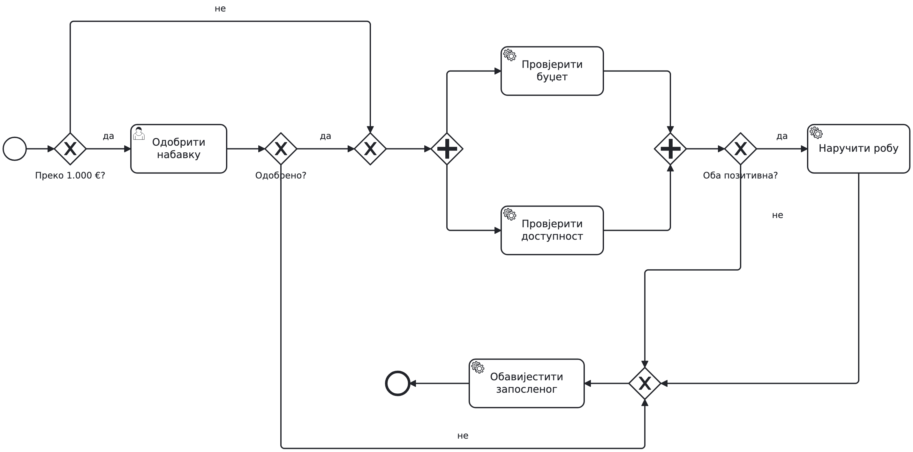

[Model za uređivanje](17-base-overview.bpmn) · [SVG](17-base-overview.svg) · [PNG](17-base-overview.png)

## Рјешење: заједнички рок обје провјере

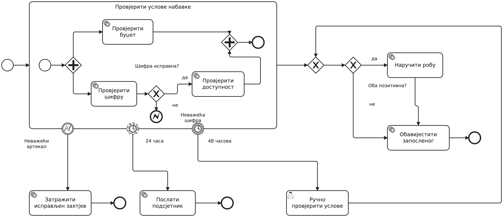

[Model za uređivanje](19-shared-deadline-solution.bpmn) · [SVG](19-shared-deadline-solution.svg) · [PNG](19-shared-deadline-solution.png)

## Почетак, задатак, крај

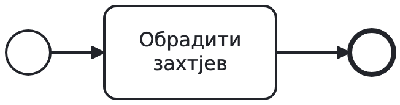

[Model za uređivanje](20-sequence.bpmn) · [SVG](20-sequence.svg) · [PNG](20-sequence.png)

## XOR: једна од двије путање

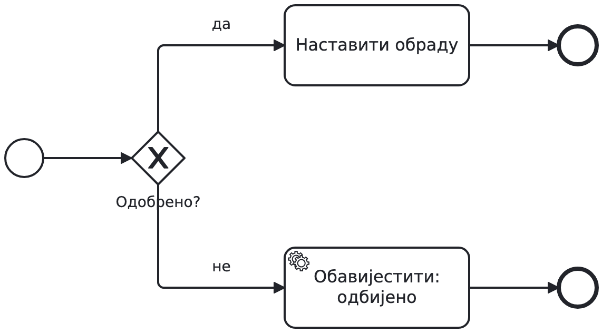

[Model za uređivanje](21-minimal-xor.bpmn) · [SVG](21-minimal-xor.svg) · [PNG](21-minimal-xor.png)

## AND: покренути обје, сачекати обје

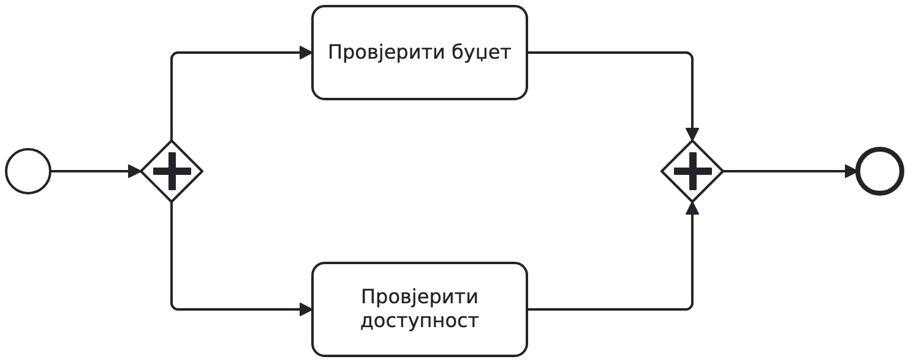

[Model za uređivanje](22-minimal-and.bpmn) · [SVG](22-minimal-and.svg) · [PNG](22-minimal-and.png)

## Прекидни тајмер

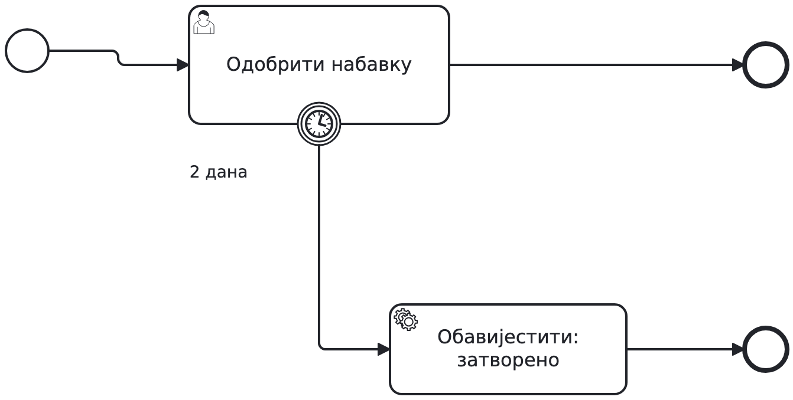

[Model za uređivanje](23-interrupting.bpmn) · [SVG](23-interrupting.svg) · [PNG](23-interrupting.png)

## Непрекидни тајмер

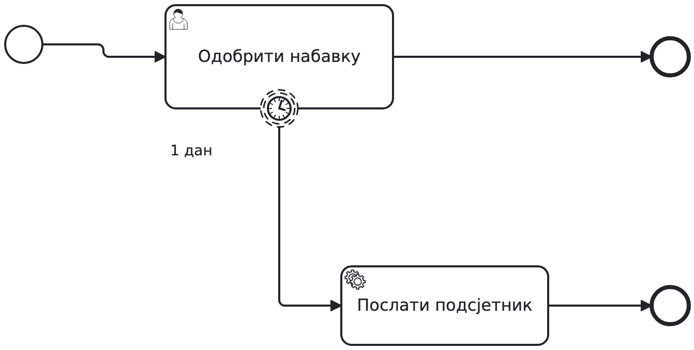

[Model za uređivanje](24-noninterrupting.bpmn) · [SVG](24-noninterrupting.svg) · [PNG](24-noninterrupting.png)

## Потпроцес: нормалан исход и грешка

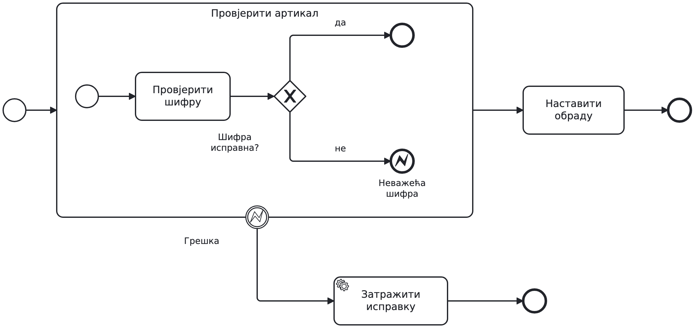

[Model za uređivanje](25-minimal-error.bpmn) · [SVG](25-minimal-error.svg) · [PNG](25-minimal-error.png)

## Намјерна грешка: рок је само на једној провјери

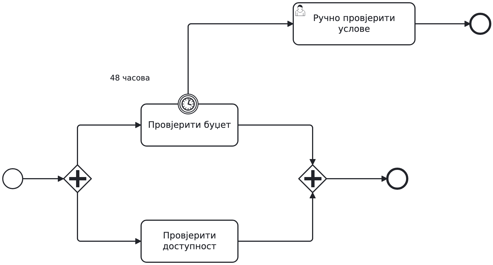

[Model za uređivanje](26-wrong-timer-scope.bpmn) · [SVG](26-wrong-timer-scope.svg) · [PNG](26-wrong-timer-scope.png)

## Самостално: рок припреме испоруке

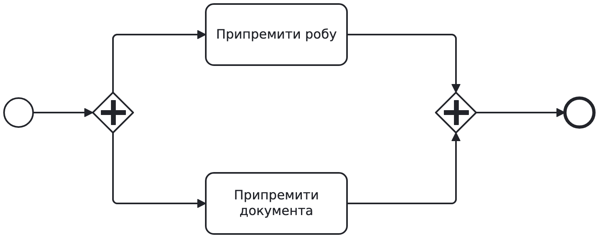

[Model za uređivanje](28-exit-preparation.bpmn) · [SVG](28-exit-preparation.svg) · [PNG](28-exit-preparation.png)

## Рјешење B: нормалан и ручни наставак

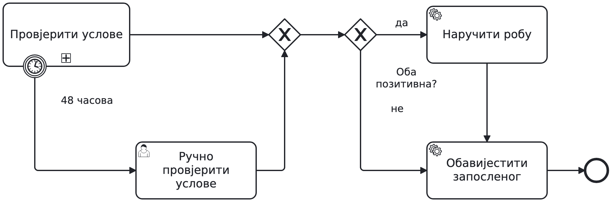

[Model za uređivanje](32-manual-return.bpmn) · [SVG](32-manual-return.svg) · [PNG](32-manual-return.png)

## Спајање алтернативних путања

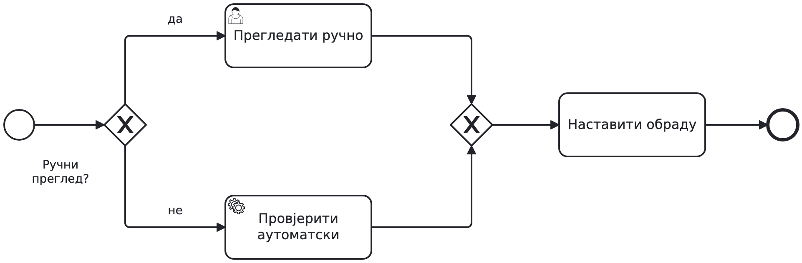

[Model za uređivanje](33-xor-merge.bpmn) · [SVG](33-xor-merge.svg) · [PNG](33-xor-merge.png)

## Паралелне провјере и заједнички наставак

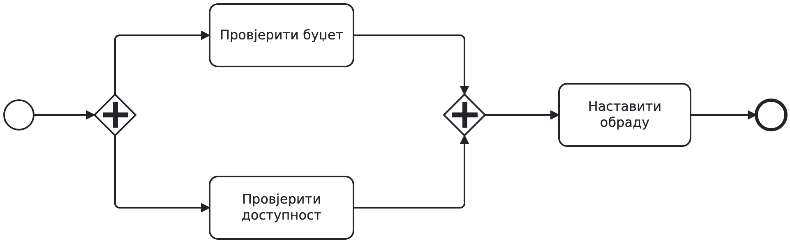

[Model za uređivanje](34-and-execution.bpmn) · [SVG](34-and-execution.svg) · [PNG](34-and-execution.png)

## Врсте гранања

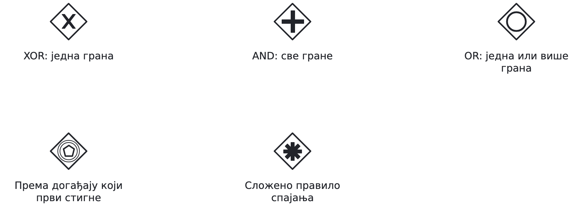

[Model za uređivanje](36-gateway-types.bpmn) · [SVG](36-gateway-types.svg) · [PNG](36-gateway-types.png)

## Врсте задатака

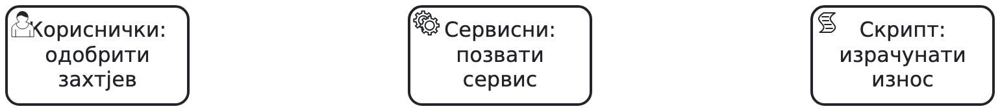

[Model za uređivanje](37-task-types.bpmn) · [SVG](37-task-types.svg) · [PNG](37-task-types.png)

## Догађаји током процеса

[Model za uređivanje](38-intermediate-types.bpmn) · [SVG](38-intermediate-types.svg) · [PNG](38-intermediate-types.png)

## Почетни догађаји

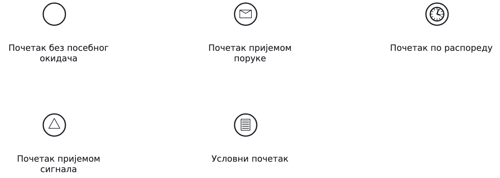

[Model za uređivanje](39-start-end-types.bpmn) · [SVG](39-start-end-types.svg) · [PNG](39-start-end-types.png)

## Погрешан подсјетник: терминирајући крај

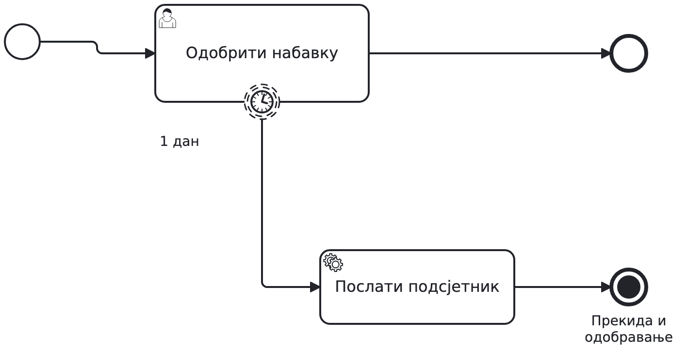

[Model za uređivanje](40-terminate-reminder.bpmn) · [SVG](40-terminate-reminder.svg) · [PNG](40-terminate-reminder.png)

Generisano pomoću [bpmn-js](https://bpmn.io/toolkit/bpmn-js/).
[Uputstvo za regenerisanje](../../../../tools/bpmn/README.md).

<!-- derived views -->
## Tok izvršavanja i uvećani detalji

Plavo označava samo rad koji sada traje. Završene aktivnosti, čekanje i posao koji još nije počeo označeni su riječima. Ostale strelice su neutralne. Boje služe objašnjenju i nisu dio BPMN notacije.
Prikaz granice je izrez modela B; izlazni tokovi nastavljaju van izreza.

### Обје провјере раде

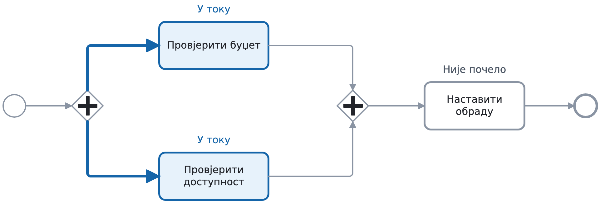

[SVG](29-and-running.svg) · [Izvorni model](34-and-execution.bpmn)

### Буџет је провјерен, чека се доступност

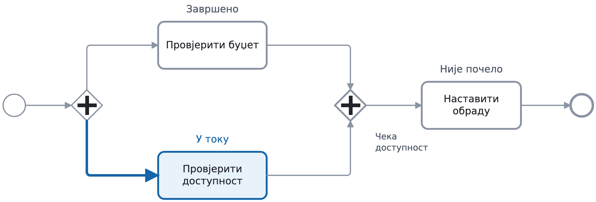

[SVG](30-and-waiting.svg) · [Izvorni model](34-and-execution.bpmn)

### Обје провјере су завршене, процес наставља

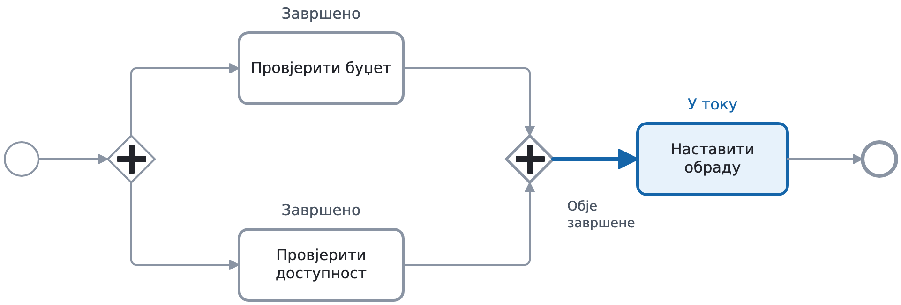

[SVG](35-and-joined.svg) · [Izvorni model](34-and-execution.bpmn)

### Три догађаја на граници потпроцеса

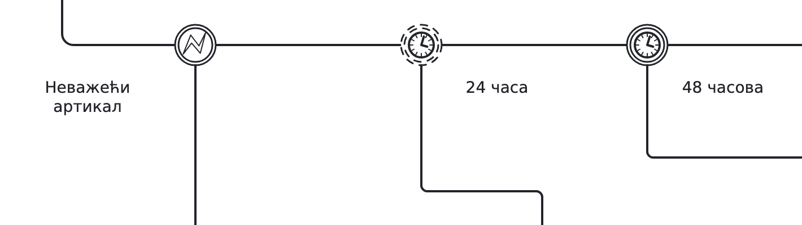

[SVG](31-boundary-detail.svg) · [Izvorni model](19-shared-deadline-solution.bpmn)
