## Гранање

```{=latex}
{\centering
```

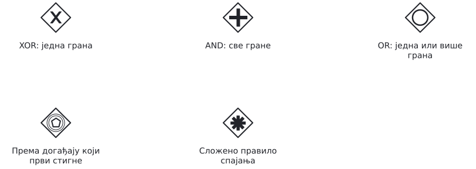{height=48% aria-label="Које врсте гранања постоје?" .compact}

```{=latex}
\par}
```

XOR бира једну грану. AND покреће све гране. OR покреће све гране чији су услови испуњени.

Гранање према догађају чека шта ће се прво десити. Сложено спајање омогућава да се зада услов под којим се ток наставља (на примјер, када стигну токови из било које двије од три улазне гране).

---

## XOR

```{=latex}
{\centering
```

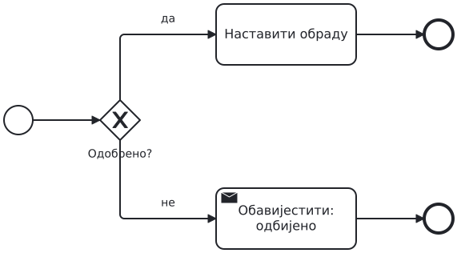{height=65% aria-label="XOR бира једну путању"}

```{=latex}
\par}
```

На излазним стрелицама пишу услови. XOR бира једну грану: ону чији је услов испуњен.

---

## XOR спаја алтернативне путање

```{=latex}
{\centering
```

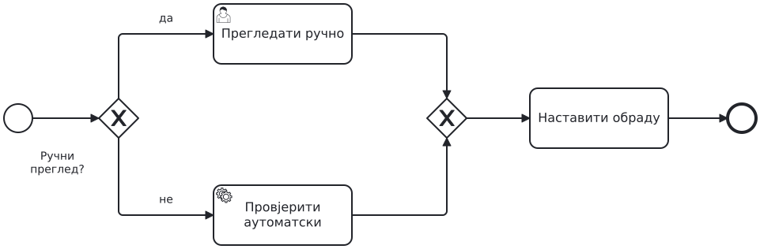{height=65% aria-label="XOR спаја алтернативне путање"}

```{=latex}
\par}
```

У овом примјеру извршава се само једна од двије гране. Када она заврши, XOR одмах води на сљедећи задатак.

---

## AND

```{=latex}
{\centering
```

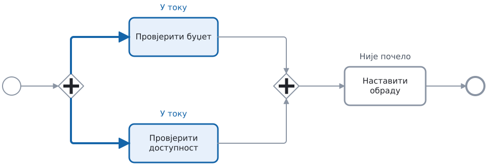{height=65% aria-label="AND покреће обје провјере"}

```{=latex}
\par}
```

AND покреће обје гране.

---

## AND спајање чека све гране

```{=latex}
{\centering
```

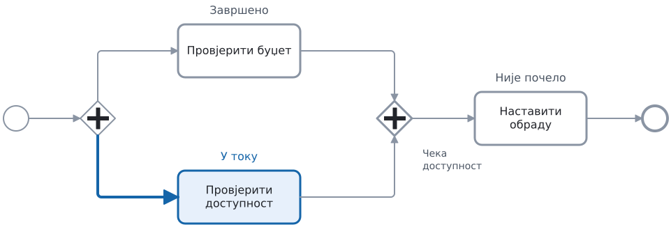{height=65% aria-label="AND чека да обје провјере заврше"}

```{=latex}
\par}
```

Када једна провјера заврши, AND чека другу. Тек када обје заврше, покреће се сљедећи задатак.

---

## Основни задаци

```{=latex}
{\centering
```

{height=48% aria-label="Ко обавља задатак?" .compact}

```{=latex}
\par}
```

Кориснички задатак обавља човјек кроз апликацију, нпр. одобрава захтјев.
Сервисни позива сервис, нпр. провјерава доступност робе.
Скрипт задатак извршава скрипту, нпр. израчунава укупан износ.

Тежимо аутоматизацији - шта год можемо да урадимо умјесто корисника - аутоматизујемо.

---

## Задатак: набавка робе

```{=latex}
{\centering
```

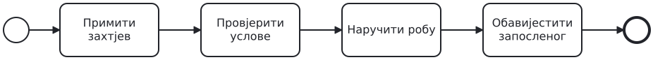{height=48% aria-label="Задатак A: набавка робе" .compact}

```{=latex}
\par}
```

Запослени тражи робу. За износ преко 1.000 € треба одобрење руководиоца.
Ако руководилац одбије захтјев, обавијестимо запосленог и завршимо поступак.
У осталим случајевима паралелно провјеравамо буџет и доступност.
Робу наручујемо само ако је доступна и има довољно новца на картици.
Запослени добија обавјештење о сваком исходу.

---

## Рјешење

```{=latex}
{\centering
```

{height=84% aria-label="Рјешење A" .overview}

```{=latex}
\par}
```

---

## Start events

```{=latex}
{\centering
```

{height=48% aria-label="Шта може да покрене процес?" .compact}

```{=latex}
\par}
```

Порука покреће процес на основу примљеног захтјева.
Тајмер га покреће у задато вријеме, а сигнал када стигне објава на коју је процес претплаћен.
Условни почетак реагује када је услов испуњен, нпр. залиха падне испод минимума.

---

## Догађаји током трајања процеса

```{=latex}
{\centering
```

{height=48% aria-label="Догађаји током процеса" .compact}

```{=latex}
\par}
```

Двоструки круг означава међудогађај. Порука је намијењена одређеном примаоцу. Сигнал је објава за све који га чекају. Тајмер означава вријеме или рок.

Разликујемо догађаје чекања (catch event) и слања (throw event).
На слици су догађаји чекања. Код слања поруке или сигнала унутрашња иконица је попуњена црном бојом. Тајмер постоји само као догађај чекања.

---

## Interrupting timer

```{=latex}
{\centering
```

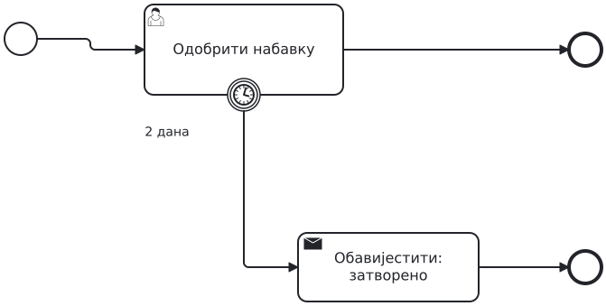{height=65% aria-label="Прекидни тајмер"}

```{=latex}
\par}
```

Ако руководилац не заврши одобравање за два дана, тајмер прекида задатак.

---

## Non-Interrupting timer

```{=latex}
{\centering
```

{height=65% aria-label="Подсјетник оставља задатак активним"}

```{=latex}
\par}
```

Ако руководилац још није одлучио након једног дана, шаљемо подсјетник.

Када се подсјетник пошаље, његова грана је готова. Процес и даље чека одлуку руководиоца.

---

## Обичан и терминирајући крај

```{=latex}
{\centering
```

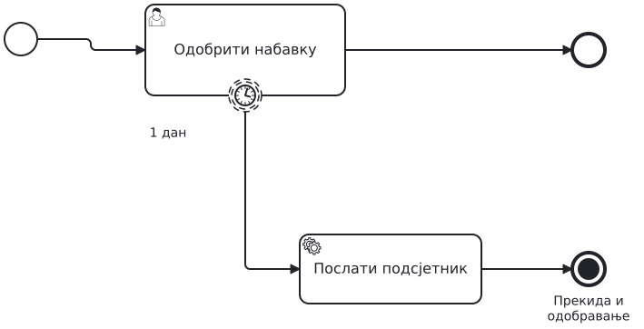{height=48% aria-label="Обичан и терминирајући крај" .compact}

```{=latex}
\par}
```

Обичан крај завршава само грану која је до њега стигла.
Попуњен круг је терминирајући крај: зауставља сав рад у истом процесу или потпроцесу у којем се налази.

Процес је готов када више нема активног рада ни чекања догађаја.

---

## Потпроцес и грешка

```{=latex}
{\centering
```

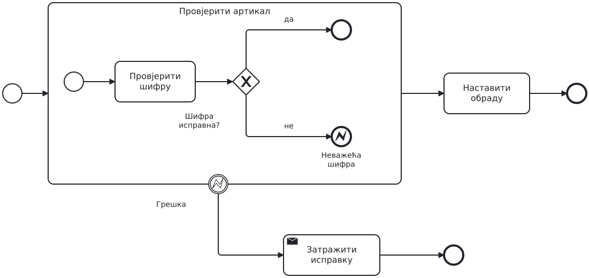{height=65% aria-label="Потпроцес и грешка"}

```{=latex}
\par}
```

Неисправна шифра води на крајњи догађај грешке (error end).
Догађај грешке на граници потпроцеса (boundary event) прекида извршавање подпроцеса и покреће сервисни задатак за обавјештавање.

---

## Задатак

```{=latex}
{\centering
```

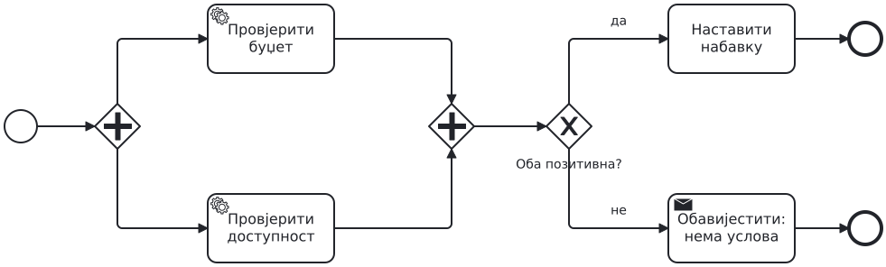{height=65% aria-label="Задатак B: прекид провјера"}

```{=latex}
\par}
```

Дорадите модел из претходног задатка.
У грани за доступност прво провјерите шифру артикла тако да се доступност провјерава само за исправну шифру.
Ако шифра није исправна, прекините и провјеру буџета ако још траје. Обавијестите запосленог да пошаље нов захтјев са исправљеном шифром.

---

## Задатак наставак

```{=latex}
{\centering
```

{height=48% aria-label="Задатак B: заједнички рок" .compact}

```{=latex}
\par}
```

Рок од 48 часова почиње када почну провјере.
Ако послије 24 часа још нису обје завршене, шаљемо један подсјетник, без прекида рада.
Ако ни до 48. часа нису обје завршене, прекидамо оне које још трају.
Тада човјек ручно провјерава буџет и доступност. На основу тих резултата одлучујемо да ли наручити робу.

---

## Рјешење

```{=latex}
{\centering
```

{height=74% aria-label="Рјешење B: измијењени дио процеса" .overview}

```{=latex}
\par}
```

Одобравање руководиоца остаје од раније.

---

## Три догађаја на граници потпроцеса

```{=latex}
{\centering
```

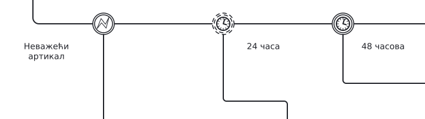{height=65% aria-label="Три догађаја на граници потпроцеса"}

```{=latex}
\par}
```

Сва три догађаја припадају истом потпроцесу. Стрелице се настављају ван изреза.

- Грешка прекида провјере и тражи нов, исправљен захтјев.
- Подсјетник у 24. часу оставља провјере активним.
- Рок у 48. часу прекида преостали рад.

---

## Послије ручне провјере одлучујемо о наручивању

```{=latex}
{\centering
```

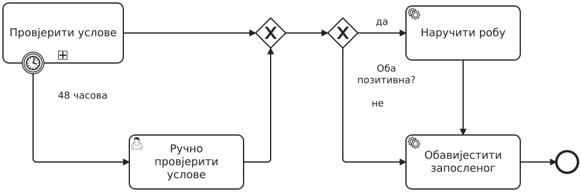{height=65% aria-label="Послије ручне провјере одлучујемо о наручивању"}

```{=latex}
\par}
```

Ако провјере заврше на вријеме, одмах користимо њихове резултате. Ако истекне 48 часова, користимо резултате накнадне ручне провјере.
Оба пута воде на исто питање: има ли довољно новца и робе? Ручна провјера је изван потпроцеса и нема рок од 48 часова.

---

## Грешка: покренута је једна грана, чекају се обје

```{=latex}
{\centering
```

{height=65% aria-label="Грешка: покренута је једна грана, чекају се обје"}

```{=latex}
\par}
```

XOR је покренуо провјеру буџета. Да ли ће почети и провјера доступности? Може ли AND дочекати обје? Исправите модел тако да се обје провјере обаве.

---

## Грешка: паралелне гране се не сачекају

```{=latex}
{\centering
```

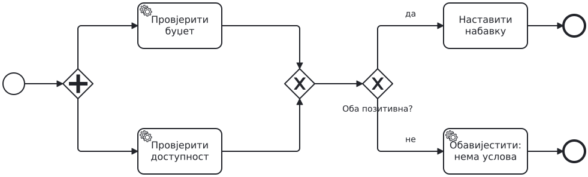{height=65% aria-label="Грешка: паралелне гране се не сачекају"}

```{=latex}
\par}
```

Када прва провјера заврши, XOR одмах покреће сљедећи задатак. Када заврши друга, покреће га поново.

Претпоставите да буџет провјеримо први. Покажите шта се затим извршава и шта се дешава када заврши провјера доступности.

---

## Грешка: рок важи за погрешан посао

```{=latex}
{\centering
```

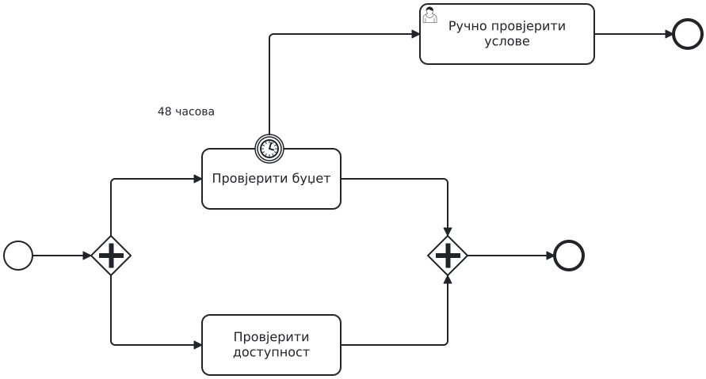{height=65% aria-label="Грешка: рок важи за погрешан посао"}

```{=latex}
\par}
```

Тајмер припада само провјери буџета.

Буџет је провјерен за 20 часова, а доступност се провјерава 60 часова. Хоће ли почети ручна провјера?

---

## Кратак одговор, свако за себе

```{=latex}
{\centering
```

{height=65% aria-label="Кратак одговор, свако за себе"}

```{=latex}
\par}
```

Обје провјере су завршене: роба је доступна, али новца нема.

Може ли процес проћи кроз AND спајање? Шта треба додати послије њега да се роба не наручи када нема новца?
Одговорите у двије реченице, без гледања рјешења.

---

## Самостална скица

```{=latex}
{\centering
```

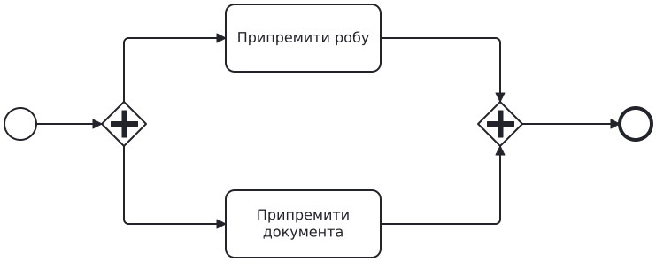{height=65% aria-label="Самостална скица"}

```{=latex}
\par}
```

За цијелу припрему испоруке имамо три часа. Ако рок истекне,
прекините послове који још трају и обавијестите оператера.

Без гледања рјешења додајте тајмер и стрелицу ка обавјештењу. Једном реченицом објасните зашто сте тајмер поставили баш ту.

---

## Додатак: одговор добављача

```{=latex}
{\centering
```

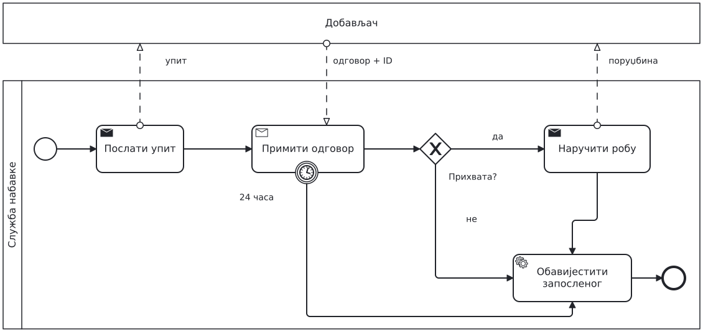{height=65% aria-label="Додатак: одговор добављача"}

```{=latex}
\par}
```

Receive task чека поруку, а прекидни тајмер ограничава чекање.
Када одговор стигне, XOR провјерава његов садржај.

Закасњели одговор не отвара поново затворен захтјев.
