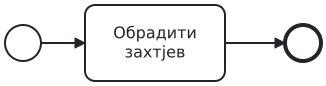
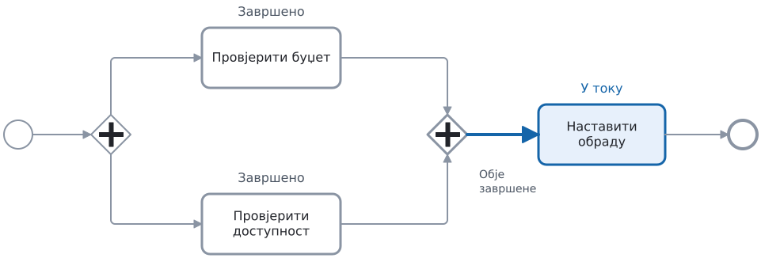
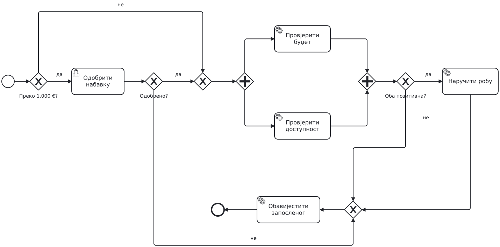
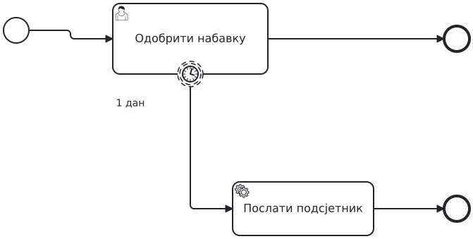
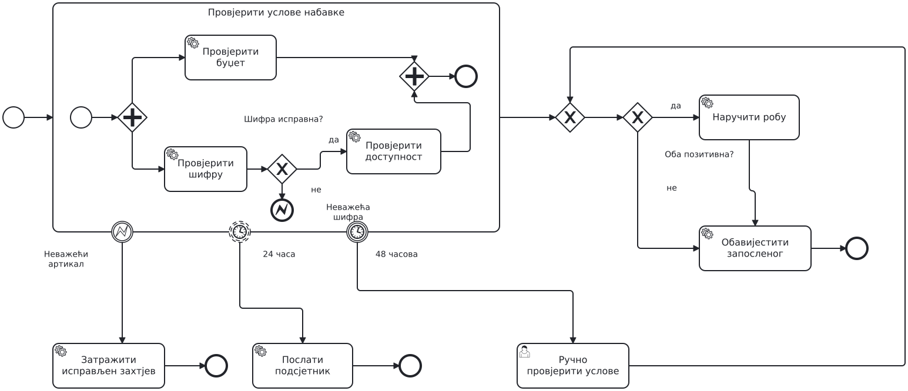

## Почетак, задатак и крај

```{=latex}
{\centering
```

{height=28% aria-label="Почетак, задатак и крај" .legend}

```{=latex}
\par}
```

Почетни догађај покреће процес. Задатак описује посао, а стрелица показује шта слиједи.
Када рад стигне до крајњег догађаја, та грана је завршена.

Док задатак „Обрадити захтјев“ траје, процес остаје на том задатку. До крајњег догађаја стиже тек када се обрада заврши.

---

## XOR бира једну путању

```{=latex}
{\centering
```

{height=65% aria-label="XOR бира једну путању"}

```{=latex}
\par}
```

На излазним стрелицама пишу услови. XOR бира једну грану: ону чији је услов испуњен.

Захтјев је одбијен. Који задатак се обавља, а који се прескаче?

---

## AND покреће обје провјере

```{=latex}
{\centering
```

{height=65% aria-label="AND покреће обје провјере"}

```{=latex}
\par}
```

AND покреће обје провјере. Оне могу трајати различито дуго.
Плаво значи „сада се извршава“. Боја и додатни натписи служе само за објашњење.

Буџет је провјерен, а доступност се још провјерава. Може ли већ почети задатак послије AND спајања?

---

## Једна провјера је готова, друга још траје

```{=latex}
{\centering
```

{height=65% aria-label="Једна провјера је готова, друга још траје"}

```{=latex}
\par}
```

Провјера буџета је завршена. AND чека да заврши и провјера доступности; тек тада може почети заједничка обрада.

---

## Када обје заврше, процес наставља

```{=latex}
{\centering
```

{height=65% aria-label="Када обје заврше, процес наставља"}

```{=latex}
\par}
```

Када обје провјере заврше, AND покреће сљедећи задатак једном.

Обје провјере су готове: роба је доступна, али новца нема. AND дозвољава наставак јер су провјере завршене. Да ли смијемо наручити робу?

---

## Задатак A: набавка робе

```{=latex}
{\centering
```

{height=48% aria-label="Задатак A: набавка робе" .compact}

```{=latex}
\par}
```

Запослени тражи робу. За износ преко 1.000 € треба одобрење руководиоца.
Ако руководилац одбије захтјев, обавијестимо запосленог и завршимо поступак. У осталим случајевима
паралелно провјеравамо буџет и доступност. Обје провјере морају завршити.
Робу наручујемо само ако има довољно новца и роба је доступна. Запослени добија обавјештење о сваком исходу.

Прво сами означите гдје процес бира једну путању, а гдје покреће обје провјере. Затим у пару нацртајте модел.

---

## Провјерите свој модел

- Одбијен захтјев не води на провјере ни наручивање.
- Прије одлуке о наручивању завршене су обје провјере.
- Робу наручујемо само ако има довољно новца и роба је доступна.
- За један захтјев шаљемо једно обавјештење и правимо највише једну наруџбину.
- Запослени добија обавјештење и када робу наручимо и када захтјев одбијемо.

---

## Рјешење A

```{=latex}
{\centering
```

{height=84% aria-label="Рјешење A" .overview}

```{=latex}
\par}
```


---

## XOR спаја алтернативне путање

```{=latex}
{\centering
```

{height=65% aria-label="XOR спаја алтернативне путање"}

```{=latex}
\par}
```

У овом примјеру извршава се само једна од двије гране. Када она заврши, XOR одмах води на сљедећи задатак.

Овдје обје стрелице могу водити и директно на исти задатак. То је исправно зато што се извршава само једна грана.

---

## Завршена провјера може имати негативан резултат

```{=latex}
{\centering
```

{height=65% aria-label="Завршена провјера може имати негативан резултат"}

```{=latex}
\par}
```

Провјера буџета може завршити одговором „нема довољно новца“.
AND чека да обје провјере заврше. XOR затим одлучује да ли њихови резултати дозвољавају наручивање.

На свом моделу покажите гдје почињу обје провјере, гдје се чека да обје заврше и гдје се одлучује о наручивању. Исправите модел ако не поштује тај редослијед.

---

## Прекидни тајмер

```{=latex}
{\centering
```

{height=65% aria-label="Прекидни тајмер"}

```{=latex}
\par}
```

Ако руководилац не заврши одобравање за два дана, тајмер прекида задатак.
Прекидни тајмер има пун обод.

Прошла су два дана, а руководилац није одлучио. Покажите стрелицу којом процес наставља и задатак који се тада обавља.

---

## Подсјетник оставља задатак активним

```{=latex}
{\centering
```

{height=65% aria-label="Подсјетник оставља задатак активним"}

```{=latex}
\par}
```

Тајмер са испрекиданим ободом послије једног дана покреће подсјетник.
Руководилац и даље може да одлучи.

Подсјетник је послат након једног дана. Руководилац одлучује сат касније. Да ли процес прихвата ту одлуку?

---

## Потпроцес и грешка

```{=latex}
{\centering
```

{height=65% aria-label="Потпроцес и грешка"}

```{=latex}
\par}
```

Потпроцес је група активности унутар једног оквира. Неисправна шифра води на крајњи догађај грешке (error end).
Догађај грешке на ивици оквира (boundary event) тада прекида преостали рад унутра и покреће обавјештење.

Пратите стрелице: шта се дешава када је шифра исправна, а шта када није?

---

## Задатак B: прекид провјера

```{=latex}
{\centering
```

{height=65% aria-label="Задатак B: прекид провјера"}

```{=latex}
\par}
```

Дорадите свој модел A. Ако је шифра артикла неважећа, прекините
све провјере које још трају. Обавијестите запосленог да пошаље
нов захтјев са исправљеном шифром.

Првих 7 минута додајте овај прекид. Провјерите: шта се дешава ако једна провјера открије неважећу шифру док друга још ради?

---

## Задатак B: заједнички рок

```{=latex}
{\centering
```

{height=48% aria-label="Задатак B: заједнички рок" .compact}

```{=latex}
\par}
```

Рок од 48 часова почиње када почну провјере. Ако послије 24 часа још нису обје завршене, шаљемо
један подсјетник, без прекида рада. Ако ни до 48. часа нису обје завршене, прекидамо
оне које још трају. Тада човјек ручно провјерава буџет и доступност. На основу тих резултата одлучујемо да ли наручити робу.

Наредних 10 минута додајте тајмере и ручну провјеру. Прво свако на својој скици означи гдје би поставио тајмере.

---

## Прођите кроз три временска случаја

```{=latex}
{\centering
```

{height=65% aria-label="Прођите кроз три временска случаја"}

```{=latex}
\par}
```

1. Обје провјере заврше за 10 часова.
2. Једна заврши за 20, друга за 30 часова.
3. Једна заврши за 20, друга још траје након 48 часова.

У посљедња 3 минута за сваки случај покажите: да ли се шаље подсјетник, да ли се нешто прекида и који задатак слиједи.

---

## Рјешење B: измијењени дио процеса

```{=latex}
{\centering
```

{height=74% aria-label="Рјешење B: измијењени дио процеса" .overview}

```{=latex}
\par}
```

Ово је само дио модела који смо промијенили. Одобравање руководиоца остаје испред њега, као у A.

---

## Три догађаја на граници потпроцеса

```{=latex}
{\centering
```

{height=65% aria-label="Три догађаја на граници потпроцеса"}

```{=latex}
\par}
```

Сва три догађаја припадају истом потпроцесу. Стрелице се настављају ван изреза.

- Грешка прекида провјере и тражи нов, исправљен захтјев.
- Подсјетник у 24. часу оставља провјере активним.
- Рок у 48. часу прекида преостали рад.

---

## Ручна провјера води на исту одлуку

```{=latex}
{\centering
```

{height=65% aria-label="Ручна провјера води на исту одлуку"}

```{=latex}
\par}
```

Рок од 48 часова прекида само рад унутар потпроцеса. Ручна провјера је изван њега и нема тај рок.
Послије редовне или ручне провјере слиједи иста одлука: да ли наручити робу?
Ради прегледности, овдје се не виде активности унутар потпроцеса, грешка ни подсјетник.

На свом моделу пратите шта се дешава када провјере заврше за 10 часова, а шта када једна траје дуже од 48 часова. Обје путање треба да воде на одлуку о наручивању.

---

## Грешка: покренута је једна грана, чекају се обје

```{=latex}
{\centering
```

{height=65% aria-label="Грешка: покренута је једна грана, чекају се обје"}

```{=latex}
\par}
```

XOR је покренуо провјеру буџета. Да ли ће почети и провјера доступности? Може ли AND дочекати обје? Исправите модел тако да се обје провјере обаве.

---

## Грешка: паралелне гране се не сачекају

```{=latex}
{\centering
```

{height=65% aria-label="Грешка: паралелне гране се не сачекају"}

```{=latex}
\par}
```

Када прва провјера заврши, XOR одмах покреће сљедећи задатак. Када заврши друга, покреће га поново.

Претпоставите да буџет провјеримо први. Покажите шта се затим извршава и шта се дешава када заврши провјера доступности.

---

## Грешка: рок важи за погрешан посао

```{=latex}
{\centering
```

{height=65% aria-label="Грешка: рок важи за погрешан посао"}

```{=latex}
\par}
```

Тајмер припада само провјери буџета.

Буџет је провјерен за 20 часова, а доступност се провјерава 60 часова. Хоће ли почети ручна провјера?

---

## Кратак одговор, свако за себе

```{=latex}
{\centering
```

{height=65% aria-label="Кратак одговор, свако за себе"}

```{=latex}
\par}
```

Обје провјере су завршене: роба је доступна, али новца нема.

Може ли процес проћи кроз AND спајање? Шта треба додати послије њега да се роба не наручи када нема новца?
Одговорите у двије реченице, без гледања рјешења.

---

## Самостална скица

```{=latex}
{\centering
```

{height=65% aria-label="Самостална скица"}

```{=latex}
\par}
```

За цијелу припрему испоруке имамо три часа. Ако рок истекне,
прекините послове који још трају и обавијестите оператера.

Без гледања рјешења додајте тајмер и стрелицу ка обавјештењу. Једном реченицом објасните зашто сте тајмер поставили баш ту.

---

## Додатак: одговор добављача

```{=latex}
{\centering
```

{height=65% aria-label="Додатак: одговор добављача"}

```{=latex}
\par}
```

Receive task чека поруку, а прекидни тајмер ограничава чекање.
Када одговор стигне, XOR провјерава његов садржај.

Закасњели одговор не отвара поново затворен захтјев.
