# Drugi čas: BPMN

Na istoj nabavci radimo dva zadatka. Prije svakog zadatka objasnimo
potrebne elemente na malim dijagramima. Studenti zatim pokušaju sami,
porede rješenja i popravljaju svoj model. Gotov model prikazujemo tek
poslije njihovog pokušaja.

## Šta studenti treba da nauče

Student treba da izabere XOR ili AND prema zahtjevu, razlikuje završetak
provjere od njenog rezultata i odredi koje aktivnosti rok ili greška
prekidaju. Svoj izbor treba da objasni na konkretnom slučaju. Ispravnost
provjeravamo ponašanjem procesa; uredan crtež sam po sebi nije dovoljan.

## Plan za 90 minuta

| Vrijeme | Dio časa | Rad studenata |
| --- | --- | --- |
| 0-3 | Početak, zadatak i kraj | Prate kada obrada počinje i kada se prelazi na kraj |
| 3-13 | XOR i AND | Prate izbor grane, paralelan rad i čekanje na spajanju |
| 13-26 | Zadatak A i provjera modela | Dva minuta sami skiciraju, zatim crtaju u paru |
| 26-36 | Rješenje A | Prolaze scenarije, objašnjavaju spajanje i popravljaju model |
| 36-48 | Tajmeri, potproces i greška | Predviđaju šta se prekida, a šta nastavlja |
| 48-68 | Zadatak B | 7 minuta za opseg i grešku, 10 za rokove i ručnu provjeru, 3 za scenarije |
| 68-78 | Rješenje B i uvećani dijelovi | Porede granicu potprocesa i povratak iz ručne provjere |
| 78-85 | Česte greške | Nalaze slučaj koji otkriva grešku i predlažu popravku |
| 85-90 | Samostalna provjera | Kratko odgovaraju o rezultatu provjere, zatim skiciraju zajednički rok |

Dodatak sa dobavljačem ostaviti za pitanje ili naredni čas. Vrijeme za
samostalan rad treba sačuvati i ako objašnjenje potraje. Danas crtamo
modele bez podešavanja za izvršavanje. Forme, worker-i, deploy,
event-based gateway se samo prepoznaje na pregledu vrsta; ne vježbamo ga. Kompenzacija nije dio časa.

## Materijali i rad u paru

- [Prezentacija](class2.md) ima 29 glavnih sadržajnih slajdova i jedan dodatak.
- [Zadaci](zadatak-class2.md) sadrže A, B, provjere modela i završni zadatak, bez rješenja.
- [Katalog dijagrama](bpmn-class2/README.md) sadrži i rješenja za analizu.

Dok studenti rade, prikazati tekst zadatka. Prezentacija i katalog
sadrže rješenja, pa ih koristimo za zajedničku analizu. Studenti koji
koriste Modeler mogu početi od praznog dijagrama. Nastavnik ima sačuvane
referentne modele.

Poslije analize A parovima kojima treba dati
[ispravan polazni model za B](bpmn-class2/17-base-overview.bpmn).
Njihov pokušaj A ostaje sačuvan za poređenje. Greške u A ne treba da ih
spriječe da rade B.

Prije rada u paru oba studenta daju svoj prijedlog. Jedan crta, drugi
prati scenarije i objašnjava odluke. U zadatku B mijenjaju uloge. Pri
obilasku pitati i tišeg člana para. Završni zadatak svako radi sam; ne
bodujemo ga, nego gledamo šta treba ponoviti.

## Podsjetnik i mali primjeri

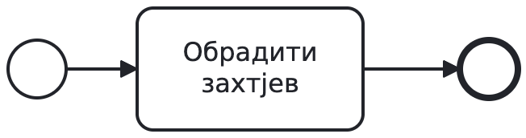

Malu početnu sliku pokazati jednom. Dok obrada traje, proces ostaje na
zadatku „Obraditi zahtjev“. Tek završetak obrade vodi na krajnji događaj.
Ovdje nema posebnog koraka čekanja: sama obrada još traje.
Krugovi označavaju događaje, a pravougaonik zadatak. Sequence flow
zadaje redoslijed u jednom pool-u. Pool-ove i poruke kratko obnoviti iz
prošlog časa.

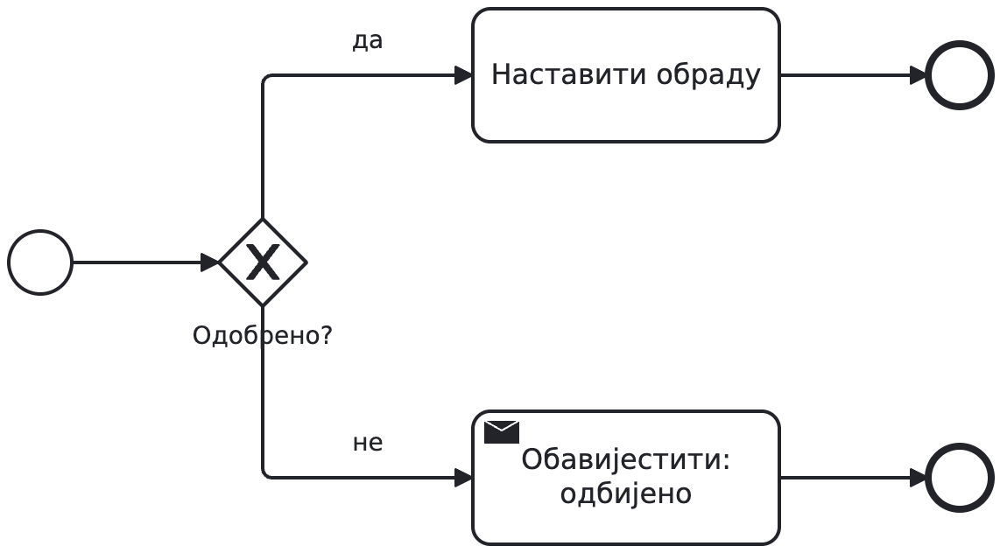

Za odbijen zahtjev slijede obavještenje i kraj. Druga grana se ne
pokreće. XOR bira prema podatku koji već imamo. Uslovi treba da jasno
pokriju slučajeve bez preklapanja. Cijeli model nabavke još ne pokazujemo;
studenti će u A sami spojiti odluke sa ostalim koracima.

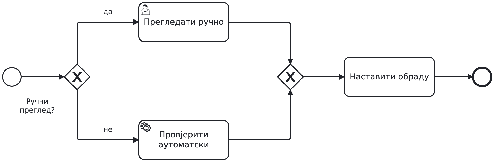

Kod XOR spajanja nastavljamo čim završi izabrana grana. Ne čeka se
druga, koja nije ni pokrenuta. To je razlika u odnosu na AND spajanje.

## AND: rad, čekanje i nastavak

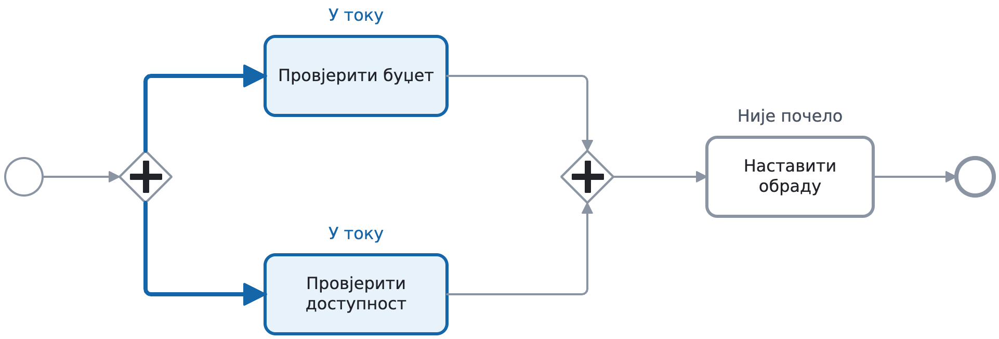

Plave su obje pokrenute grane i aktivnosti. To su dva dijela obrade
istog zahtjeva. Zamoliti svakog studenta da predvidi šta se dešava kada
prva provjera završi.

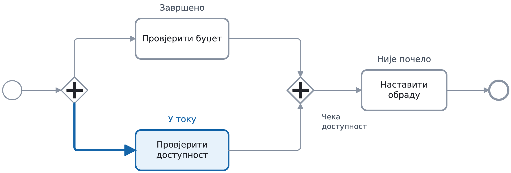

Provjera budžeta je završena, a dostupnost se još provjerava. AND čeka
drugu granu. Pitati može li zajednički zadatak već početi i tražiti
objašnjenje na dijagramu.

Kada i druga provjera završi, zajednički zadatak počinje jednom.
Razliku između završetka provjera i njihovih rezultata kratko objasniti
na rješenju A: završena provjera može dati negativan odgovor.

Plavo označava samo posao koji sada traje. Završetak, čekanje i posao
koji nije počeo pišu uz aktivnosti i spajanje. Dvije slike pokazuju
uzastopna stanja istog procesa. Boja i natpisi služe objašnjenju; nisu
dio BPMN notacije i ne prikazuju živu simulaciju. Obje slike koriste isti izvorni model.
Prije grupnog odgovora tražiti kratko predviđanje od svakog studenta.

## Zadatak A

Dati tekst i provjere sa lista zadataka, bez uputstva koji gateway ide
na koje mjesto. Prva dva minuta studenti sami skiciraju, zatim rade u
paru. Pri obilasku pitati šta se dešava za 1.000 € i šta ako završi samo
jedna provjera. Ako zapnu, vratiti ih na zahtjev koji njihov model treba
da ispuni.

Od odbijanja se ne dolazi do provjera ni naručivanja. Obje provjere
moraju završiti prije odluke o rezultatima. Narudžbina ide samo uz oba
pozitivna rezultata. Svaki završni ishod šalje jedno obavještenje, bez
duplikata. Provjere samo čitaju podatke i u A se uvijek završe. Rokove
još ne uvodimo.

## Rješenje A

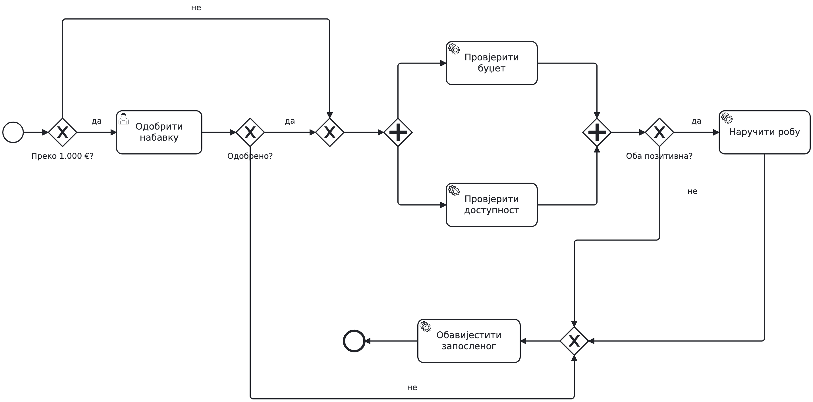

[Model rješenja A](bpmn-class2/17-base-overview.bpmn).

Za iznos do uključivo 1.000 € preskačemo odobravanje. Za veći iznos
rukovodilac odlučuje. Odbijanje vodi na obavještenje i kraj. Odobrenje
i preskakanje spajaju se XOR-om. AND pokreće provjere budžeta i
dostupnosti i čeka obje. XOR zatim čita rezultate. Dva pozitivna vode
na naručivanje, a ostali na obavještenje. Donji dio dijagrama teče
zdesna nalijevo. XOR prije obavještenja spaja alternativne ishode.

Prihvatiti i model u kom alternativni ulazi vode neposredno na isti
zadatak. Taj zadatak ne bi sinhronizovao paralelne grane. Broj rombova
ne mora biti isti kao u našem rješenju; provjeravamo da li model daje
traženo ponašanje.

Tražiti da na svom modelu pokažu tri mjesta: pokretanje obje provjere,
čekanje da obje završe i odluku o naručivanju. Za svako mjesto neka
objasne šta se tu dešava. Ako njihov model odlučuje prije završetka
provjera, treba da ga isprave. Drugačiji raspored i druga ispravna
konstrukcija su prihvatljivi.

| Slučaj | Očekivani tok |
| --- | --- |
| 1.000 €, oba rezultata pozitivna | Bez odobravanja; provjere, jedna porudžbina i jedno obavještenje |
| 1.500 €, rukovodilac odbija | Bez provjera i naručivanja; jedno obavještenje |
| 800 €, roba nije dostupna | Obje provjere završe; nema naručivanja; jedno obavještenje |
| Budžet potvrđen, dostupnost još traje | Čekanje na spajanju; odluka još ne počinje |

Posljednja dva minuta ovog bloka ostaviti za ispravku. Svaki par treba
da zabilježi bar jednu izmjenu ili objasni zašto njihov model već prolazi
navedene slučajeve.

## Kratki pregledi vrsta elemenata

Pregledi su pomoć pri čitanju simbola, bez posebnih zadataka. XOR i AND
vježbamo; OR, event-based i složeni gateway samo prepoznajemo. Ne
objašnjavati njihovo spajanje na ovom času. Vrsta zadatka govori ko ili
šta radi: korisnički kroz aplikaciju, servisni pozivom programa, skript
izvršavanjem skripte, ručni van sistema, slanje i prijem poruke.

Pomenuti da poruka, signal i tajmer imaju svoje početne događaje.
Uslovni start je zasebna vrsta koja reaguje na ispunjen uslov.
Međudogađaji imaju dvostruki obod. Poruka ima određenog primaoca,
signal je objava pretplaćenim primaocima, a eskalacija prijavljuje slučaj
višem nivou obrade. Ne uvoditi podešavanje za izvršavanje.

Za ove preglede koristiti do četiri minuta ukupno. U bloku 3-13 ostaviti
oko minut za vrste grananja; pregled zadataka pokazati pred A. U bloku
36-48 dati dva minuta za početne i međudogađaje i minut za kraj; skratiti
usmenu analizu već poznatih malih primjera. Vrijeme rada na A i B ostaje.

## Prije zadatka B

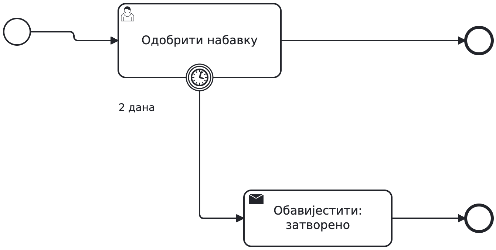

Tajmer sa punim obodom poslije dva dana prekida aktivno odobravanje.
Tada se uobičajenom izlaznom putanjom tog zadatka ne nastavlja. Ako
rukovodilac završi ranije, tajmer prestaje da čeka. Rok pripada tom
zadatku i sam po sebi ne ograničava cijelu instancu.

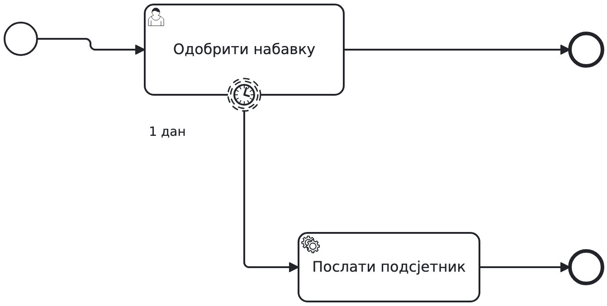

Tajmer sa isprekidanim obodom poslije jednog dana šalje jedan podsjetnik.
Odobravanje ostaje aktivno. Običan end završava granu podsjetnika, dok
rukovodilac i dalje može da odluči. Ovaj jednokratni tajmer ne ponavlja
podsjetnik periodično.

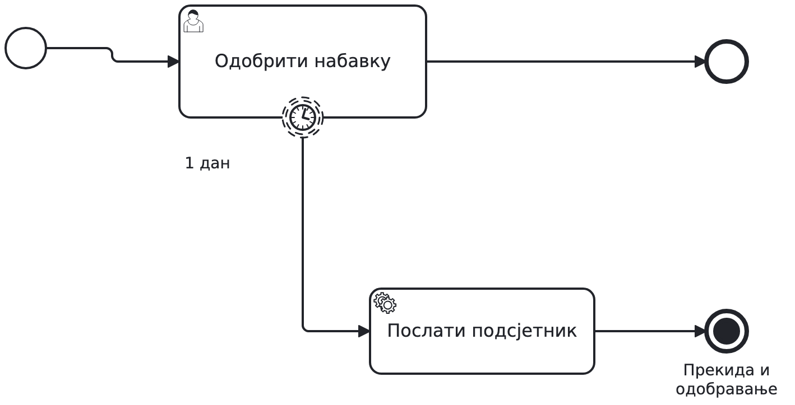

Uporediti sa prethodnim podsjetnikom. Običan kraj završava samo tu granu.
Terminirajući kraj prekida sav aktivan rad u svom opsegu. U ovom primjeru
bio bi pogrešan jer bi prekinuo i odobravanje. U potprocesu bi prekinuo
rad tog potprocesa, ne automatski cijelu nadređenu nabavku.

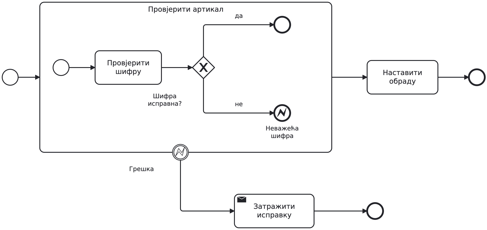

Ako je šifra ispravna, unutrašnji rad završava i proces nastavlja van
potprocesa. Nevažeća šifra vodi na krajnji događaj greške (error end) sa oznakom
NEVAZECI_ARTIKAL. Događaj sa istom oznakom na ivici potprocesa
(error boundary) prekida preostali rad unutar okvira i pokreće
obavještenje da treba poslati nov zahtjev. Na malom primjeru je jedna provjera. Šifru uvijek provjeravamo prije dostupnosti. U B
studenti treba da isti princip primijene na dvije provjere.

Nedostatak budžeta ostaje očekivani negativan rezultat koji obrađuje
XOR. BPMN grešku ovdje koristimo zato što pravilo traži prekid cijele
grupe provjera. Exception u programu ne postaje automatski BPMN error.
Tehničke kvarove i ponavljanja ostaviti za rad sa servisnim pozivima.

## Zadatak B

Studenti mijenjaju ispravljen model A. Rješenje sa dva tajmera na
potprocesu još ne vide. U grani dostupnosti prvo se provjerava šifra, a tek zatim dostupnost. Nevažeća šifra treba da prekine provjeru budžeta ako još traje i
zatraži nov zahtjev. Obični negativni rezultati i ostala pravila A ostaju.

Rok od 48 časova počinje ulaskom u provjere. U 24. času šaljemo jedan
podsjetnik i nastavljamo rad. U 48. času prekidamo preostale
provjere i počinje ručna provjera uslova. Njene rezultate koristimo za
istu odluku o nabavci. Ovi rokovi ne važe za prethodno odobravanje ni za
kasniji ručni rad.

Za B ostaviti 20 minuta. U prvih sedam svaki student označi šta treba
prekinuti, pa par grupiše provjere i dodaje obradu nevažeće šifre. Na
prvoj provjeri proći nevažeću šifru dok druga provjera još traje: koji
posao se prekida i da li se još čeka AND? Gotovo rješenje još ne otvarati.

Narednih deset minuta dodaju rokove i ručnu provjeru. Na drugoj provjeri
pogledati da li oba roka mjere isti dio procesa i da li ručni rezultati
vode na odluku. Pitati od kog trenutka računaju rok i šta nastavlja da
radi poslije podsjetnika. Posljednja tri minuta ostaju za tri vremenska
scenarija. Slučaj greške već je provjeren poslije prvih sedam minuta.
Par koji zapne na A koristi ponuđeni ispravan A i radi iste zahtjeve B.

## Rješenje B

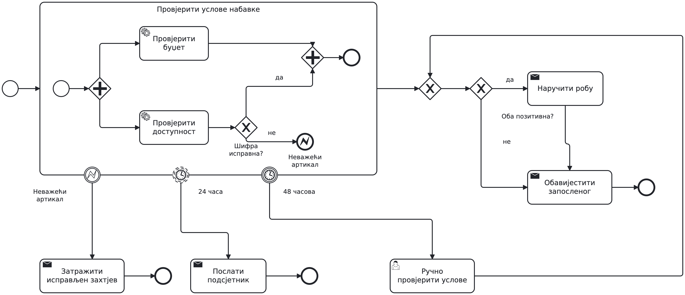

[Model rješenja B](bpmn-class2/19-shared-deadline-solution.bpmn).
Prikazati ga poslije zadatka. Pregled služi za orijentaciju, a
objašnjenje nastaviti na uvećanim dijelovima, gdje se natpisi lakše čitaju.

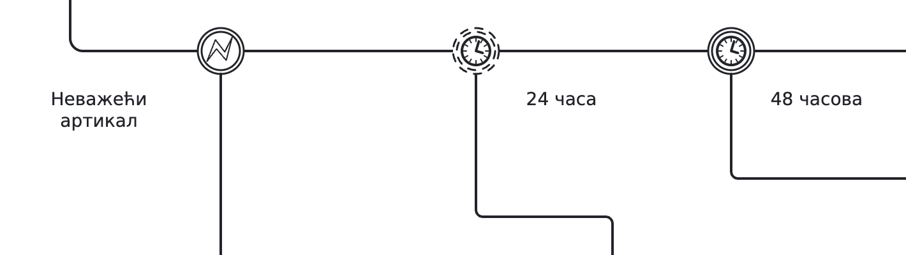

Ovo je izrez istog modela. Strelice izlaze van izreza. Sva tri događaja
pripadaju istom potprocesu. Greška vodi na ispravku. PT24H šalje
podsjetnik bez prekida, a PT48H prekida preostali rad.

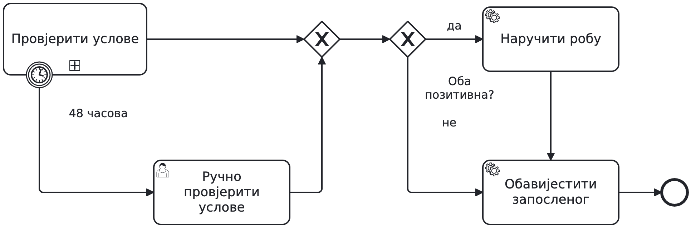

Potproces je ovdje sklopljen, a raspored promijenjen da se lakše prati
normalan i ručni nastavak. Greška i podsjetnik postoje na cijelom modelu,
ali nisu ponovljeni u ovom detalju. Oba prikazana puta vode na istu
odluku o rezultatima. Korisnički zadatak za ručnu provjeru je van prekinutog potprocesa.
Prikazujemo drugi dio istog rješenja, ne novi poslovni primjer.

Oba tajmera kreću ulaskom u potproces. Kada obje provjere završe, AND
dozvoljava izlazak iz potprocesa i prelazak na odluku o naručivanju. Podsjetnik ima zasebnu
granu sa običnim end događajem; njen završetak ne prekida provjere.

U cijeloj nabavci odobravanje ostaje prije ovog dijela. Poslije normalne
ili ručne provjere XOR čita oba rezultata. Dva pozitivna vode na
"Naručiti robu", pa na obavještenje. Ostali vode direktno na obavještenje.
Greška ima odvojen izlaz na zahtjev za ispravku i kraj. Početak fragmenta
u povezanom modelu zamjenjuje dolazni tok iz odobravanja; ne dodavati
nov početak procesa u njegovu sredinu.

Ako greška prekine potproces, prestaju njegove aktivne provjere i
preostali tajmeri. Ako se potproces ranije normalno završi, tajmeri
više ne čekaju. Ručna provjera daje potrebne rezultate i ne nasljeđuje
istekli rok. Provjere samo čitaju podatke, pa prekid ne zahtijeva
poništavanje spoljnih efekata.

| Slučaj | Podsjetnik i prekid | Nastavak |
| --- | --- | --- |
| Obje provjere završe za 10 časova | Nema podsjetnika ni prekida; tajmeri prestaju | Odluka prema rezultatima |
| Jedna završi za 20, druga za 30 časova | Jedan podsjetnik u 24. času; druga provjera nastavlja | Odluka u 30. času; rok od 48 više ne čeka |
| Jedna završi za 20, druga traje nakon 48 časova | Podsjetnik u 24; u 48 se prekida preostali rad | Ručna provjera, zatim odluka prema rezultatima |
| Nevažeća šifra dok druga provjera traje | Greška prekida taj dio procesa; preostali tajmeri prestaju | Obavještenje da treba poslati nov, ispravljen zahtjev |

Posljednja dva minuta analize B ostaviti za ispravku njihovog modela.
Svaki par treba da objasni zašto oba tajmera pripadaju tom potprocesu ili zašto je ručna
provjera van njega. Tako analiza uključuje i njihov rad na modelu.

## Česte greške

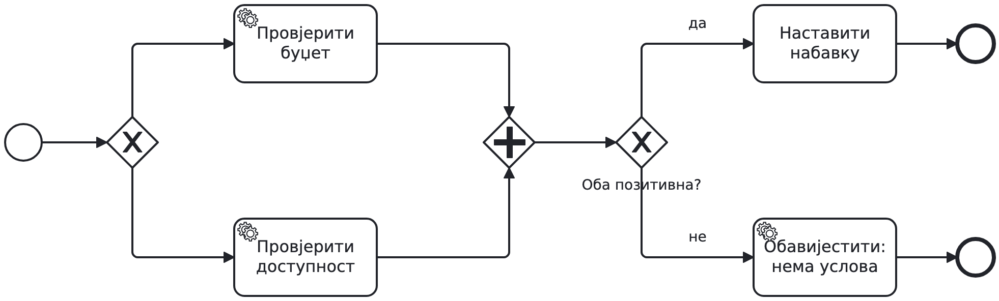

AND čeka i granu koju XOR nije pokrenuo. Ako obje provjere moraju da se
obave, potrebni su AND razdvajanje i spajanje. Zamjena samo spajanja
XOR-om uklonila bi čekanje, ali ne bi pokrenula drugu provjeru.

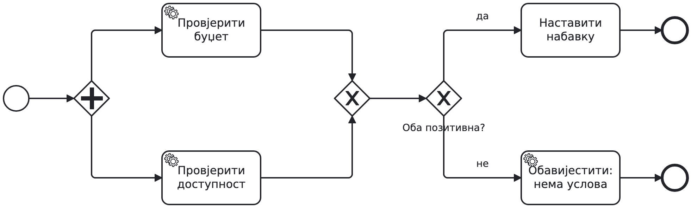

XOR spajanje ne čeka drugu granu, pa nastavak može krenuti dvaput.
Na primjer, budžet završi prvi i pokrene nastavak, a dostupnost završi
kasnije i pokrene ga ponovo. Prvi nastavak je pritom krenuo prerano.

Prije popravke svaki par treba da navede slučaj koji otkriva grešku.
Zatim mijenja model i provjerava isti slučaj ponovo.

Na studentskim modelima provjeriti i sljedeće:

- AND spajanje ne čita pozitivnost rezultata.
- Običan end jedne grane ne prekida ostale aktivne grane.
- Tajmer zadatka sam po sebi ne ograničava cijeli proces.
- Sequence flow ostaje u pool-u; između učesnika ide message flow.
- Uslovi ne treba da se preklapaju ili propuste granični iznos.
- Čitljiv raspored olakšava pregled, ali ne dokazuje ispravnost.

## Završna provjera, svako za sebe

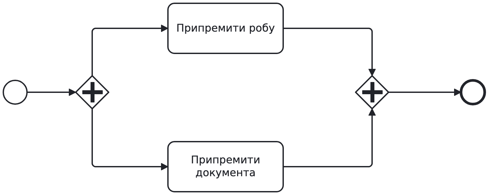

Prvih 30 do 45 sekundi svaki student piše dvije rečenice: obje provjere
su završene; roba je dostupna, ali novca nema. Može li proces proći
kroz AND spajanje? Šta treba dodati poslije njega da se roba ne naruči
kada nema novca? Prikazati minimalni AND bez nacrtanog XOR
rješenja i sačekati odgovore prije objašnjenja.

Očekivani odgovor: AND više ne čeka jer su obje provjere završene.
XOR poslije njega provjerava rezultate i odlučuje da li naručiti robu.

Zatim studenti bez gledanja rješenja dopunjuju pripremu isporuke: oba
posla stavljaju u zajednički potproces, dodaju prekidni PT3H i rezervni
tok za obavještenje operateru. Normalan završetak i dalje čeka oba posla.
Dovoljna je skica oko datih aktivnosti i jedna rečenica objašnjenja;
ne crtaju cijelu nabavku ponovo.

Prikupiti odgovore prije razgovora. Provjeriti odgovor o AND-u i
rezultatu, pa na skici pogledati da li su obuhvaćena oba posla, da li je
tajmer prekidni i da li je rezervni tok van tog potprocesa. Zabilježiti
ko razumije opseg, ko zna simbol ali ne i ponašanje i kome treba obnoviti
sinhronizaciju. To će odrediti početak sedmice 3.

## Prisjećanje sljedeće sedmice

Prvih pet minuta prikazati isti dijagram pripreme, bez rješenja. Svako
sam odgovara prije razgovora:

1. Dokumenta su spremna, roba još nije. Zašto proces još ne završava?
2. Poslije jednog časa treba podsjetnik bez prekida. Koji događaj i gdje?
3. Poslije tri časa treba prekinuti oba posla. Koji događaj i gdje?
4. U nabavci je otkrivena nevažeća šifra dok druga provjera traje. Šta
   se prekida i da li se čeka AND?

Očekivano: AND čeka obje grane. Jednokratni neprekidni tajmer na
zajedničkom potprocesu šalje podsjetnik. Prekidni tajmer na istom
potprocesu određuje ukupni rok. Za četvrto pitanje: error boundary
prekida aktivan rad u potprocesu i njegovo AND spajanje više ne čeka.
Običan negativan rezultat umjesto toga vodi na XOR odluku poslije provjera.
Kratko proći odgovore, pa nastaviti
provjeru modelovanja. Studenti treba da se prisjete bez gledanja
prethodnog rješenja.

## Dodatak: odgovor dobavljača

Poznati boundary obrazac ovdje ograničava čekanje poruke. Receive task
čeka odgovor, tajmer prekida čekanje po isteku roka, a XOR nakon prijema
čita sadržaj. ID zahtjeva povezuje poruku sa instancom. Zakašnjela poruka
ne otvara zatvoren zahtjev. Ovaj dio koristiti ako se pitanje pojavi ili
na narednom času. Nije potreban za A i B.

## Zašto ovakav raspored

Poslije malog riješenog primjera slijede pokušaj, objašnjenje i ispravka.
Individualni odgovori i prisjećanje sljedeće sedmice pokazuju koliko je
svako razumio pored zajedničkog crteža. Opšti oslonac je
[IES, Organizing Instruction and Study to Improve Student Learning](https://ies.ed.gov/ncee/wwc/PracticeGuide/1).
Izbor zadataka i raspored prilagođeni su ovoj grupi i mijenjaju se prema
odgovorima studenata. Ako ponestane vremena, u galeriji grešaka birati
one koje su se javile u radu. Sačuvati pokušaje, ispravke i završnu provjeru.

## Poslije prve grupe

Zapisati kada su parovi završili A i B, koliko ih je uzelo ispravan
polazni A i gdje su zapeli na dvije provjere tokom B. Na individualnim
odgovorima prebrojati miješanje završetka i pozitivnog rezultata, pogrešan
opseg i pogrešan tip tajmera. Po tome prilagoditi objašnjenja za narednu
grupu. Dvadeset minuta za B je plan, a ne izmjereno vrijeme. Sačuvati
nekoliko anonimnih tipičnih skica za osvrt.

## Arhiva

[Verzije v1 do v4](archive/README.md) sačuvane su sa svojim dijagramima.

## Izvori za vrste događaja

- [BPMN simboli i primjeri](https://camunda.com/bpmn/reference/)
- [Terminate end i opseg prekida](https://docs.camunda.io/docs/components/modeler/bpmn/terminate-events/)

Pregledi opisuju BPMN notaciju. Podršku konkretne izvršne platforme
provjeravamo na času implementacije.
