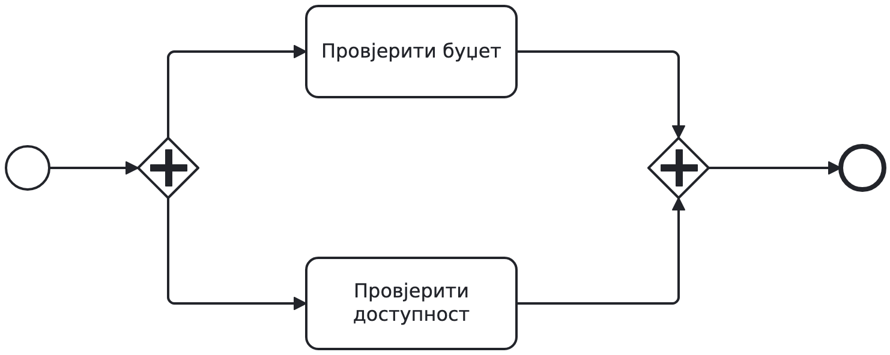
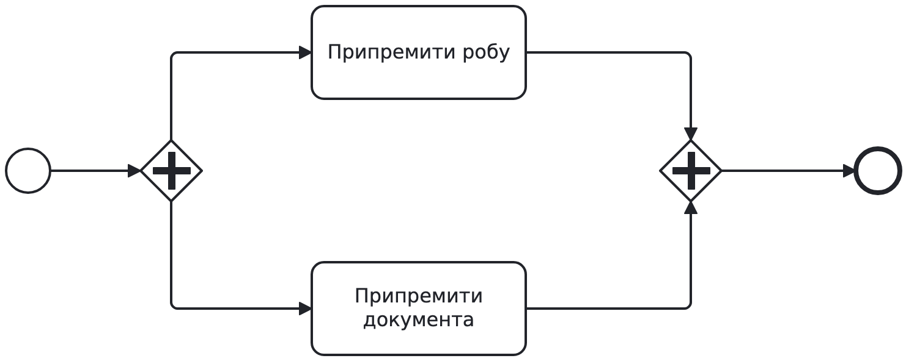

# BPMN: задаци за рад на часу

## Задатак A: набавка робе

Запослени тражи робу. За износ преко 1.000 € треба одобрење руководиоца.
Ако руководилац одбије захтјев, обавијестимо запосленог и завршимо поступак.
У осталим случајевима паралелно провјеравамо буџет и доступност.
Робу наручујемо само ако је доступна и има довољно новца на картици.
Запослени добија обавјештење о сваком исходу.

Износ и остали подаци из захтјева су познати. Провјере не мијењају податке, а у задатку A увијек заврше. Рокове и грешке додаћете у задатку B.

Прва два минута сами означите гдје процес бира једну путању, а гдје покреће обје провјере. Затим у пару нацртајте модел. Рјешење погледајте тек током заједничке анализе.

### Провјера модела

- Пратите сваку путању од почетка до краја: за сваку је јасно да ли је роба наручена и које обавјештење запослени добија.
- Одбијање не води на провјере ни наручивање.
- Одлука о наручивању чека да се заврше и провјера буџета и провјера доступности.
- Робу наручујемо само ако је роба доступна и има довољно новца на картици.
- За један захтјев шаљемо једно обавјештење и правимо највише једну наруџбину.
- Запослени добија обавјештење о сваком завршном исходу.

Пратите захтјев од 1.000 € за који има довољно новца и роба је доступна, захтјев од 1.500 € који је руководилац одбио и захтјев од 800 € за робу која није доступна. Послије анализе рјешења исправите свој модел.

## Задатак B: додајте грешку и рокове

У грани за доступност прво провјерите шифру артикла. Само за исправну шифру провјеравајте доступност. Ако шифра није исправна, прекините и провјеру буџета ако још траје. Обавијестите запосленог да пошаље нов захтјев са исправљеном шифром.

Рок од 48 часова почиње када почну провјере. Ако послије 24 часа још нису обје завршене, шаљемо
један подсјетник, без прекида рада. Ако ни до 48. часа нису обје завршене, прекидамо
оне које још трају. Тада човјек ручно провјерава буџет и доступност. На основу тих резултата одлучујемо да ли наручити робу.

Остала правила задатка A остају. Недостатак буџета или робе је обичан негативан резултат, а не грешка која прекида провјере.

Вријеме рачунајте од почетка провјера, послије евентуалног одобравања. Вријеме гране доступности укључује и провјеру шифре. Ако обје провјере заврше раније, подсјетник и прекид више нису потребни. Ручна провјера нема рок од 48 часова.

Ако послије анализе A немате исправан модел, затражите полазни модел од наставника. Сачувајте и свој покушај A. За B имате 20 минута.

Првих 7 минута додајте обраду грешке. Прије рада у пару свако означи шта треба прекинути. Провјерите случај неважеће шифре док провјера буџета још траје. Наредних 10 минута додајте рокове и ручну провјеру; прво свако предложи мјесто за рокове. Посљедња 3 минута провјерите три временска случаја:

1. Обје провјере заврше за 10 часова.
2. Једна заврши за 20, друга за 30 часова.
3. Једна заврши за 20, друга још траје након 48 часова.

За сваки случај одговорите: шаље ли се подсјетник у 24. часу, прекида ли се нека провјера у 48. часу и иде ли се на ручну провјеру или одмах на одлуку о наручивању. Послије анализе рјешења исправите модел.

## Завршна провјера, свако за себе

Обје провјере су завршене: роба је доступна, али новца нема. Допуните дијаграм одлуком о наручивању. Када нема новца, процес треба да обавијести запосленог и заврши без наруџбине.

За цијелу припрему испоруке имамо три часа. Ако рок истекне, прекините послове који још трају и обавијестите оператера. Поставите један тајмер за цијелу припрему. По истеку рока прекините преостали рад и позовите сервис за обавјештавање оператера.
