# BPMN: трећи час — нацрти

Концептуални модели, без подешавања за извршавање.

## Упит за цијену: оба процеса

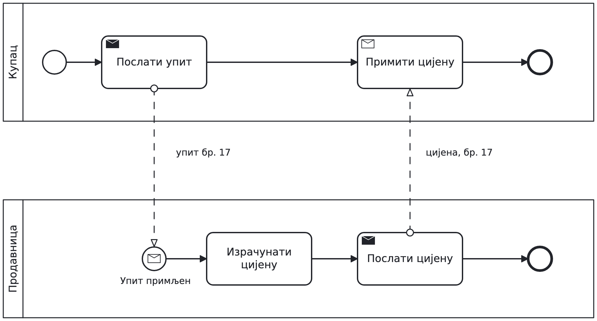

[BPMN](01-message-basics.bpmn) · [SVG](01-message-basics.svg)

## Слање наруџбине и пријем одговора

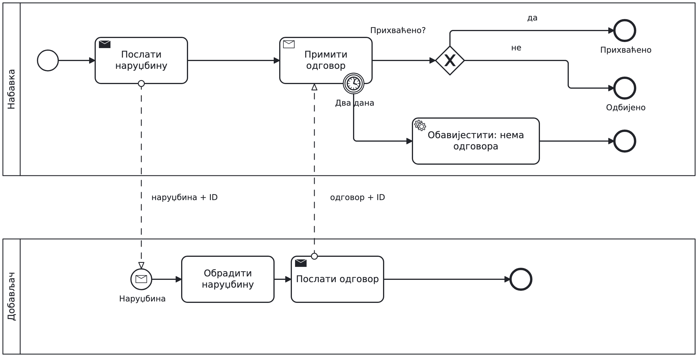

[BPMN](02-messages.bpmn) · [SVG](02-messages.svg)

## Потврда, одбијање или истек рока

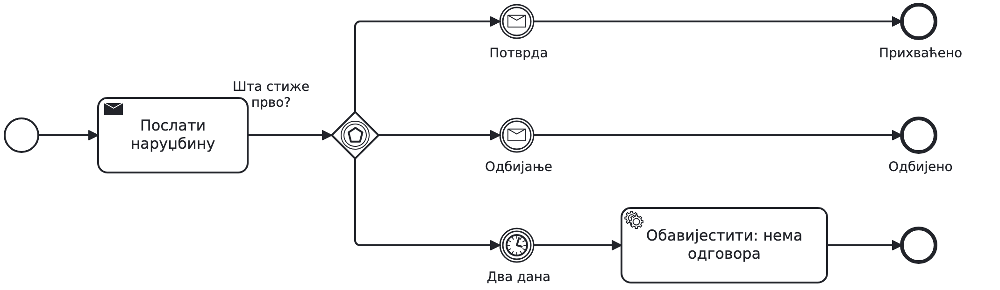

[BPMN](04-event-choice.bpmn) · [SVG](04-event-choice.svg)

## Event-based gateway: први догађај бира путању

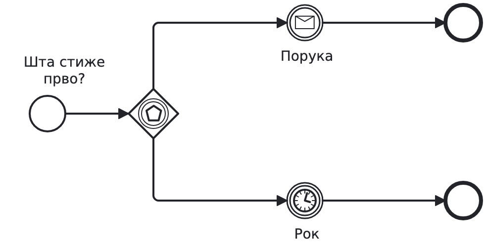

[BPMN](03-event-basics.bpmn) · [SVG](03-event-basics.svg)

## Један задатак, више извршавања

[BPMN](05-multi-markers.bpmn) · [SVG](05-multi-markers.svg)

## Паралелно: свака ставка наруџбине

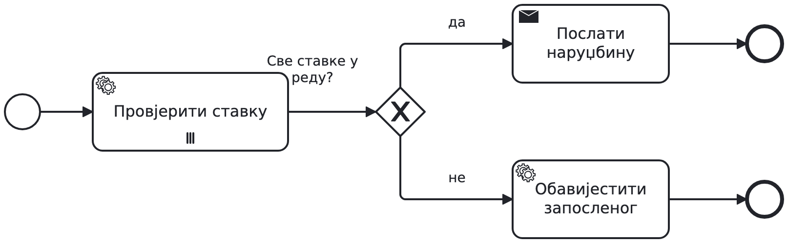

[BPMN](06-parallel-multi.bpmn) · [SVG](06-parallel-multi.svg)

## Редом: референт прегледа ставку по ставку

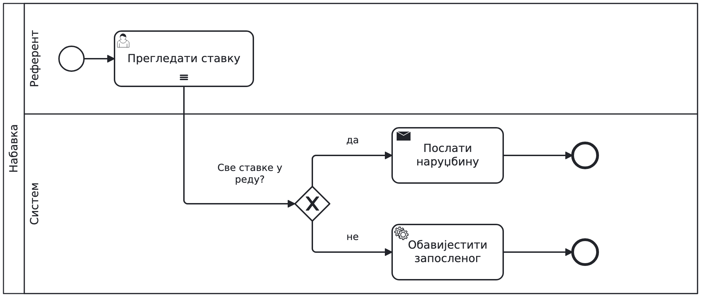

[BPMN](07-sequential-multi.bpmn) · [SVG](07-sequential-multi.svg)

## Понављање до потпуне наруџбине

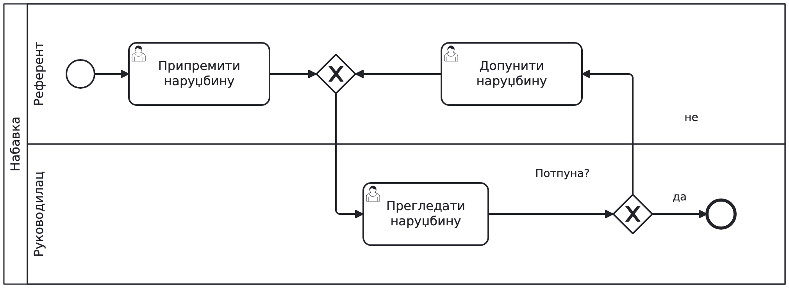

[BPMN](08-correction-loop.bpmn) · [SVG](08-correction-loop.svg)

## Задатак, потпроцес и call activity

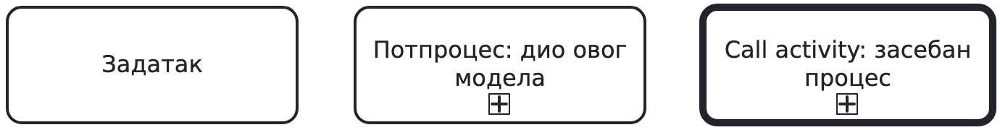

[BPMN](09-reuse-kinds.bpmn) · [SVG](09-reuse-kinds.svg)

## Набавка позива провјеру добављача

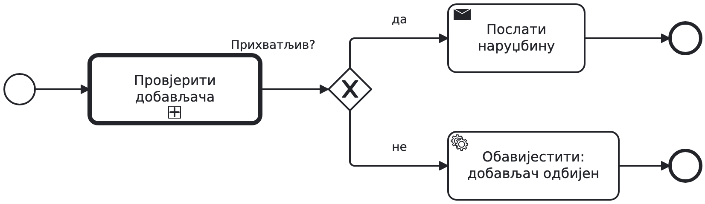

[BPMN](10-call-activity.bpmn) · [SVG](10-call-activity.svg)

## Позвани процес: провјера добављача

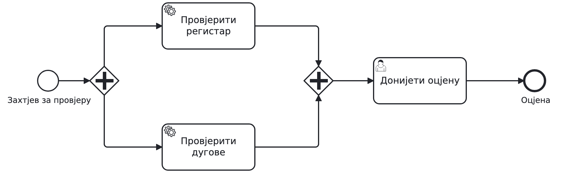

[BPMN](11-called-process.bpmn) · [SVG](11-called-process.svg)

## Поврат робе

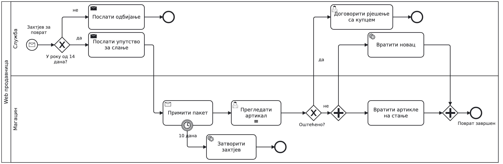

[BPMN](12-checkpoint-return.bpmn) · [SVG](12-checkpoint-return.svg)

