## 1. Претходни час: набавка робе

```{=latex}
{\centering
```

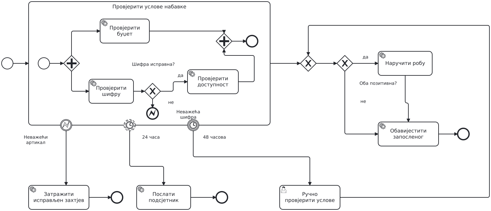{height=80% aria-label="Рјешење B са прошлог часа"}

```{=latex}
\par}
```

## 2. Поруке између учесника

Комуникација између двије апликације. Пандан у коду: HTTP позив или ред порука, па чекање одговора.
Са првог часа: message flow иде између pool-ова.

```{=latex}
{\centering
```

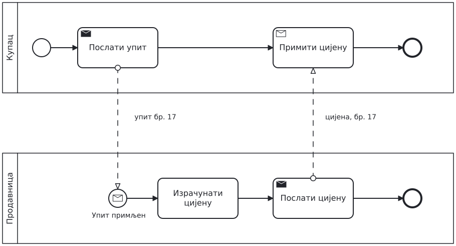{height=55% aria-label="Упит за цијену: оба процеса"}

```{=latex}
\par}
```

## Поруке: шта је ново

- **Send task** шаље поруку, **receive task** чека поруку.
- **Message start event**: порука покреће процес другог учесника.
- Порука носи број упита. По том броју одговор стиже баш оном купцу који га чека.

## Задатак: наруџбина добављачу

Набавка шаље наруџбину добављачу. Добављач је обради и одговори: прихваћено или одбијено.
Ако одговор не стигне за два дана, набавка обавјештава запосленог.

- Учесници: **Набавка** и **Добављач**, сваки у свом pool-у.
- Нацртајте оба процеса и повежите их порукама.
- Који податак у поруци повезује одговор са наруџбином?

## Рјешење: поруке

```{=latex}
{\centering
```

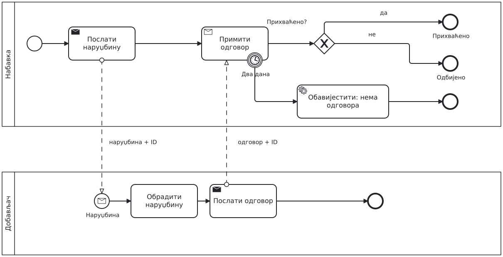{height=80% aria-label="Слање и пријем порука"}

```{=latex}
\par}
```

## Шта ако...?

- Добављач одговори послије три дана. Шта се деси са поруком?

## 3. Чекање више догађаја

```{=latex}
{\centering
```

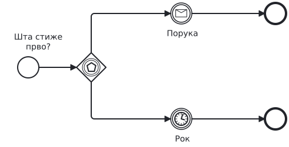{height=55% aria-label="Event-based gateway"}

```{=latex}
\par}
```

- **Event-based gateway** чека; прати путању догађаја који стигне први.
- Иза њега су догађаји чекања или receive task-ови.

## Задатак: одговор или рок

Добављач сада шаље једну од двије различите поруке: **Потврда** или **Одбијање**.
Ако за два дана не стигне ниједна, набавка обавјештава запосленог.

- Нацртајте дио набавке од слања наруџбине до краја.

## Рјешење: event-based gateway

```{=latex}
{\centering
```

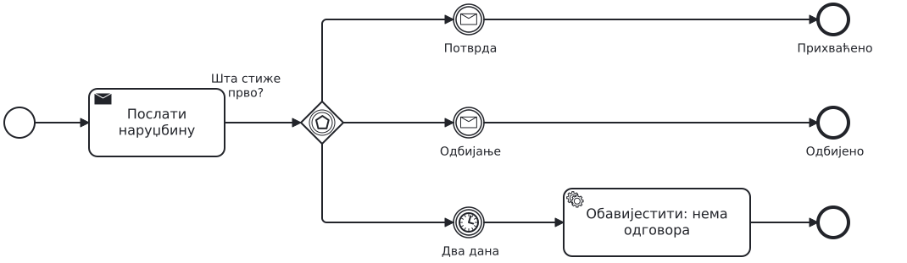{height=80% aria-label="Потврда, одбијање или рок"}

```{=latex}
\par}
```

## Шта ако...?

- Добављач може послати и поруку „Одложено”. Гдје је додајете?
- Када је receive task са тајмером довољан?

## 4. Више извршавања једног задатка

```{=latex}
{\centering
```

{height=55% aria-label="Један задатак, више извршавања"}

```{=latex}
\par}
```

- **|||**: сва извршавања одједном; **≡**: једно по једно.
- Број извршавања одређује листа у тренутку покретања.

## Задатак: ставке наруџбине

Наруџбина има од једне до двадесет ставки. Систем провјерава сваку ставку посебно.
Ако су све ставке у реду, шаљемо наруџбину. Иначе обавјештавамо запосленог.

## Рјешење: multi-instance

```{=latex}
{\centering
```

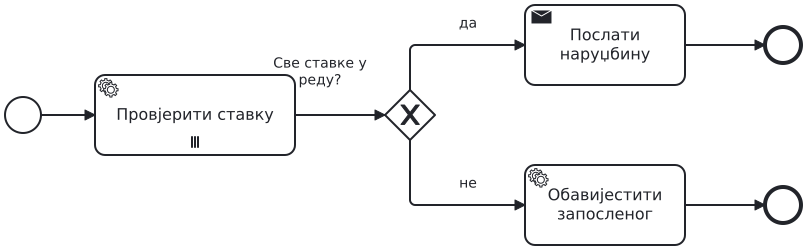{height=80% aria-label="Паралелни multi-instance"}

```{=latex}
\par}
```

## Шта ако...?

Референт прегледа ставке ручно, једну по једну.

```{=latex}
{\centering
```

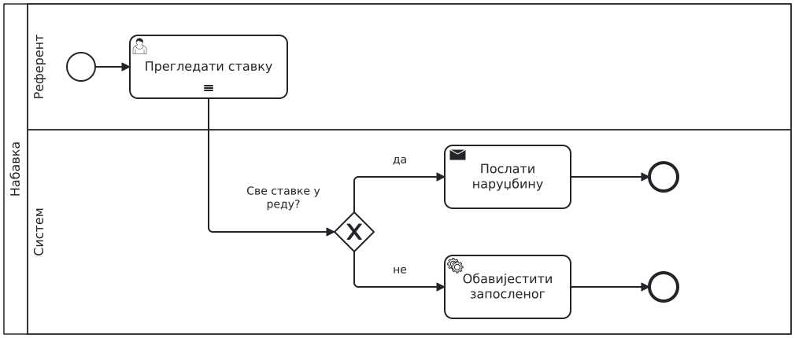{height=55% aria-label="Секвенцијални multi-instance"}

```{=latex}
\par}
```

## Понављање

У коду: `while`. У BPMN: XOR који враћа процес назад.

- Повратна путања улази у XOR, не директно у задатак.
- Петља мора имати услов за излаз: овдје „Потпуна? да”.

## Задатак: допуна наруџбине

Референт припреми наруџбину, а руководилац је прегледа.
Ако није потврђена, референт је допуни и руководилац је поново прегледа, док не буде потпуна.

- Сваку улогу нацртајте у свом lane-у.

## Рјешење: понављање

```{=latex}
{\centering
```

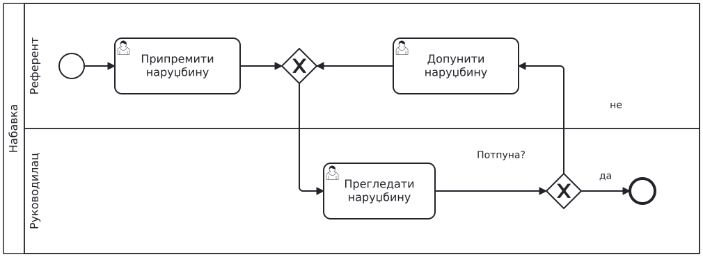{height=80% aria-label="Понављање до исправке"}

```{=latex}
\par}
```

## 5. Позив засебног процеса

Пандан у коду: позив функције.

```{=latex}
{\centering
```

{height=55% aria-label="Задатак и call activity"}

```{=latex}
\par}
```

- **Call activity** (дебела ивица) позива засебан процес.

## Задатак: провјера добављача

Прије наруџбине провјеравамо добављача: регистар и дугове паралелно, затим референт даје оцјену.
Провјеру моделујемо као засебан процес, а набавка га позива.

- Шта провјера добија, а шта враћа?

## Рјешење: call activity

```{=latex}
{\centering
```

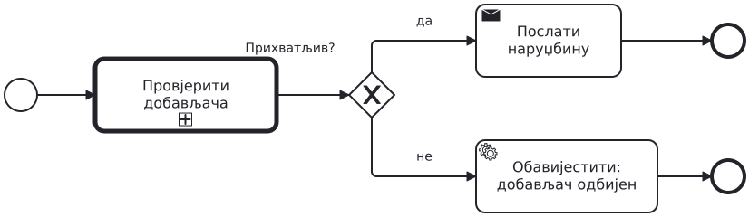{height=80% aria-label="Набавка позива провјеру добављача"}

```{=latex}
\par}
```

## Позвани процес

```{=latex}
{\centering
```

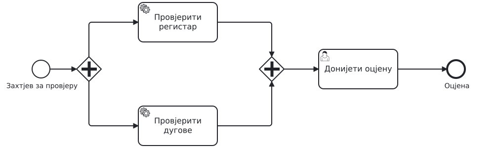{height=80% aria-label="Позвани процес: провјера добављача"}

```{=latex}
\par}
```

## Шта ако...?

- Провјера траје дуже него набавка смије да чека. Гдје стављате рок?

## Припрема за контролну тачку

Сервис лаптопа

Купац пријављује квар лаптопа сервису. Учесници: Купац и Сервис. У сервису су lane-ови Пријем и Техничар.

- Пријем паралелно провјерава гаранцију и доступност дијелова. Понуда иде тек кад заврше обје провјере.
- Ако серијски број не постоји у евиденцији, прекидају се обје провјере и пријем тражи од купца исправан број.
- Техничар уради дијагностику, а пријем купцу пошаље понуду са цијеном.
- Купац прихвати или одбије понуду. Ако одбије или не одговори за три дана, лаптоп враћамо.

## Припрема: наставак

- За сваки неисправан дио техничар замијени дио и тестира га.
- Затим техничар ради контролу квалитета. Ако контрола не прође, поправка се понавља.
- Ако поправка траје дуже од пет дана, купац добија обавјештење, а поправка се наставља.
- Ако траје дуже од десет дана, поправка се прекида и купац добија замјенски лаптоп.
- На крају пријем обавјештава купца да је лаптоп спреман.

## Провјерите свој модел

Пратите на свом моделу:

1. Серијски број не постоји, а провјера гаранције још траје.
2. Купац не одговори за три дана.
3. Два дијела су неисправна, контрола једном не прође, а други пут прође.
4. Поправка траје седам дана; поправка траје дванаест дана.

Шта се прекида, а шта наставља? Који дио процеса обухвата ваш рок?

## Задатак 2: поврат робе

Опишите процес по корацима

```{=latex}
{\centering
```

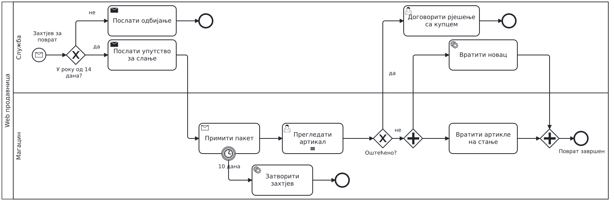{height=80% aria-label="Поврат робе"}

```{=latex}
\par}
```


## 7. Завршни осврт

На моделу означити гдје се уносе подаци и који подаци су потребни за одлуке.
