## Претходни час: набавка робе

```{=latex}
{\centering
```

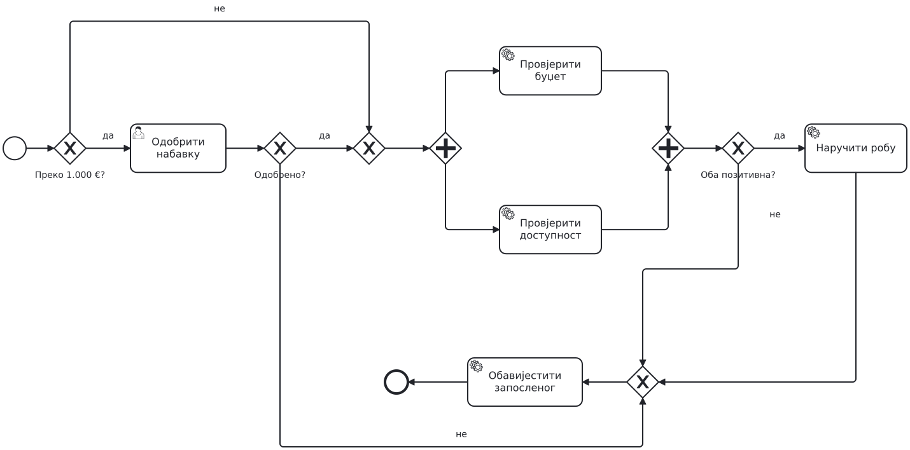{height=84% aria-label="Рјешење A са прошлог часа" .overview}

```{=latex}
\par}
```


---

## Основни задаци

```{=latex}
{\centering
```

{height=48% aria-label="Ко обавља задатак?" .compact}

```{=latex}
\par}
```

Кориснички задатак обавља човјек кроз апликацију, нпр. одобрава захтјев.
Сервисни позива сервис, нпр. провјерава доступност робе.
Скрипт задатак извршава скрипту, нпр. израчунава укупан износ.

Тежимо аутоматизацији - шта год можемо да урадимо умјесто корисника - аутоматизујемо.


---

## Start events

```{=latex}
{\centering
```

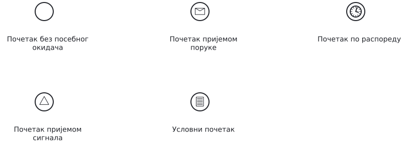{height=48% aria-label="Шта може да покрене процес?" .compact}

```{=latex}
\par}
```

Порука покреће процес на основу примљеног захтјева.
Тајмер га покреће у задато вријеме, а сигнал када стигне објава на коју је процес претплаћен.
Условни почетак реагује када је услов испуњен, нпр. залиха падне испод минимума.


---

## Догађаји током трајања процеса

```{=latex}
{\centering
```

{height=48% aria-label="Догађаји током процеса" .compact}

```{=latex}
\par}
```

Двоструки круг означава међудогађај. Порука је намијењена одређеном примаоцу. Сигнал је објава за све који га чекају. Тајмер означава вријеме или рок.

Разликујемо догађаје чекања (catch event) и слања (throw event).
На слици су догађаји чекања. Код слања поруке или сигнала унутрашња иконица је попуњена црном бојом. Тајмер постоји само као догађај чекања.


---

## Interrupting timer

```{=latex}
{\centering
```

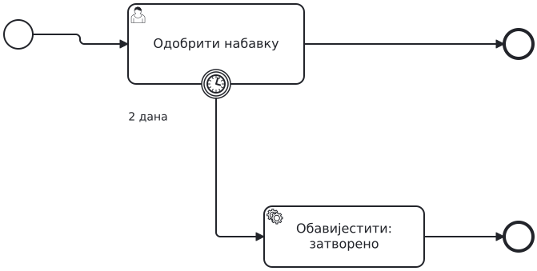{height=65% aria-label="Прекидни тајмер"}

```{=latex}
\par}
```

Ако руководилац не заврши одобравање за два дана, тајмер прекида задатак.


---

## Non-Interrupting timer

```{=latex}
{\centering
```

{height=65% aria-label="Подсјетник оставља задатак активним"}

```{=latex}
\par}
```

Ако руководилац још није одлучио након једног дана, шаљемо подсјетник.

Када се подсјетник пошаље, његова грана је готова. Процес и даље чека одлуку руководиоца.


---

## Обичан и терминирајући крај

```{=latex}
{\centering
```

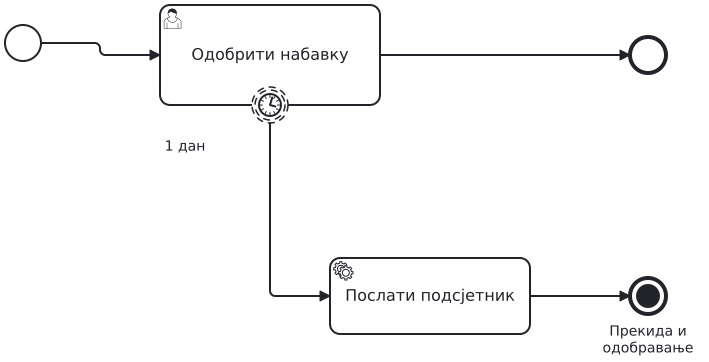{height=48% aria-label="Обичан и терминирајући крај" .compact}

```{=latex}
\par}
```

Обичан крај завршава само грану која је до њега стигла.
Попуњен круг је терминирајући крај: зауставља сав рад у истом процесу или потпроцесу у којем се налази.

Процес је готов када више нема активног рада ни чекања догађаја.


---

## Потпроцес и грешка

```{=latex}
{\centering
```

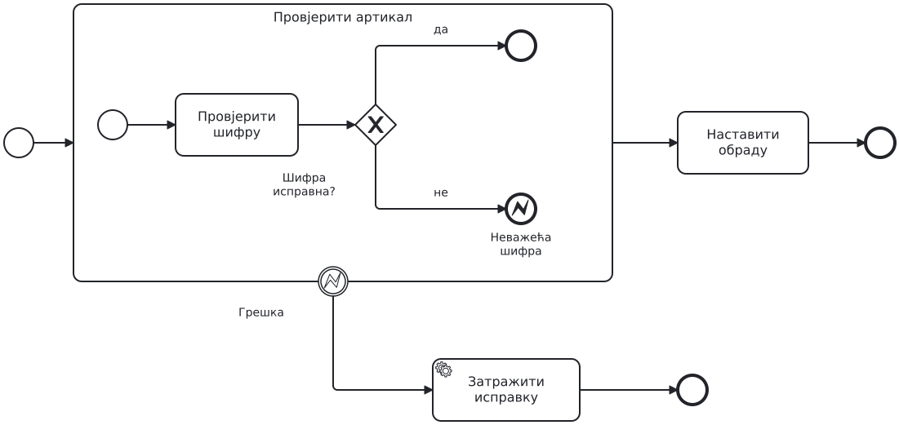{height=65% aria-label="Потпроцес и грешка"}

```{=latex}
\par}
```

Неисправна шифра води на крајњи догађај грешке (error end).
Догађај грешке на граници потпроцеса (boundary event) прекида извршавање потпроцеса и покреће сервисни задатак за обавјештавање.


---

## Задатак

```{=latex}
{\centering
```

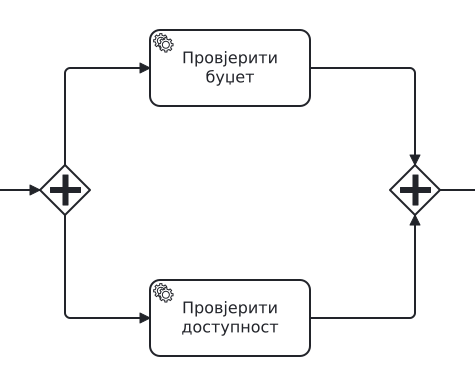{height=48% aria-label="Дио рјешења A: паралелне провјере које проширујемо" .compact}

```{=latex}
\par}
```

Приказан је дио модела набавке са двије провјере. Додајте провјеру шифре артикла.
У грани за доступност прво провјерите шифру артикла тако да се доступност провјерава само за исправну шифру.
Ако шифра није исправна, прекините и провјеру буџета ако још траје. Обавијестите запосленог да пошаље нов захтјев са исправљеном шифром.


---

## Задатак наставак

Рок од 48 часова почиње када почну провјере.
Ако послије 24 часа још нису обје завршене, шаљемо један подсјетник, без прекида рада.
Ако ни до 48. часа нису обје завршене, прекидамо оне које још трају.
Тада човјек ручно провјерава буџет и доступност. На основу тих резултата одлучујемо да ли наручити робу.


---

## Рјешење

```{=latex}
{\centering
```

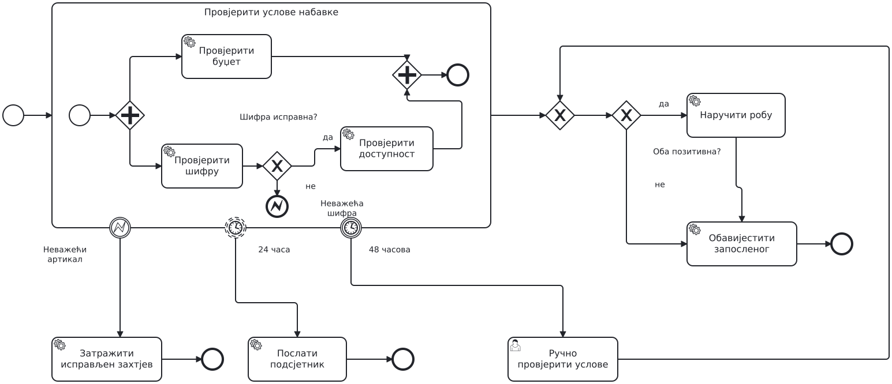{height=74% aria-label="Рјешење B: измијењени дио процеса" .overview}

```{=latex}
\par}
```

Одобравање руководиоца остаје од раније.


---

## Три догађаја на граници потпроцеса

```{=latex}
{\centering
```

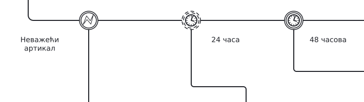{height=65% aria-label="Три догађаја на граници потпроцеса"}

```{=latex}
\par}
```

- Грешка прекида извршавање потпроцеса.
- Подсјетник се шаље, а потпроцес наставља са извршавањем.
- Рок прекида извршавање.


---

## Провјерите свој модел

Провјера буџета је завршена, али провјера доступности још траје када истекне 48 часова.
При ручној провјери утврђено је да је роба доступна, али новца нема.

Покажите којим путем пролази ваш модел. Који рад се прекида? Да ли се роба наручује и које обавјештење добија запослени?


---

## Понављање

У коду: `while`. У BPMN: XOR који враћа процес назад.

- Повратна путања улази у XOR, не директно у задатак.
- Петља мора имати услов за излаз: овдје „Потпуна? да”.


---

## Задатак: допуна наруџбине

Референт припреми наруџбину, а руководилац је прегледа.
Ако није потпуна, референт је допуни и руководилац је поново прегледа, док не буде потпуна.

- Сваку улогу нацртајте у свом lane-у.


---

## Рјешење: понављање

```{=latex}
{\centering
```

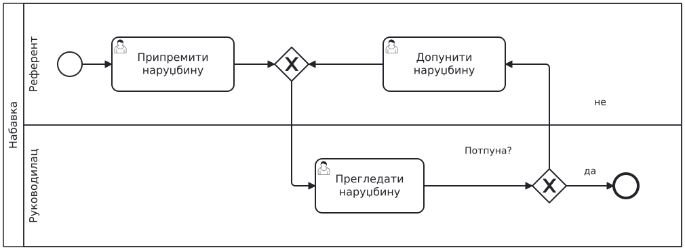{height=80% aria-label="Понављање до исправке"}

```{=latex}
\par}
```


---

## Позив засебног процеса

Пандан у коду: позив функције.

```{=latex}
{\centering
```

{height=55% aria-label="Задатак, потпроцес и call activity"}

```{=latex}
\par}
```

- **Потпроцес** је дио истог модела.
- **Call activity** (дебела ивица) позива засебан процес.


---

## Задатак: провјера добављача

Прије наруџбине провјеравамо добављача: регистар и дугове паралелно, затим референт даје оцјену.
Провјеру моделујемо као засебан процес, а набавка га позива.

- Шта провјера добија, а шта враћа?


---

## Рјешење: call activity

```{=latex}
{\centering
```

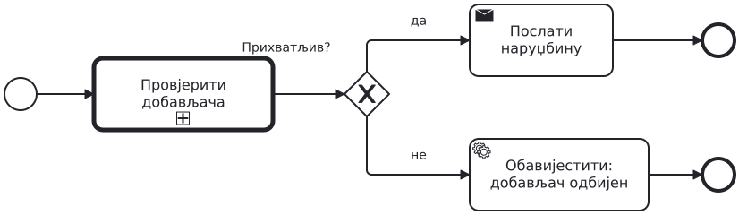{height=80% aria-label="Набавка позива провјеру добављача"}

```{=latex}
\par}
```


---

## Позвани процес

```{=latex}
{\centering
```

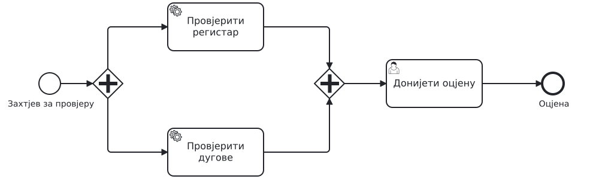{height=80% aria-label="Позвани процес: провјера добављача"}

```{=latex}
\par}
```


---

## Шта ако...?

- Провјера траје дуже него набавка смије да чека. Гдје стављате рок?


---

## Задатак: ко обавља који посао?

У свој модел набавке додајте pool „Набавка робе” и lane-ове за руководиоца, систем и запосленог који обавља ручну провјеру.

Распоредите активности према томе ко их обавља. Систем провјерава шифру, буџет и доступност, наручује робу и шаље обавјештења. Руководилац одобрава набавку, а запослени ручно провјерава буџет и доступност када истекне рок.
